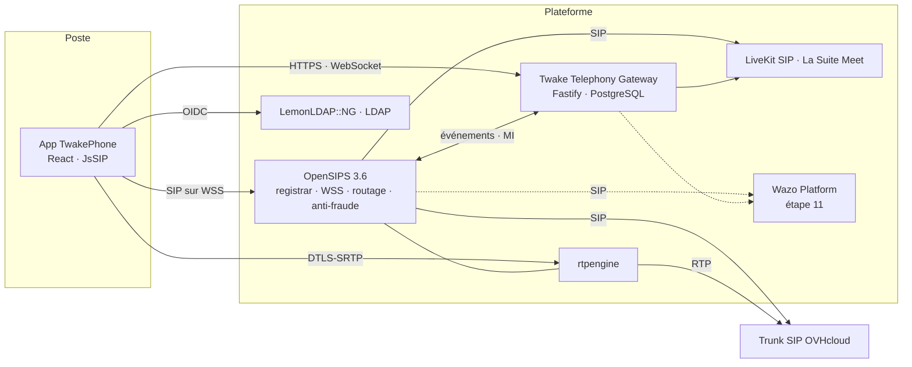

<div align="center">

# TwakePhone

**La téléphonie souveraine de Twake : un softphone dans le navigateur, un serveur SIP libre, un trunk opérateur, et zéro licence par utilisateur.**

[](#licence)
[](#le-plan-en-11-%C3%A9tapes)
[](#la-pile)
[](https://ci.linagora.com/tdelobelle/poc-twake-phone)

*TwakePhone is Twake's sovereign telephony: a browser softphone, a free SIP server, a carrier trunk, no per-seat licence. Docs are in French for now.*

</div>

---

## Pourquoi

Les administrations qui passent à Twake gardent un PABX propriétaire déconnecté de leur outil collaboratif, ou cèdent à Teams Phone et Zoom Phone : américains, facturés par utilisateur. Le marché CANUT (CCTP §7.4.6.2) demande une softphonie intégrée, auto-hébergée, à parité avec ces offres.

TwakePhone y répond avec du logiciel libre, déployé chez le bénéficiaire :

- **Rien à installer sur le poste.** Le softphone tourne dans le navigateur, en WebRTC, provisionné par la session Twake.
- **Un seul serveur SIP pour commencer.** OpenSIPS et rtpengine font l'enregistrement, le routage, l'anti-fraude et le trunk. Wazo n'arrive que pour la messagerie vocale, le SVI et les files.
- **Une passerelle neutre.** L'application ne connaît aucun PBX : elle parle à la Twake Telephony Gateway, qui isole chaque fournisseur derrière un contrat.
- **Twake sans pile SIP.** TwakePhone est une application autonome. Twake Chat l'affichera plus tard dans un widget, sans embarquer de SIP.
- **La visio au bout du fil.** Un numéro et un PIN pour rejoindre une salle Meet depuis n'importe quel téléphone.

## Ce que fait le MVP web

| Domaine | Fonctions |
|---|---|
| Appels | Émettre, recevoir, mettre en attente, transférer (direct et supervisé), DTMF, sonnerie dans tous les onglets, réception sans onglet ouvert (Web Push) |
| Annuaire et présence | Annuaire LDAP et CardDAV, favoris, présence téléphonique en temps réel, NPD planifié avec message |
| Règles d'appel | Renvois immédiat, sur occupation, sur non-réponse ; groupes à sonnerie simultanée ; numéro de repli |
| Opérateur | Trunk SIP OVHcloud ou tout trunk SIP standard, SDA, appels d'urgence, international bloqué par défaut, plafonds, détection de fraude |
| Visio | Rejoindre une salle Meet par téléphone (PIN natif), appeler un numéro depuis une salle, passer un appel à deux en conférence à plusieurs |
| Administration | Trunks, SDA, routes, limites, profils de droits, abonnements webhooks, sans console |
| Intégration | Webhooks signés (HMAC) pour chaque événement d'appel, CDR rapprochés avec OVHcloud, historique unifié |

Après le MVP web : **Wazo** (messagerie vocale transcrite par LinTO, SVI, files, enregistrement, supervision), **QoS** (Homer, MOS par appel, Grafana), **haute disponibilité**, **mobile** (Twake mobile, sip_ua, CallKit et ConnectionService), **transcription des appels**.

## Architecture



La voix suit le chemin **navigateur → OpenSIPS (WSS) → rtpengine → trunk**. La passerelle ne transporte aucun média : elle relie les événements d'OpenSIPS, de Meet et d'OVHcloud à l'application et aux abonnés webhooks.

Trois règles d'architecture, héritées du POC et non négociables :

1. Aucune notion OpenSIPS hors de `provider-opensips`, aucune notion Wazo hors de `provider-wazo`, aucune notion LiveKit ou Meet hors de `conference-livekit`.
2. L'application et la passerelle ne connaissent que le contrat `provider-sdk` (`TelephonyProvider`, `MediaProvider`, `ConferenceBridgeProvider`).
3. Les secrets ne sont jamais dans le code ni dans la configuration : références `env:NOM`.

## La pile

| Couche | Choix | Pourquoi |
|---|---|---|
| Application | React, OIDC (PKCE) sur LemonLDAP::NG | Autonome, intégrable ensuite dans Twake Chat (grille d'apps, widget Matrix) |
| Softphone | [JsSIP](https://jssip.net) (MIT) | Maintenu (3.13, mai 2026) ; [sip_ua](https://pub.dev/packages/sip_ua), son port Dart, servira le mobile |
| Passerelle | Fastify 5, TypeScript, PostgreSQL, OpenAPI, WebSocket | Reprise du POC : auth OIDC, secrets SIP par utilisateur chiffrés, historique, multi-tenant, tests de contrat |
| Serveur SIP | [OpenSIPS](https://opensips.org) 3.6 (GPLv2) + [rtpengine](https://github.com/sipwise/rtpengine) (GPLv3) | Registrar, WSS, `dispatcher`, `drouting`, `dialplan`, `fraud_detection`, `acc`, `dialog`, HEP ; `mid_registrar` quand Wazo arrive |
| IPBX (étape 11) | [Wazo Platform](https://wazo-platform.org) (GPLv3, gratuit) | Seul moyen libre et complet d'avoir messagerie, SVI, files, enregistrement, supervision |
| Visio | [LiveKit SIP](https://docs.livekit.io/sip/) (Apache 2.0) + La Suite Meet | Déjà fonctionnel dans le POC : dial-in par PIN, dial-out |
| Transcription | [LinTO](https://linto.ai) STT (AGPL) | Souverain, maîtrisé par LINAGORA |
| QoS | Homer 7, Prometheus, Grafana | MOS par appel, traces SIP, alertes |
| Opérateur | Trunk SIP OVHcloud par défaut, tout trunk standard accepté | SDA, repli, urgences |

Retirés par décision du 13 octobre 2026 : Linphone desktop, Flexisip, SIP.js, Asterisk brut par ARI, Cozy comme hôte de l'application.

## Origine : le POC

Ce dépôt part du **POC Twake Phone** de Linagora : <https://ci.linagora.com/tdelobelle/poc-twake-phone> (AGPL-3.0). Son README d'origine est conservé dans [docs/POC.md](docs/POC.md), sa documentation dans [docs/](docs/).

Le POC a prouvé le cœur : la Twake Telephony Gateway et son contrat de provider, le softphone navigateur, l'accès à Meet par téléphone avec dial-out, et une stack de dev complète avec de vrais appels SIP en e2e. TwakePhone reprend ce code et le pousse vers l'architecture ci-dessus :

| POC | TwakePhone |
|---|---|
| Application Cozy dans Twake Workplace | Application React autonome, OIDC |
| SIP.js | JsSIP |
| Asterisk piloté par ARI, navigateur connecté directement au PBX | OpenSIPS seul, puis Wazo derrière OpenSIPS |
| Trunk sans garde-fou (« un appel externe n'est pour l'instant limité par rien ») | Anti-fraude, plafonds, routes, repli |
| Spike Web Push | Réception d'appel sans onglet ouvert, en production |
| Appartenance des appels en mémoire | PostgreSQL, puis Redis pour plusieurs réplicas |

Les leçons du POC sur un trunk réel derrière NAT (pas de port 5060, un contact par serveur de l'opérateur, aucune adresse externe déclarée) sont reprises telles quelles.

## Le plan en 11 étapes

Pas de calendrier en semaines : le développement avance par étapes ordonnées, chacune fermée par une **porte de sortie** (tests verts, e2e du POC conservés, scénario de démo écrit avant de coder).

| # | Étape | Démo de sortie | État |
|---|---|---|---|
| 1 | **Monorepo** : import du POC avec tous ses tests, ADR, CI | `yarn test` vert, ADR relus | PR ouverte |
| 2 | **App React autonome** : OIDC, annuaire LDAP et CardDAV, synchronisation des comptes, CSP, socle RGAA | Connexion SSO, recherche d'un collègue | |
| 3 | **OpenSIPS et JsSIP** : Docker OpenSIPS + rtpengine, softphone réécrit, attente, transfert direct et supervisé, DTMF, trois navigateurs | Deux utilisateurs s'appellent, s'attendent, se transfèrent | |
| 4 | **provider-opensips** : événements, présence, CDR, renvois, NPD planifié, groupes | La pastille change pendant un appel, un renvoi est appliqué | |
| 5 | **Réception sans onglet** : service worker, Web Push, renvoi après délai | Navigateur fermé, la notification ouvre l'app sur l'appel | |
| 6 | **Trunk OVH et anti-fraude** : `dispatcher`, `drouting`, `fraud_detection`, repli, urgences | Appel sortant vers un mobile, entrant sur la SDA, appel interdit refusé | |
| 7 | **Administration** : trunks, SDA, routes, limites, droits, webhooks | Un admin ajoute une SDA et sa route sans console | |
| 8 | **Meet et conférence** : LiveKit SIP derrière OpenSIPS, PIN, dial-out, conférence audio, passage en visio | Rejoindre une salle par téléphone ; un appel à deux devient une conférence à trois | |
| 9 | **Intégration Twake Chat** (secondaire) : grille d'apps, liens `tel:`, widget, carte d'appel, présence, bot | Un numéro cliqué dans Chat lance l'appel | |
| 10 | **Webhooks et OVH** : hub signé, `provider-ovh`, historique unifié. *Fin du MVP web.* | Un abonné reçoit `call.missed` signé, les CDR OVH sont rapprochés | |
| 11 | **Wazo** : `mid_registrar`, `provider-wazo`, messagerie transcrite, SVI, files, enregistrement, supervision | Un appel en NPD tombe sur la messagerie, le message transcrit arrive | |

Ensuite : QoS, exploitation et haute disponibilité, pilote de 30 à 50 utilisateurs, mobile, transcription des appels.

## Organisation du dépôt

Ce qui existe à la fin de l'étape 1 (le POC importé) :

```
apps/phone                   application Phone (React 18, encore Cozy et SIP.js : étapes 2 et 3)
apps/gateway                 Twake Telephony Gateway (Fastify, PostgreSQL, OpenAPI sur /docs)
packages/telephony-types     modèle neutre : Call, Presence, Capabilities
packages/provider-sdk        contrat TelephonyProvider / MediaProvider / ConferenceBridgeProvider
packages/telephony-client    SDK front : REST, WebSocket, E.164, conférences
packages/provider-asterisk   provider de référence du POC (ARI) ; remplacé à l'étape 4
packages/softphone           softphone SIP.js et harnais de test navigateur ; JsSIP à l'étape 3
packages/sip-media           plan média SIP / WebRTC partagé
packages/phone-link          <PhoneLink> et requestCall : numéro cliquable (intent CALL)
packages/phone-widget        widget d'appel à monter dans les autres apps Twake Workplace
packages/conference-livekit  Meet : API externe, LiveKit SIP, dial-in, dial-out
docker/                      stack de dev du POC : MiniPBX + overlay ARI/WebRTC, LiveKit SIP, correctifs Twake
scripts/                     mise en place de la stack de dev
docs/                        documentation du POC, docs/adr/ : une décision, un fichier
```

À venir : `packages/provider-opensips` (étape 4), `packages/provider-ovh` (étape 10), `packages/provider-wazo` (étape 11), `docker/` sur OpenSIPS et rtpengine (étape 3).

## Démarrer

Prérequis : Node 24 (`.nvmrc` ; la passerelle et les paquets acceptent 22+), Yarn 1, Docker.

```bash
yarn install && yarn build && yarn test        # paquets et passerelle, aucun service externe
(cd apps/phone && yarn install && yarn test)   # application (résout @twake/* vers packages/*/dist)
yarn dev:gateway                               # passerelle sur http://localhost:8080, OpenAPI sur /docs
```

Stack complète en local (Twake, Phone, passerelle, PBX de dev), encore celle du POC jusqu'à l'étape 3 :

```bash
scripts/setup-references.sh          # clone la stack Twake, Drive et MiniPBX aux révisions testées, applique les correctifs
cp docker/.env.example docker/.env   # puis renseigner les secrets (voir le fichier)
scripts/start-twake-stack.sh         # demande le mot de passe pour trois réglages de l'hôte, expliqués dans le script
```

Visio (accès téléphonique aux salles Meet) et trunk SIP réel : [docker/README.md](docker/README.md).

| Commande | Vérifie |
|---|---|
| `yarn test` | unitaires de tous les paquets et de la passerelle (vitest), contrat de stockage mémoire et, avec `TEST_DATABASE_URL`, PostgreSQL |
| `cd apps/phone && yarn lint && yarn test` | application (eslint, stylint, jest) |
| `yarn e2e:live` | passerelle ↔ PBX de dev (MiniPBX, ARI), avec de vrais appels SIP |
| `yarn e2e:browser` | deux navigateurs, audio réel simulé (WebRTC) |
| `yarn e2e:widget` | widget dans un hôte cozy-interapp réel |
| `node docker/meet-sip/platform.e2e.mjs` | Meet sur la plateforme : jetons, LiveKit, SIP, PBX |

La CI joue les deux premières lignes sur chaque PR ; les e2e demandent la stack Docker et se jouent à chaque porte de sortie. L'étape 3 remplace MiniPBX (hébergé chez un tiers, `git.oriatec.fr`) par OpenSIPS et rtpengine en Docker Compose, ce qui les fera entrer en CI.

## Décisions

Chaque décision est un ADR dans [docs/adr/](docs/adr/README.md). Celles déjà prises, le 13 octobre 2026 :

| Décision | Choix | Alternative écartée |
|---|---|---|
| Client sur le poste | Softphone dans le navigateur | Linphone desktop (rien à installer, même pile que le mobile) |
| Pile SIP navigateur | JsSIP | SIP.js (plus de version depuis octobre 2022) |
| Serveur SIP du MVP | OpenSIPS seul | Flexisip + IPBX dès le départ |
| IPBX | Wazo à l'étape 11, derrière OpenSIPS | XiVO, Asterisk brut, FreeSWITCH |
| Passerelle | Fastify + PostgreSQL du POC | Réécriture |
| Visio | LiveKit SIP + La Suite Meet | Pile média unique LiveKit pour la téléphonie |
| Chiffrement | DTLS-SRTP, puis SRTP ou TLS saut par saut | ZRTP de bout en bout |
| Mobile | Twake mobile, sip_ua et flutter_webrtc, après le web | SDK Linphone |
| Planning | Étapes avec portes de sortie | Semaines |

## Contribuer

- Une fonctionnalité ou un correctif, une branche, une PR, une revue indépendante qui cherche ce qui casse. Voir [CONTRIBUTING.md](CONTRIBUTING.md).
- Une PR qui ajoute une notion de fournisseur hors de son `provider-*` est refusée.
- Les tests du POC restent verts à chaque étape ; un test n'est jamais désactivé pour passer.
- Secrets : jamais dans le dépôt, jamais dans un `.env` commité. Références `env:NOM`.

## Licence

AGPL-3.0, voir [LICENSE](LICENSE), comme le POC dont ce dépôt est issu.

---

<div align="center">

Un projet [LINAGORA](https://linagora.com) pour [Twake](https://twake.app) · Logiciel libre, hébergé chez vous.

</div>
