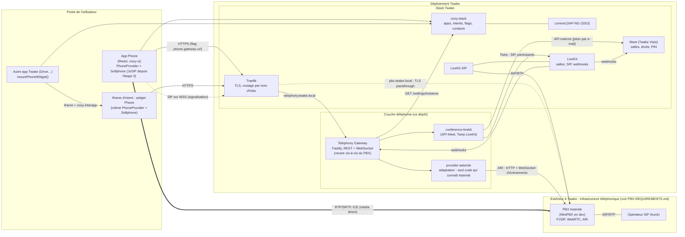
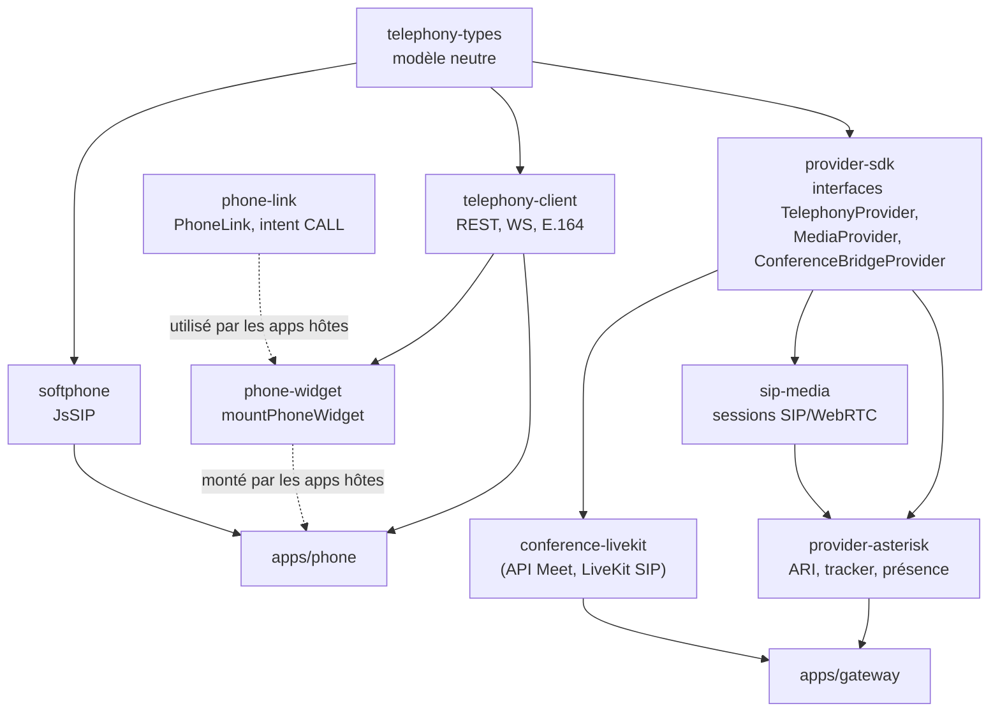
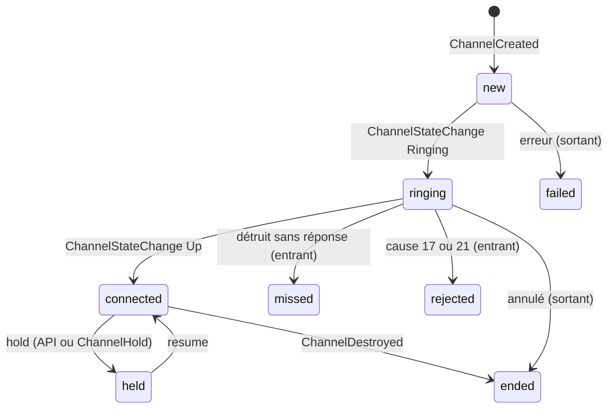
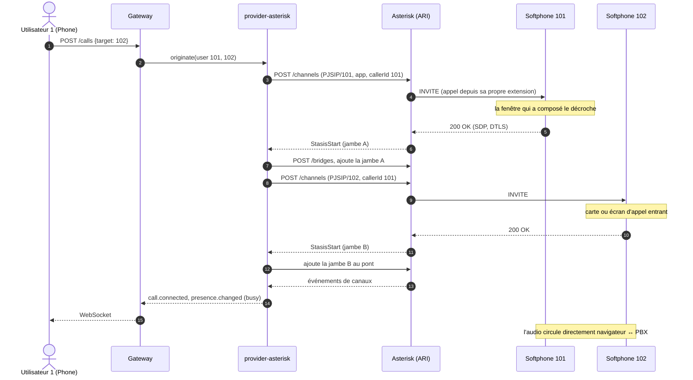
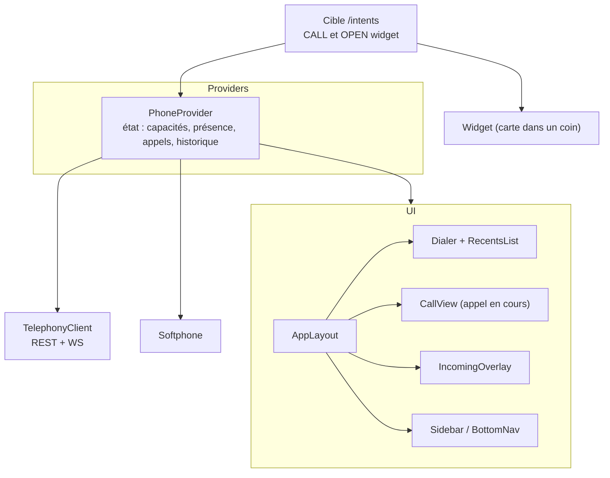

# Twake Phone : architecture et explication technique

Ce document décrit ce qui est réellement implémenté dans le dépôt (état à ce jour), pas seulement la cible du cahier des charges. Les écarts sont listés en §11, l'accès téléphonique aux salles Meet (Twake Visio) en §12 et le trunk SIP réel en §13. Ce qu'un PBX externe doit fournir : [PBX-REQUIREMENTS.md](PBX-REQUIREMENTS.md).

## 1. Vue d'ensemble



Trait plein : contrôle (REST/ARI). Pointillés : signalisation SIP. Double trait : audio.

**Deux zones.** Tout ce qui est dans « Déploiement Twake » est déployé et exploité avec Twake. Le PBX et l'opérateur sont **à l'extérieur** : joints par URL (ARI, WSS) et par des ports UDP, ils peuvent être gérés par une autre équipe ou un hébergeur, et être remplacés. Dans la zone Twake, seul `provider-asterisk` connaît Asterisk ; ce que le PBX externe doit fournir est dans [PBX-REQUIREMENTS.md](PBX-REQUIREMENTS.md). Dans la stack de développement, le PBX tourne dans Docker à côté de Twake par commodité, ce qui ne change pas la frontière. Traefik fait passer le WSS sans le déchiffrer (TLS passthrough) ; en production le navigateur peut aussi joindre le PBX directement.

**Deux plans séparés (cahier §25) :**

| Plan | Qui | Où |
|---|---|---|
| Contrôle : appeler, raccrocher, attente, présence, état des appels, événements | Gateway et provider, via l'API REST/WebSocket du Gateway et ARI côté PBX | `apps/gateway`, `packages/provider-asterisk` |
| Média : audio, SIP, ICE, DTLS-SRTP | Le navigateur directement vers le serveur SIP | `packages/softphone` (JsSIP), `packages/sip-media` (POC) |

Le Gateway ne voit jamais l'audio.

## 2. Organisation du dépôt



| Paquet | Rôle | Dépend d'un fournisseur ? |
|---|---|---|
| `telephony-types` | `Call`, `CallState`, `Presence`, `Capabilities`, `TelephonyEvent`, `MediaSession`… | Non |
| `provider-sdk` | Contrat qu'un provider doit respecter (`originate`, `hangup`, `hold`, `subscribe`, `getCapabilities`…) | Non |
| `provider-asterisk` | Traduit le contrat vers ARI. Aucune notion Asterisk n'en sort. | Oui, c'est son rôle |
| `sip-media` | Fournit la session média `sip-webrtc` (URL WSS, identité, ICE). Réutilisable par un futur provider SIP générique. | Non |
| `apps/gateway` | API publique `/api/v1`, annuaire utilisateur↔extension, bus d'événements, registre des providers par tenant | Non |
| `telephony-client` | SDK front : REST (appels, historique, conférences), WebSocket avec reconnexion, normalisation et formatage E.164 | Non |
| `softphone` | Enveloppe JsSIP (§5) : enregistrement, appels, mute, hold, DTMF, compteurs RTP, reconnexion | Non |
| `phone-widget` | Monte le widget d'appel dans n'importe quelle app (iframe d'intent) | Non |
| `phone-link` | `<PhoneLink>` et `requestCall` : rendre un numéro cliquable (intent `CALL`) | Non |
| `conference-livekit` | Accès téléphonique aux salles Meet : client de l'API externe de Meet, client Twirp de LiveKit (trunks SIP, participants, webhooks). Aucune notion LiveKit n'en sort. | Oui (LiveKit/Meet), c'est son rôle |
| `apps/phone` | L'app Twake/Cozy (UI, historique, intents) | Non |

La règle d'architecture est tenue : tout ce qui touche à Asterisk (ARI, PJSIP, états d'appareil `Stasis:`) reste dans `provider-asterisk`, tout ce qui touche à LiveKit et Meet dans `conference-livekit`. Remplacer le PBX revient à écrire un autre provider.

## 3. Le Gateway

Fastify, TypeScript. Routes principales sous `/api/v1` :

| Route | Rôle |
|---|---|
| `GET /me`, `/me/endpoints`, `/me/media-session` | Identité, endpoints, session média (identité SIP + URL WSS) |
| `GET /capabilities` | Ce que le provider sait faire ; l'UI s'adapte |
| `GET/PUT /me/presence` | Présence normalisée (`available`, `busy`, `away`, `dnd`, `offline`) |
| `POST /calls` (+ `Idempotency-Key`) | Crée un appel (click-to-call) |
| `GET /calls/history`, `DELETE /me/history` | Historique serveur de l'appelant (filtres, curseur) et effacement |
| `POST /calls/:id/{hangup,hold,resume,dtmf,transfer,answer,reject}` | Actions sur un appel, réservées à ses participants (voir ci-dessous) |
| `POST /ws-ticket`, `GET /ws` | Ticket à usage unique, puis flux d'événements temps réel de l'utilisateur |
| `POST /conferences`, `GET/DELETE /conferences/:id`, `POST /conferences/:id/participants`, `DELETE …/participants/:pid`, `POST …/participants/:pid/mute` | Accès téléphonique à une salle Meet (§12) |
| `POST /webhooks/livekit` | Webhooks LiveKit, authentifiés par signature (§12) |
| `/health`, `/ready`, `/docs`, `/openapi.json` | Exploitation |

Mécanismes :

- **Authentification** (`auth.ts`), choisie par `AUTH_MODE` (refus de démarrer si la configuration est incomplète) :
  - `cozy` (défaut) : le client envoie le jeton d'application Cozy qu'il a déjà et l'URL de son instance (`X-Cozy-Instance`). Le Gateway demande à **cette instance** (`GET /settings/instance`) à qui appartient le jeton : le stack fait autorité, il n'y a ni clé à partager ni seconde connexion. L'instance doit correspondre à `COZY_INSTANCE_PATTERN` (protection contre l'usage du Gateway pour joindre un hôte arbitraire). Un jeton inconnu donne 401, une panne du stack 503. Les jetons vérifiés sont mis en cache une minute.
  - `jwt` : jeton OIDC signé, vérifié sur le JWKS du SSO (émetteur, audience, expiration, algorithme).
  - Dans les deux cas l'identité porte aussi l'**e-mail** (attribut `email` de `/settings/instance`, revendication `email`), que §12 utilise pour agir chez Meet au nom de la personne.
  - `dev` : jeton `dev:<user>`, jamais en production (le Gateway refuse de démarrer avec `NODE_ENV=production`).
- **Ticket WebSocket** : un navigateur ne peut pas poser d'en-tête sur un WebSocket. Le client échange ses identifiants contre un ticket à usage unique valable 30 s (`POST /ws-ticket`), puis ouvre `/ws?ticket=…`. Aucun jeton durable ne circule dans une URL.
- **Persistance** (`store/`) : PostgreSQL (`provider_configs`, `user_mappings` avec service, source et date de synchronisation, `call_history`, `sip_credentials`, `conferences`, `favorites`), migrations SQL appliquées au démarrage. Toute méthode du `Store` prend le tenant. Un contrat de tests identique tourne sur l'implémentation mémoire et sur PostgreSQL, dont l'isolation entre tenants.
- **Appartenance des appels** : le Gateway retient, pour chaque appel, les utilisateurs dont les événements l'ont porté (et celui qui l'a lancé). Toute action `/calls/:id/…` d'un autre utilisateur répond 404, comme pour un appel inexistant. La table est en mémoire.
- **Tenants** : l'identité authentifiée fixe le tenant et l'utilisateur, jamais la requête. Le provider est celui du tenant (`registry.ts`), la correspondance utilisateur/extension est par tenant.
- **Annuaire** (`contacts.ts`, `ldap-directory.ts`) : les personnes que l'on peut appeler viennent du LDAP de l'organisation (`LDAP_*`), jamais mises en cache ; `GET /directory?q=` cherche chaque mot par préfixe sur nom, prénom, courriel, service et identifiant, et un numéro tapé par ses derniers chiffres ; la réponse dit si elle est tronquée. Un annuaire ne sert qu'un tenant (`LDAP_TENANT`) : les autres reçoivent 501, comme un déploiement sans annuaire (`/me` l'annonce dans `features.directory`). Une connexion liée par requête, avec délai de connexion et d'opération ; une panne du LDAP répond 503 sans en dire la cause au client. Les recherches sont limitées à 30 par 10 secondes et par utilisateur. Les favoris (`favorites`, 100 par personne) sont des identifiants de l'annuaire, résolus à la lecture : une personne qui quitte l'annuaire disparaît des favoris.
- **Synchronisation des comptes** (`directory-sync.ts`) : quand l'annuaire sait quel attribut porte le poste (`LDAP_ATTR_EXTENSION`), ses personnes deviennent des correspondances utilisateur ↔ poste (`user_mappings`, avec le nom, le service, `source = ldap` et la date), toutes les `LDAP_SYNC_INTERVAL` et à la demande (`POST /admin/directory/sync`). Une seule exécution à la fois par processus (`POST` répond 202, l'écran suit `GET /admin/directory`) ; le rapport (vus, avec poste, créés, mis à jour, retirés, conflits) est gardé en mémoire. L'annuaire fait foi pour les personnes qu'il connaît ; une correspondance manuelle d'une personne inconnue de l'annuaire n'est ni retirée ni dépossédée de son poste ; un poste donné à deux personnes reste à celle qui l'a déjà, sinon à la première listée ; un conflit ne coûte jamais sa correspondance à la personne (tout est tranché avant la première écriture) ; un listing vide ne retire rien (filtre ou compte lecteur en cause) ; les lignes à réécrire sont retirées avant les écritures, pour que deux personnes puissent échanger leurs postes. Les écritures ne sont pas dans une transaction et le verrou est en mémoire : avec plusieurs réplicas, deux exécutions simultanées se signalent des conflits que l'exécution suivante répare ; un verrou en base viendra avec l'exploitation multi-réplicas (ADR 0009).
- **Administrateurs** (`admin.ts`) : le rôle `ADMIN_ROLE` dans la revendication `JWT_ROLES_CLAIM` du jeton (aucune revendication lue si la variable est absente), ou un utilisateur de `ADMIN_USERS`. `/me` le dit dans `features.admin` ; les routes `/admin/*` répondent 403 aux autres. Hors mode `dev` (où l'en-tête `x-dev-roles` est cru, comme `x-dev-user`), rien dans une requête ne peut se déclarer administrateur.
- **En-têtes de sécurité** (`security.ts`) : toute réponse porte `Content-Security-Policy: default-src 'none'; frame-ancestors 'none'`, `X-Content-Type-Options`, `X-Frame-Options`, `Referrer-Policy` et `Cache-Control: no-store` (l'interface OpenAPI sous `/docs` garde une politique qui la laisse tourner) ; `Strict-Transport-Security` quand `HSTS_MAX_AGE` est renseigné (`0` le retire, `HSTS_INCLUDE_SUBDOMAINS=1` l'étend).
- **Historique** : chaque fin d'appel vue par le provider est enregistrée pour l'utilisateur concerné (`history.ts`, idempotent sur l'identifiant d'appel). `GET /calls/history` filtre par direction, statut, numéro, dates et pagine par curseur ; `DELETE /me/history` efface l'historique de l'appelant.
- **Secrets SIP** (`sip-secrets.ts`) : un secret aléatoire par utilisateur, généré par le Gateway, poussé au PBX par son API de provisionnement puis conservé chiffré (AES-256-GCM) en base. Rien n'est stocké dans un doctype ni dans le front : le navigateur ne le reçoit que par l'appel authentifié `media-session`. Si le PBX refuse, rien n'est enregistré.
- **Secrets de configuration** : la configuration d'un provider ne contient que des références (`env:ARI_PASSWORD`), résolues au démarrage.
- **Registre de providers par tenant** (`registry.ts`) : point d'extension multi-tenant et multi-provider.
- **Bus d'événements** (`events.ts`) : diffuse chaque événement au seul utilisateur concerné. Mémoire aujourd'hui, interface prévue pour Redis.
- **Prêt à fonctionner** : `/ready` n'est vert que si tous les providers sont `CONNECTED` ; `originate` refuse (503) si la liaison PBX est coupée.
- Les journaux masquent les en-têtes d'autorisation et les tickets.

## 4. provider-asterisk

### 4.1 Pourquoi ARI

MiniPBX n'expose qu'AMI, en local, et exclut WebRTC et ARI de son périmètre. L'overlay (§8) ajoute ARI. Le provider s'y connecte avec **un WebSocket d'événements** (`subscribeAll=true`, pour voir aussi les appels qui ne passent pas par Stasis) et des appels REST.

### 4.2 Machine à états (`tracker.ts`)

Fonction pure : événements ARI en entrée, événements normalisés en sortie. Testable sans PBX.



- Un **appel** correspond à une jambe PJSIP d'extension (`PJSIP/101-0000000a`). Les jambes de trunk ne sont pas des appels utilisateur.
- La **direction** vient d'abord des indications posées à l'`originate`, sinon de l'événement `Dial` (l'appelant est sortant, l'appelé entrant), sinon d'une inférence.
- ARI n'émet pas d'événement quand on demande un hold par API : le provider le signale lui-même sur l'appel de l'utilisateur qui l'a demandé.

### 4.3 Présence

Calculée, pas stockée :

1. `Stasis:dnd<ext>` à `BUSY` donne `dnd`, `Stasis:away<ext>` donne `away` (source `user`)
2. sinon une jambe connectée ou en attente donne `busy` (source `telephony`)
3. sinon `PJSIP/<ext>` `UNAVAILABLE` donne `offline`
4. sinon `available`

DND est un **état d'appareil ARI** `Stasis:dnd<ext>` (ARI ne pilote que ce préfixe). Il est appliqué à deux endroits : par le dialplan de l'overlay pour les appels composés depuis un téléphone, et par le provider avant un click-to-call, car ARI contourne le dialplan.

### 4.4 Click-to-call



Le premier appel fait sonner **le propre poste** de l'appelant, puis la cible est appelée et pontée. Pour l'UI, cette jambe représente l'appelé : `PhoneProvider` remplace le numéro par la cible et la marque sortante.

**Faire sonner toutes les fenêtres.** Un `originate` ARI (ou un `Dial`) vers `PJSIP/<ext>` ne joint **qu'un seul** des contacts enregistrés : avec Phone et un widget ouverts, la fenêtre qui sonne peut ne pas être celle qu'on utilise. Les jambes internes passent donc par `Local/<ext>@twake-ring/n`, un contexte du plan d'appel qui fait `Dial(${PJSIP_DIAL_CONTACTS(${EXTEN})})`. Le téléphone réellement composé est alors un autre canal que celui créé par l'API : le tracker lit l'événement `Dial` (l'appelant est dans son champ `caller`) et rattache le canal au numéro et à l'identifiant d'appel de l'API.

## 5. Le softphone (`packages/softphone`)

Réécrit à l'étape 3 sur JsSIP (ADR 0003) : `UA` et `RTCSession`. Il ne fait que le **média et la signalisation SIP**, jamais le contrôle d'appel métier. L'app (`apps/web/src/softphone.tsx`, `SoftphoneProvider`) le monte une fois au-dessus du routeur, dès que la passerelle donne une session `sip-webrtc`, et affiche l'état d'enregistrement dans l'en-tête et le panneau d'appel (`CallPanel`) au-dessus des pages.

- Récupère à chaque démarrage `GET /me/media-session` : URL WSS, domaine SIP, poste, secret, serveurs ICE.
- Un `SoftCall` par appel (`new`, `ringing`, `connected`, `held`, `ended` avec sa raison : raccroché, refusé, occupé, sans réponse, injoignable, annulé, échec) : répondre, refuser (603), raccrocher, attente et reprise (re-INVITE), micro, DTMF (RFC 4733 par défaut, INFO sur demande ; les INFO reçus sont remontés), `stats()` (compteurs RTP, utilisés par les e2e pour prouver que l'audio circule).
- **Reconnexion** : JsSIP rouvre le WebSocket et se réenregistre seul quand le réseau ou le serveur tombe ; sur un enregistrement refusé (secret tourné, compte retiré), le softphone redémarre avec une session neuve de la passerelle, avec backoff.
- Se désinscrit à la déconnexion de l'app (prouvé par le e2e : 404 ensuite) et, au mieux, à la fermeture de la page (`pagehide`, le WebSocket se ferme en même temps) ; un contact mort (connexion partie sans désinscription) vaut 477 ou 480 à l'appelant, rendu « injoignable » ; la déconnexion de l'app attend la confirmation de la désinscription avant de quitter la page.
- Un élément audio par appel, deux appels au plus : celui en cours et celui en attente. Un appel passé pendant un appel est une consultation (l'appel en cours est mis en attente d'abord) ; un second appel entrant reçoit 486 (pas de double appel pour l'instant).
- **Transferts** (ADR 0010) : direct par REFER (le correspondant appelle le poste visé et rend compte par NOTIFY ; échec, ou silence de 30 s, rendu au transférant, qui reprend son correspondant), supervisé par REFER avec `Replaces` après consultation ; un REFER reçu est suivi sans demander s'il vise un poste composable du domaine local (`Referred-By` recopié), un INVITE avec `Replaces` remplace l'appel visé sans sonner. Une consultation qui finit sans transfert rend l'appel en attente d'elle-même. Les erreurs du softphone sont des codes (`CallError`) que l'app traduit. L'app : bouton Transférer (direct ou consulter d'abord), puis « Transférer X à Y » ou « Annuler la consultation ».
- Le nom affiché sur un appel entrant vient du `From` posé par l'appelant (une personne authentifiée peut y mettre ce qu'elle veut) ; l'étape 4 le fera poser par OpenSIPS depuis l'annuaire.
- Un seul tenant par serveur OpenSIPS pour l'instant : `subscriber` n'a pas de colonne de tenant (`use_domain 0`) et `lookup("location")` route entre tous les postes enregistrés. Le multi-tenant SIP viendra avec l'administration (étape 7).

## 6. L'application Phone (`apps/phone`)

Application Cozy « pure » (backend = cozy-stack pour les contacts, le Gateway pour la téléphonie), construite avec rsbuild.



Points de conception :

- **Une seule source d'état** : `PhoneProvider`. Capacités et présence viennent du Gateway ; si le provider a l'audio navigateur, l'état des appels vient du softphone, sinon des événements du Gateway.
- **L'UI suit les capabilities** : le bouton transfert n'apparaît que si `calling.transfer` est vrai, mute et clavier DTMF seulement avec l'audio navigateur, Répondre seulement si la page peut décrocher.
- **Règle de l'appel depuis sa propre extension** : une fenêtre ne décroche cette jambe que si elle vient de composer (fenêtre de 20 s). Les autres fenêtres de la même personne l'ignorent, ce qui évite qu'un autre onglet vole l'audio.
- **Historique** : lu depuis le Gateway (`GET /calls/history`), complété localement par les appels de la session en cours. Compteur de manqués non lus.
- **Visio** : la vue `Meetings` (entrée « Visio », visible seulement si `capabilities.conference.dialIn`) ouvre le panneau téléphone d'une salle Meet par son lien ou en crée une, affiche numéro et PIN, invite un numéro, coupe le micro ou retire un participant, avec mise à jour en direct par les événements `conference.*`.
- **Contacts** : requête cozy-client sur `io.cozy.contacts`, rapprochement par numéro (E.164) et par préfixe pendant la saisie.
- **Configuration par flags Cozy** : `phone.gateway-url` (global), `phone.dev-user` (par instance, mode dev).
- **Interface** : reproduction du design fourni (Plus Jakarta Sans via npm car la CSP du stack interdit les polices externes ; CSS standard, pas de CSS Modules).
- **Qualité** : `eslint` (config cozy-app et règles React Compiler) sans erreur ; le temps des minuteurs vient d'un hook partagé `useNow`, aucune lecture impure pendant le rendu.

### 6.5 L'application autonome TwakePhone (`apps/web`)

Depuis l'étape 2, l'application cible est `apps/web` : React 18 construit par rsbuild sans dépendance Cozy, connexion OIDC (PKCE, jeton de rafraîchissement, `oidc-client-ts`), client de la passerelle (`telephony-client`), fr et en, socle RGAA. Sa configuration (`config.json` : passerelle, fournisseur d'identité, indicateur de ressource) est lue au démarrage, ce qui fait un seul build pour toutes les plateformes.

En production, `apps/web/server` (Node sans dépendance, `docker/Dockerfile.web`) sert le build, génère `config.json` depuis l'environnement et pose les en-têtes : une CSP qui ne connaît que les scripts et styles du build, la passerelle (REST et WebSocket) et le fournisseur d'identité, plus `CONNECT_SRC` (le WSS du serveur SIP à l'étape 3) ; `frame-ancestors` limité aux origines de `FRAME_ANCESTORS` (celles de Twake Chat à l'étape 9, `'none'` sinon, avec `X-Frame-Options: DENY`) ; `Permissions-Policy` qui n'ouvre que le micro, pour cette origine ; `Referrer-Policy: no-referrer` ; HSTS sur demande (`HSTS_MAX_AGE`, `HSTS_INCLUDE_SUBDOMAINS=1`). Les valeurs de `FRAME_ANCESTORS` et `CONNECT_SRC` sont vérifiées au démarrage (une source CSP chacune, rien qui puisse clore la directive) ; un chemin mal encodé répond 400 et une erreur interne 500, sans arrêter le serveur. La page construite embarque aussi une CSP en balise `meta`, plus large (elle ne connaît pas la passerelle), pour un hébergement statique qui ne poserait pas d'en-tête. Le navigateur applique les deux. L'e2e `yarn e2e:web` passe par ce serveur : la politique testée est celle livrée.

L'écran d'administration (`/admin`, visible aux seuls administrateurs annoncés par `/me`) montre la source de l'annuaire sans secret, l'état de la synchronisation et son dernier rapport, et la lance à la demande. L'administration des trunks, SDA et routes arrive à l'étape 7.

## 7. Le widget dans les autres applications

Le problème : chaque app Twake tourne sur sa propre origine (`user1-drive`, `user1-mail`…). Il n'existe donc aucun contexte JavaScript partagé. Solution : l'application **hôte** embarque Phone dans une iframe via le mécanisme d'**intent** de Cozy.

```mermaid
sequenceDiagram
  autonumber
  participant H as App hôte (Drive)
  participant Lib as phone-widget
  participant S as cozy-stack
  participant I as Iframe Phone (/intents)
  participant GW as Gateway
  participant PBX as Asterisk

  H->>Lib: mountPhoneWidget({ client })
  Lib->>Lib: crée le conteneur fixe en bas à droite (0×0)
  Lib->>S: POST /intents OPEN io.twake.phone.widget (cozy-interapp)
  S-->>Lib: intent + URL du service (Phone /intents?intent=…)
  Lib->>I: insère l'iframe, allow="microphone; autoplay" posé AVANT l'insertion
  I->>S: createService (poignée de main postMessage)
  I->>GW: capacités, présence, media-session
  I->>PBX: SIP REGISTER sur WSS (le widget est un contact SIP)
  Note over I: la carte demande 0×0 tant qu'il n'y a pas d'appel

  PBX-->>I: INVITE (appel entrant)
  I->>H: resizeClient({ width: 360, height: 68 })
  Note over H,I: la carte apparaît dans le coin de l'app
  I->>PBX: l'utilisateur clique Répondre : 200 OK (micro, DTLS-SRTP)
```

Ce que l'hôte doit fournir, et ce qui a été corrigé en le testant :

1. **Place et position** : `phone-widget` crée un conteneur fixe, `overflow: hidden`, de taille 0 au repos. L'iframe lui demande de grandir via `resizeClient`.
2. **Micro** : `cozy-interapp` crée l'iframe sans attribut `allow`. La bibliothèque pose `allow="microphone; autoplay"` **avant** l'insertion (le navigateur le lit à ce moment). L'autorisation du micro est accordée à l'**origine de l'hôte**, pas à celle de Phone.
3. **Hauteur** : dans une iframe sans hauteur, la feuille de style globale d'une app Cozy écrasait la racine à 0. Le widget mesure son contenu et neutralise ces règles.
4. **Interopérabilité de module** : l'import de `cozy-interapp` est résolu quelle que soit la sémantique du bundler.
5. **Plusieurs fenêtres** : chaque fenêtre (Phone ou widget) est un contact SIP de la même extension ; toutes sonnent, la première qui répond prend l'appel.

### PhoneLink et l'intent CALL

`@twake/phone-link` rend un numéro cliquable (`<PhoneLink number>`, ou `requestCall()` hors React). Le numéro est validé et normalisé (E.164) : un texte qui n'est pas un numéro n'est jamais composé. Trois chemins, du plus direct au plus lent :

1. **La page porte le widget** : `requestCall` lui parle directement par un canal de messages privé (`MessageChannel`). Il ne crée surtout **pas** un second intent : l'écouteur de `cozy-interapp` lève « Invalid event id » dès que deux intents répondent depuis la même origine, ce qui détruirait le widget.
2. **Pas de widget, mais une fenêtre Phone est ouverte dans ce navigateur** : intent `CALL`. Son service, une iframe sans softphone, relaie la demande à une fenêtre Phone déjà enregistrée par un `BroadcastChannel`. Une seule la traite (un Web Lock nommé d'après la demande), d'abord parmi les fenêtres visibles. C'est cette fenêtre qui compose, car elle doit aussi décrocher le premier appel.
3. **Aucune fenêtre Phone** : l'app Phone est ouverte sur `#/dialer?dial=<numéro>` et compose dès que son softphone est enregistré.

Côté widget, la demande d'un hôte n'est acceptée que si son origine est une application de la même instance (`origin.js`).

L'intégration cible est **cozy-bar** (présente dans toutes les apps) : deux lignes, au lieu d'un changement par application.

## 8. Le PBX de développement (`docker/`)

MiniPBX est utilisé tel quel, avec un **overlay appliqué au build** (`docker/minipbx-dev/overlay/patch.py`, qui échoue si une ancre amont a bougé). MiniPBX n'est jamais modifié.

| Ajout | Pourquoi |
|---|---|
| Modules WebSocket, SRTP, Opus, ARI, Stasis | WebRTC et contrôle d'appel, absents de MiniPBX |
| Transport `wss` et `webrtc=yes`, `from_domain` fixe | Endpoints navigateur ; SIP.js refuse un nom d'hôte de conteneur dans l'en-tête `From` |
| Certificat générique du stack monté dans Asterisk, TLS passthrough par Traefik sur `pbx.twake.local` | WSS de confiance sans accepter de certificat à la main |
| Hook DND dans le dialplan (`Stasis:dnd<ext>`) | DND appliqué pour les appels composés depuis un téléphone |
| Jusqu'à 10 contacts par extension, éviction du plus ancien | Plusieurs fenêtres par personne |
| Candidats ICE hôte (`ASTERISK_EXTERNAL_ADDRESS`) injectés dans le gabarit `rtp.conf` | Un navigateur ne joint pas l'IP du conteneur ; MiniPBX régénère `rtp.conf`, donc le réglage vit dans le gabarit |
| Graines : extensions 101-103 (usage manuel), 104-105 (tests automatiques) | Les tests ne doivent pas voler la session d'une personne |
| Endpoint `livekit` identifié par IP, contexte `livekit-in`, numéro d'accès `8000` et correspondant de test `8888` | Pont avec LiveKit SIP pour Meet (§12) |
| Un contact par IP de l'opérateur dans l'AOR du trunk, `qualify_frequency=15` | Garde ouverts les accès du NAT pour les appels entrants (§13) |
| Port SIP `5080` au lieu de 5060 | Le port source 5060 n'obtenait aucune réponse de l'opérateur (§13) |

Réseau : `telephony.twake.local` va au Gateway ; `pbx.twake.local` va au PBX en TLS passthrough ; la CSP de cozy-stack autorise ces deux hôtes (`connect`).

**Dépôts de référence.** La stack Twake, Drive et MiniPBX ne sont pas versionnés ici : `scripts/setup-references.sh` les clone à des révisions précises dans `references/` et applique `docker/stack/*.patch` (application de développement montée dans cozy-stack, CSP, Meet avec téléphonie et API externe, webhooks LiveKit, widget dans Drive). `docker/.env.example` liste les secrets locaux. `docker/meet-sip/` ajoute LiveKit SIP et les variables Meet du Gateway.

## 9. Chemin des données, de bout en bout

| Étape | Protocole | Chemin |
|---|---|---|
| Charger les contacts | HTTPS | App, cozy-stack |
| Capacités, présence, créer un appel | HTTPS (REST) | App, Traefik, Gateway |
| Événements temps réel | WebSocket | Gateway, App (`/api/v1/ws`) |
| Contrôle d'appel | ARI (HTTP + WebSocket) | Gateway/provider, Asterisk |
| Signalisation SIP | SIP sur WSS | Navigateur, Traefik (passthrough), Asterisk |
| Audio | RTP/SRTP (DTLS), ICE | Navigateur, Asterisk (ports UDP 10000-10100 publiés) |
| Salles Meet (création, PIN) | HTTPS, API externe de Meet | Gateway, Meet (jeton délégué par e-mail) |
| Participants téléphone, trunks SIP | Twirp (HTTP JSON) | Gateway, LiveKit |
| Dial-in / dial-out | SIP + RTP | Asterisk, LiveKit SIP (réseau Docker) |
| Événements de salle | Webhooks signés | LiveKit, Gateway, WebSocket de l'utilisateur |
| Appels de l'opérateur | SIP/UDP + RTP | Opérateur, NAT, Asterisk (port 5080) |

## 10. Tests

| Commande | Ce qui est vérifié |
|---|---|
| `yarn test` | Unitaires (vitest) : types, client (E.164, backoff, lien Meet), tracker (états, présence), reconnexion ARI, Gateway (REST, WS, authentification, appartenance des appels, conférences, webhooks), `conference-livekit` (jetons, trunks, API Meet) |
| `TEST_DATABASE_URL=… yarn test` | Le même contrat de stockage contre PostgreSQL (isolation entre tenants, conférences) |
| `apps/phone` : `npx jest`, `yarn lint` | UI : dialer, vue d'appel selon capabilities, récents, widget, visio, règles du `PhoneProvider` ; lint sans erreur |
| `yarn e2e:live` | API complète contre le PBX réel avec deux agents SIP (appel, présence, hold, DND, idempotence) |
| `yarn e2e:sip` (remplace `e2e:browser` du POC) | Deux Chromium à travers OpenSIPS et rtpengine : enregistrement WSS, appel, RTP dans les deux sens, attente, DTMF, reconnexion après coupure, désinscription |
| `yarn e2e:widget` | Un « Drive » factice avec la vraie `cozy-interapp` : carte visible, appel décroché depuis le widget |
| `node docker/meet-sip/platform.e2e.mjs` | Visio sur la plateforme, sans simulation : jetons Cozy réels, Meet, LiveKit, LiveKit SIP, PBX (§12) |
| `node docker/meet-sip/smoke.mjs` | LiveKit seul, mode sans Meet |

**Enseignement.** Les tests qui simulent le réseau ne suffisent pas pour ce qui traverse plusieurs services : l'essai sur la plateforme a trouvé des défauts invisibles aux tests unitaires (voir §12 et §13). Une erreur `tsc` dans un fichier de test fait aussi échouer le build Docker du Gateway et laisse l'ancien conteneur : lire toute la sortie d'un `docker compose build`.

Tous les tests automatiques utilisent les extensions 104/105 et leur propre application ARI (`twake-<test>-<pid>`).

## 11. Écarts avec le cahier des charges et limites

Fait : abstraction fournisseur, capabilities, présence normalisée et bidirectionnelle (Asterisk), événements, séparation contrôle/média, softphone WebRTC, click-to-call, widget inter-apps, authentification par la session Twake, secrets SIP par utilisateur, persistance PostgreSQL avec isolation par tenant, historique serveur, intent `CALL` et `PhoneLink`, appartenance des appels, accès téléphonique aux salles Meet (dial-in, dial-out, événements), appels entrants et sortants par un trunk SIP réel.

Pas encore fait :

- **Mode `jwt` non éprouvé en réel** : implémenté et testé avec une clé locale, mais aucun client OIDC n'est déclaré dans LemonLDAP ; le mode `cozy` est celui qui tourne sur le stack.
- **Secrets SIP non éphémères** : un secret par utilisateur, pas un identifiant par session. La rotation existe (`rotate`) mais rien ne la déclenche encore. Un secret renouvelé est repris par le softphone, qui se ré-enregistre avec une session neuve.
- **Redis** (bus multi-réplica), administration des providers par une interface, tenants multiples hors bootstrap.
- **Appels** : transfert par l'API de la passerelle (le softphone transfère lui-même depuis l'étape 3), historique de présence, politiques de numérotation et quotas (un appel externe n'est pour l'instant limité par rien côté Gateway), enregistrement.
- **Appels externes** : le trunk est à configurer dans MiniPBX (voir `docker/README.md` et §13). Sur un Mac derrière une box, l'entrant dépend du réseau (port source, NAT) et n'a pas été éprouvé ailleurs que sur la ligne de développement.
- **Meet** : dial-in/dial-out livrés (voir §12). Restent : transférer un appel en cours vers une salle, configuration LiveKit et Meet par tenant (aujourd'hui un seul LiveKit et une seule application Meet par déploiement, via l'environnement), expliquer dans l'UI qu'une salle vide n'est pas joignable par téléphone.
- **Appartenance des appels en mémoire** : un redémarrage du Gateway en cours d'appel fait répondre 404 aux actions Gateway de cet appel (le softphone, lui, agit directement). À persister avec Redis.
- **Route entrante unique** : en dev, tous les appels de la ligne vont à Meet (extension interne `8000`) ; une ligne partagée avec un accueil vocal n'est pas faite.
- **Droits dans une salle** : l'API externe de Meet n'indique pas le rôle de la personne ; toute personne ayant accès à la salle peut ouvrir son panneau téléphone, inviter, couper un micro ou retirer quelqu'un.
- **Valeurs de développement** : secret JWT de l'API externe de Meet, clés LiveKit, mot de passe ARI et de la base `telephony` sont des valeurs de démonstration de la stack de dev (`docker/`). Aucune ne doit servir en production ; la configuration réelle passe par l'environnement ou un coffre (`env:NOM` dans `provider_configs`).
- **Intégration du widget et de `PhoneLink` dans cozy-bar et dans Contacts** : fonctionnent dans le clone de Drive et dans la reproduction automatique, pas dans les applications du registre.
- **Réception hors fenêtre** : rien ne sonne si aucune fenêtre portant Phone ou le widget n'est ouverte (Web Push).
- **Un seul nom d'application ARI par Gateway** : deux clients avec le même nom se désactivent mutuellement ; le Gateway ne détecte pas encore ce cas.
- **Mode CTI sans audio navigateur** : hold et DTMF s'adressent à la jambe du pont ; non éprouvés avec des téléphones physiques.

## 12. Visio : accès téléphonique aux salles Meet

```
Phone ──REST/WS──> Gateway ──API externe (jeton par e-mail)──> Meet (backend)
                     │  └──Twirp (SIP, participants)──────────> LiveKit ◄── webhooks ── Meet, Gateway
                     │                                              ▲
                     ▼                                       LiveKit SIP ◄──SIP/RTP──> Asterisk ──> postes, trunk
                 PostgreSQL
```

**Qui fait quoi.** Meet (La Suite Meet, serveur de Twake Visio) possède salles, droits, PIN et règles de dial-in. Le Gateway ne duplique rien : c'est une *application* de Meet.

- **Identité** : le Gateway connaît l'e-mail de la personne (cozy-stack ou OIDC) et demande à Meet un jeton « délégué » pour cet e-mail (`POST /external-api/v1.0/application/token/`, identifiants `MEET_CLIENT_ID/SECRET`, domaines limités). Meet décide alors quelles salles la personne voit. Une salle qu'elle ne voit pas répond 404, jamais 403.
- **Salles** : `POST /conferences {slug}` ouvre le panneau téléphone d'une salle existante, `{create:true}` en crée une chez Meet. L'identifiant public est l'`id` Meet (UUID), qui est aussi le nom de la salle dans LiveKit. Le panneau d'une salle est lié à la première personne qui l'ouvre (table `conferences`) ; Meet est reconsulté à chaque action, donc une révocation d'accès coupe tout.
- **Dial-in** (natif Meet, `ROOM_TELEPHONY_ENABLED`) : quand LiveKit signale `room_started`, Meet crée une règle de dispatch « direct » avec le PIN à 10 chiffres de la salle, et la retire à `room_finished`. **Une salle n'est donc joignable par téléphone que tant qu'elle est ouverte.** Le Gateway prépare seulement les trunks LiveKit SIP (`ensureTrunks`) : entrant pour le numéro d'accès (`8000` sur le PBX de dev), sortant vers le PBX.
- **Dial-out** : `CreateSIPParticipant` demande à LiveKit d'appeler le PBX ; le contexte `livekit-in` renvoie vers le dialplan MiniPBX (extensions, trunk et règles sortantes habituels). Meet ne sait pas le faire : c'est l'apport du Gateway, avec couper le micro et retirer.
- **Événements** : LiveKit appelle le Gateway (`POST /api/v1/webhooks/livekit`, signature JWT + SHA-256 du corps) puis le Gateway relaie `conference.participant.joined|left` sur le WebSocket de la personne. LiveKit appelle aussi Meet ; en dev par le proxy nginx du frontend, car Meet redirige le HTTP simple (`SECURE_SSL_REDIRECT`) et n'accepte que ses hôtes déclarés.
- **Vie privée** : `MEET_NUMBER_PRIVACY=show|mask|hide` pour les numéros des participants téléphone.
- **Sans Meet** (pas de `MEET_URL`) : le Gateway retombe sur son propre mode, une règle de dispatch par salle avec un PIN à 6 chiffres (`createDialIn`). Pratique pour un LiveKit seul, non utilisé avec Twake Visio.
- **Numéro d'accès** : celui que Meet affiche vient de sa configuration (`ROOM_TELEPHONY_PHONE_NUMBER`, réglé dans la stack par `MEET_TELEPHONY_NUMBER`). Ce doit être un vrai numéro E.164 : avec `8000` Meet affiche « +33 8000 », qui n'est pas appelable. L'extension interne `8000` n'est que le dernier saut entre le PBX et LiveKit SIP ; la route entrante de MiniPBX y envoie les appels de la ligne.
- **Configuration du Gateway** : `LIVEKIT_URL`, `LIVEKIT_API_KEY`, `LIVEKIT_API_SECRET`, `MEET_OUTBOUND_ADDRESS` (adresse SIP du PBX, `pbx:5080`), `MEET_DIALIN_NUMBERS` (numéro du trunk entrant côté LiveKit), `MEET_URL`, `MEET_CLIENT_ID`, `MEET_CLIENT_SECRET`, `MEET_NUMBER_PRIVACY`. Un trunk sortant LiveKit dont l'adresse a changé est remplacé automatiquement.

**Tests sur la plateforme** (`docker/meet-sip/platform.e2e.mjs`, sans simulation) : vrais jetons Cozy de user1 et user2, Gateway, backend Meet, LiveKit, LiveKit SIP et PBX. Ils vérifient : création d'une salle chez Meet avec son PIN, règle de dial-in créée par Meet avec ce PIN, isolation entre utilisateurs, dial-out jusqu'à un participant téléphone, événements reçus sur le WebSocket, appel du PBX vers le numéro d'accès accepté par LiveKit SIP, couper le micro et retirer. Ils ont déjà révélé trois défauts que les tests simulés ne voyaient pas (un GET avec corps vide rejeté par `fetch`, une redirection HTTPS des webhooks, un hôte non déclaré côté Meet). Mise en place de la stack et de l'application Meet du Gateway : `docker/README.md`.

## 13. Trunk SIP réel : ce que la ligne de développement a appris

Un appel entrant sur un numéro d'opérateur traverse : opérateur, box (NAT), Mac, Docker Desktop, Asterisk. Trois constats mesurés (ligne freepro, deux serveurs d'appel `85.31.193.197` et `.213`) :

1. **Le port source 5060 est inutilisable ici.** Depuis ce port, aucun paquet SIP (OPTIONS ou REGISTER) n'obtenait de réponse de l'opérateur ; depuis n'importe quel autre port, depuis l'hôte comme depuis un conteneur, la réponse était immédiate. Le trunk restait « Registered » puis tombait en « Rejected », et aucun appel n'arrivait. Le PBX de dev écoute donc sur **5080** (réglage `sip_port` de MiniPBX, port publié `5080:5080/udp`, `MEET_OUTBOUND_ADDRESS=pbx:5080`). La couche responsable (box, NAT de Docker Desktop ou opérateur) n'a pas été identifiée.
2. **Un NAT n'admet que les destinations à qui l'on a écrit récemment.** Avec deux serveurs d'appel, l'INVITE peut venir de celui auprès duquel on n'est pas enregistré. L'overlay donne à l'AOR du trunk un contact par IP du serveur de l'opérateur, chacun qualifié toutes les 15 s (OPTIONS), ce qui garde les deux accès ouverts. `pjsip show contacts` doit montrer les trois contacts `Avail`.
3. **Ne pas renseigner d'adresse externe.** Mettre l'IP publique ou celle de la machine comme adresse externe de MiniPBX n'aide pas (l'opérateur répond sur la connexion de l'enregistrement) et a fait cesser les réponses à l'enregistrement. Elle reste vide, le réseau local est `172.27.0.0/16`.

Les enregistrements ne doivent pas être forcés à répétition pendant les essais : l'opérateur cesse de répondre à une adresse qui en envoie trop.

Vérification : `pjsip show registrations` (état `Registered`), `pjsip show contacts`, `pjsip set logger on` pendant un appel de test (un INVITE doit apparaître), puis `docker/meet-sip/platform.e2e.mjs`, dont une étape simule l'appel entrant par la route de la ligne.
