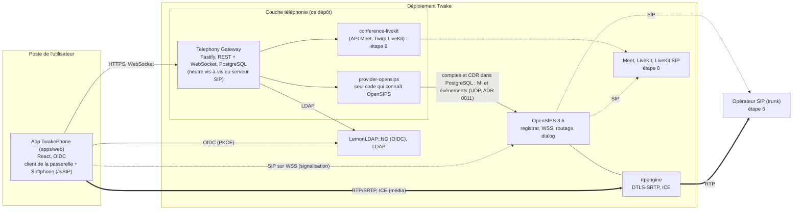
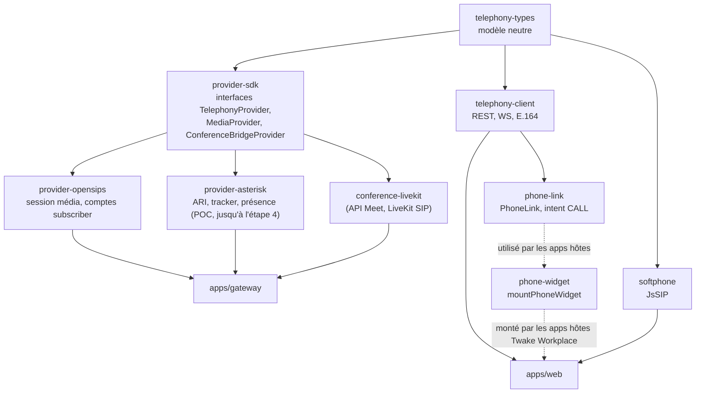
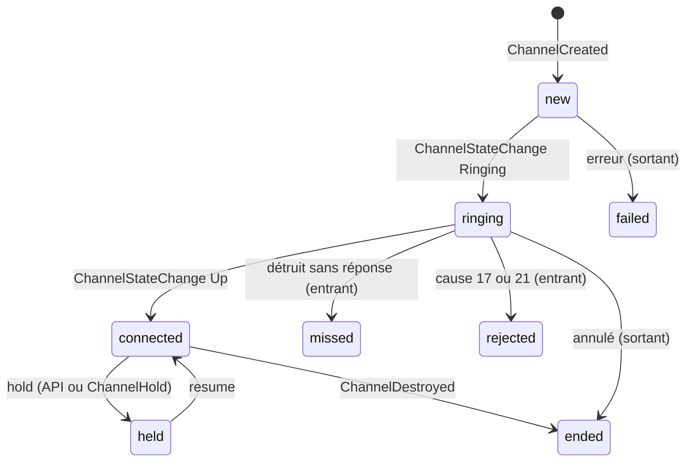
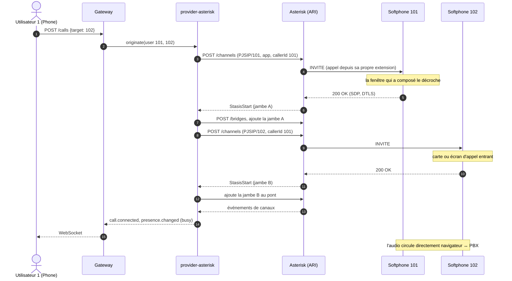

# Twake Phone : architecture et explication technique

Ce document décrit ce qui est réellement implémenté dans le dépôt (état à ce jour), pas seulement la cible du cahier des charges. Les écarts sont listés en §11, l'accès téléphonique aux salles Meet (Twake Visio) en §12 et le trunk SIP réel en §13. Ce qu'un PBX externe doit fournir : [PBX-REQUIREMENTS.md](PBX-REQUIREMENTS.md). Le code du POC (app Phone Cozy, PBX de dev MiniPBX, `sip-media`, stack de dev) a été retiré à la PR 3c ; ce que ce document en gardait est remplacé par ce que fait le MVP et par l'étape du plan qui refait chaque partie.

## 1. Vue d'ensemble

Trait plein : contrôle (REST, base de données). Pointillés : signalisation SIP. Double trait : audio.

**Deux zones.** La passerelle, ses providers et le serveur SIP sont déployés et exploités avec Twake (`docker/docker-compose.sip.yml` pour OpenSIPS, rtpengine et leur PostgreSQL). L'opérateur est **à l'extérieur** : joint par SIP et RTP, il peut être remplacé. Dans la zone Twake, seul `provider-opensips` connaît OpenSIPS ; `provider-asterisk`, le provider de référence du POC (ARI), reste dans le dépôt jusqu'à la fin de l'étape 4 (PR 4c), `provider-opensips` ayant désormais les événements, la présence et l'historique (PR 4a, ADR 0011). Ce qu'un PBX externe doit fournir est dans [PBX-REQUIREMENTS.md](PBX-REQUIREMENTS.md).

**Deux plans séparés (cahier §25) :**

| Plan | Qui | Où |
|---|---|---|
| Contrôle : comptes, session média, présence, état des appels, événements, historique | Gateway et provider, via l'API REST/WebSocket du Gateway ; côté serveur SIP, la table `subscriber`, les CDR du module `acc`, les événements (`event_datagram`) et l'interface MI (`mi_datagram`) d'OpenSIPS | `apps/gateway`, `packages/provider-opensips` (`packages/provider-asterisk` jusqu'à l'étape 4) |
| Média et signalisation d'appel : SIP, ICE, DTLS-SRTP, attente, DTMF, transferts | Le navigateur directement vers le serveur SIP | `packages/softphone` (JsSIP) |

Le Gateway ne voit jamais l'audio.

## 2. Organisation du dépôt

| Paquet | Rôle | Dépend d'un fournisseur ? |
|---|---|---|
| `telephony-types` | `Call`, `CallState`, `Presence`, `Capabilities`, `TelephonyEvent`, `MediaSession`… | Non |
| `provider-sdk` | Contrat qu'un provider doit respecter (`originate`, `hangup`, `hold`, `subscribe`, `getCapabilities`…) | Non |
| `provider-opensips` | Session média `sip-webrtc` (URL WSS, domaine, poste, secret, ICE), comptes dans la table `subscriber` d'OpenSIPS (empreintes `ha1`), abonnement aux événements d'OpenSIPS par MI (`events.ts`) et suivi pur des appels et de la présence par poste (`tracker.ts`, ADR 0011). Aucune notion OpenSIPS n'en sort. | Oui, c'est son rôle |
| `provider-asterisk` | Provider de référence du POC : traduit le contrat vers ARI (avec sa propre session média `sip-webrtc`, `src/sip-media.ts`). Retiré à l'étape 4. | Oui, c'est son rôle |
| `apps/gateway` | API publique `/api/v1`, annuaire LDAP, correspondances utilisateur↔poste, bus d'événements, registre des providers par tenant | Non |
| `telephony-client` | SDK front : REST (appels, historique, conférences), WebSocket avec reconnexion, normalisation et formatage E.164 | Non |
| `softphone` | Enveloppe JsSIP (§5) : enregistrement, appels, mute, hold, DTMF, transferts, compteurs RTP, reconnexion | Non |
| `phone-widget` | Monte le widget d'appel dans une app Twake Workplace (iframe d'intent) | Non |
| `phone-link` | `<PhoneLink>` et `requestCall` : rendre un numéro cliquable (intent `CALL`) | Non |
| `conference-livekit` | Accès téléphonique aux salles Meet : client de l'API externe de Meet, client Twirp de LiveKit (trunks SIP, participants, webhooks). Aucune notion LiveKit n'en sort. | Oui (LiveKit/Meet), c'est son rôle |
| `apps/web` | L'application TwakePhone (§6) | Non |

La règle d'architecture est tenue : tout ce qui touche à OpenSIPS (`subscriber`, realm, MI) reste dans `provider-opensips`, tout ce qui touche à Asterisk (ARI, PJSIP, états d'appareil `Stasis:`) dans `provider-asterisk`, tout ce qui touche à LiveKit et Meet dans `conference-livekit`. Remplacer le serveur SIP revient à écrire un autre provider.

## 3. Le Gateway

Fastify, TypeScript. Routes principales sous `/api/v1` :

| Route | Rôle |
|---|---|
| `GET /me`, `/me/endpoints`, `/me/media-session` | Identité, endpoints, session média (identité SIP + URL WSS) |
| `GET /capabilities` | Ce que le provider sait faire ; l'UI s'adapte |
| `GET/PUT /me/presence` | Présence normalisée (`available`, `busy`, `away`, `dnd`, `offline`) ; `PUT` répond la présence effective (ce que les autres voient) |
| `GET /presence` | Présence de tout le tenant, par poste, quand le provider la tient à jour (`realtime`) |
| `POST /calls` (+ `Idempotency-Key`) | Crée un appel (click-to-call) |
| `GET /calls/history`, `DELETE /me/history` | Historique serveur de l'appelant (filtres, curseur) et effacement |
| `POST /calls/:id/{hangup,hold,resume,dtmf,transfer,answer,reject}` | Actions sur un appel, réservées à ses participants (voir ci-dessous) |
| `POST /ws-ticket`, `GET /ws` | Ticket à usage unique, puis flux d'événements temps réel : d'abord `{"type":"stream.ready"}` (la session est acceptée, le client peut relire l'état), puis ceux de l'utilisateur (appels) et ceux du tenant (`presence.changed`, avec le poste) |
| `POST /conferences`, `GET/DELETE /conferences/:id`, `POST /conferences/:id/participants`, `DELETE …/participants/:pid`, `POST …/participants/:pid/mute` | Accès téléphonique à une salle Meet (§12) |
| `POST /webhooks/livekit` | Webhooks LiveKit, authentifiés par signature (§12) |
| `/health`, `/ready`, `/docs`, `/openapi.json` | Exploitation |

Mécanismes :

- **Authentification** (`auth.ts`), choisie par `AUTH_MODE` (refus de démarrer si la configuration est incomplète) :
  - `cozy` (défaut) : le client envoie le jeton d'application Cozy qu'il a déjà et l'URL de son instance (`X-Cozy-Instance`). Le Gateway demande à **cette instance** (`GET /settings/instance`) à qui appartient le jeton : le stack fait autorité, il n'y a ni clé à partager ni seconde connexion. L'instance doit correspondre à `COZY_INSTANCE_PATTERN` (protection contre l'usage du Gateway pour joindre un hôte arbitraire). Un jeton inconnu donne 401, une panne du stack 503. Les jetons vérifiés sont mis en cache une minute.
  - `jwt` : jeton OIDC signé, vérifié sur le JWKS du SSO (émetteur, audience, expiration, algorithme).
  - Dans les deux cas l'identité porte aussi l'**e-mail** (attribut `email` de `/settings/instance`, revendication `email`), que §12 utilise pour agir chez Meet au nom de la personne.
  - `dev` : jeton `dev:<user>`, jamais en production (le Gateway refuse de démarrer avec `NODE_ENV=production`).
- **Ticket WebSocket** : un navigateur ne peut pas poser d'en-tête sur un WebSocket. Le client échange ses identifiants contre un ticket à usage unique valable 30 s (`POST /ws-ticket`), puis ouvre `/ws?ticket=…`. Aucun jeton durable ne circule dans une URL.
- **Persistance** (`store/`) : PostgreSQL (`provider_configs`, `user_mappings` avec service, source et date de synchronisation, `call_history`, `sip_credentials`, `conferences`, `favorites`), migrations SQL appliquées au démarrage. Toute méthode du `Store` prend le tenant. Un contrat de tests identique tourne sur l'implémentation mémoire et sur PostgreSQL, dont l'isolation entre tenants.
- **Appartenance des appels** : le Gateway retient, pour chaque appel, les utilisateurs dont les événements l'ont porté (et celui qui l'a lancé). Toute action `/calls/:id/…` d'un autre utilisateur répond 404, comme pour un appel inexistant. La table est en mémoire.
- **Tenants** : l'identité authentifiée fixe le tenant et l'utilisateur, jamais la requête. Le provider est celui du tenant (`registry.ts`), la correspondance utilisateur/extension est par tenant.
- **Annuaire** (`contacts.ts`, `ldap-directory.ts`) : les personnes que l'on peut appeler viennent du LDAP de l'organisation (`LDAP_*`), jamais mises en cache ; `GET /directory?q=` cherche chaque mot par préfixe sur nom, prénom, courriel, service et identifiant, et un numéro tapé par ses derniers chiffres ; la réponse dit si elle est tronquée. Un annuaire ne sert qu'un tenant (`LDAP_TENANT`) : les autres reçoivent 501, comme un déploiement sans annuaire (`/me` l'annonce dans `features.directory`). Une connexion liée par requête, avec délai de connexion et d'opération ; une panne du LDAP répond 503 sans en dire la cause au client. Les recherches sont limitées à 30 par 10 secondes et par utilisateur. Les favoris (`favorites`, 100 par personne) sont des identifiants de l'annuaire, résolus à la lecture : une personne qui quitte l'annuaire disparaît des favoris.
- **Synchronisation des comptes** (`directory-sync.ts`) : quand l'annuaire sait quel attribut porte le poste (`LDAP_ATTR_EXTENSION`), ses personnes deviennent des correspondances utilisateur ↔ poste (`user_mappings`, avec le nom, le service, `source = ldap` et la date), toutes les `LDAP_SYNC_INTERVAL` et à la demande (`POST /admin/directory/sync`). Une seule exécution à la fois par processus (`POST` répond 202, l'écran suit `GET /admin/directory`) ; le rapport (vus, avec poste, créés, mis à jour, retirés, conflits) est gardé en mémoire. L'annuaire fait foi pour les personnes qu'il connaît ; une correspondance manuelle d'une personne inconnue de l'annuaire n'est ni retirée ni dépossédée de son poste ; un poste donné à deux personnes reste à celle qui l'a déjà, sinon à la première listée ; un conflit ne coûte jamais sa correspondance à la personne (tout est tranché avant la première écriture) ; un listing vide ne retire rien (filtre ou compte lecteur en cause) ; les lignes à réécrire sont retirées avant les écritures, pour que deux personnes puissent échanger leurs postes. Les écritures ne sont pas dans une transaction et le verrou est en mémoire : avec plusieurs réplicas, deux exécutions simultanées se signalent des conflits que l'exécution suivante répare ; un verrou en base viendra avec l'exploitation multi-réplicas (ADR 0009).
- **Administrateurs** (`admin.ts`) : le rôle `ADMIN_ROLE` dans la revendication `JWT_ROLES_CLAIM` du jeton (aucune revendication lue si la variable est absente), ou un utilisateur de `ADMIN_USERS`. `/me` le dit dans `features.admin` ; les routes `/admin/*` répondent 403 aux autres. Hors mode `dev` (où l'en-tête `x-dev-roles` est cru, comme `x-dev-user`), rien dans une requête ne peut se déclarer administrateur.
- **En-têtes de sécurité** (`security.ts`) : toute réponse porte `Content-Security-Policy: default-src 'none'; frame-ancestors 'none'`, `X-Content-Type-Options`, `X-Frame-Options`, `Referrer-Policy` et `Cache-Control: no-store` (l'interface OpenAPI sous `/docs` garde une politique qui la laisse tourner) ; `Strict-Transport-Security` quand `HSTS_MAX_AGE` est renseigné (`0` le retire, `HSTS_INCLUDE_SUBDOMAINS=1` l'étend).
- **Historique** : chaque fin d'appel vue par le provider est enregistrée pour l'utilisateur concerné (`history.ts`, idempotent sur l'identifiant d'appel) ; avec OpenSIPS, les deux parties de l'appel reçoivent la leur (sortant, entrant, manqué, refusé), et l'app recharge les Récents à chaque fin d'appel reçue sur le WebSocket. `GET /calls/history` filtre par direction, statut (`missed`, `declined`, `answered`, `failed`), numéro, dates et pagine par curseur ; `DELETE /me/history` efface l'historique de l'appelant.
- **Secrets SIP** (`sip-secrets.ts`) : un secret aléatoire par utilisateur, généré par le Gateway, poussé au PBX par son API de provisionnement puis conservé chiffré (AES-256-GCM) en base. Rien n'est stocké dans un doctype ni dans le front : le navigateur ne le reçoit que par l'appel authentifié `media-session`. Si le PBX refuse, rien n'est enregistré.
- **Secrets de configuration** : la configuration d'un provider ne contient que des références (`env:ARI_PASSWORD`), résolues au démarrage.
- **Registre de providers par tenant** (`registry.ts`) : point d'extension multi-tenant et multi-provider.
- **Bus d'événements** (`events.ts`) : diffuse chaque appel à ses seuls participants et chaque changement de présence à tout le tenant ; la passerelle garde la présence courante par poste pour `GET /presence`. Mémoire aujourd'hui, interface prévue pour Redis (qui devra aussi porter la présence entre réplicas).
- **Prêt à fonctionner** : `/ready` est vert tant que tous les providers sont `CONNECTED` ou `DEGRADED` (les appels passent ; le corps donne alors `degraded`, leur nombre, et `reasons`, leurs raisons en quelques mots sans adresse), 503 sinon ; `originate` refuse (503) si la liaison PBX est coupée.
- Les journaux masquent les en-têtes d'autorisation et les tickets.

## 4. provider-asterisk (provider de référence du POC, retiré à l'étape 4)

### 4.1 Pourquoi ARI

Le POC a été éprouvé sur MiniPBX, qui n'exposait qu'AMI, en local, et excluait WebRTC et ARI de son périmètre : un overlay (retiré avec le POC) y ajoutait ARI. Le provider s'y connecte avec **un WebSocket d'événements** (`subscribeAll=true`, pour voir aussi les appels qui ne passent pas par Stasis) et des appels REST.

### 4.2 Machine à états (`tracker.ts`)

Fonction pure : événements ARI en entrée, événements normalisés en sortie. Testable sans PBX.

- Un **appel** correspond à une jambe PJSIP d'extension (`PJSIP/101-0000000a`). Les jambes de trunk ne sont pas des appels utilisateur.
- La **direction** vient d'abord des indications posées à l'`originate`, sinon de l'événement `Dial` (l'appelant est sortant, l'appelé entrant), sinon d'une inférence.
- ARI n'émet pas d'événement quand on demande un hold par API : le provider le signale lui-même sur l'appel de l'utilisateur qui l'a demandé.

### 4.3 Présence

Calculée, pas stockée :

1. `Stasis:dnd<ext>` à `BUSY` donne `dnd`, `Stasis:away<ext>` donne `away` (source `user`)
2. sinon une jambe connectée ou en attente donne `busy` (source `telephony`)
3. sinon `PJSIP/<ext>` `UNAVAILABLE` donne `offline`
4. sinon `available`

DND est un **état d'appareil ARI** `Stasis:dnd<ext>` (ARI ne pilote que ce préfixe). Il est appliqué à deux endroits : par le dialplan du PBX pour les appels composés depuis un téléphone, et par le provider avant un click-to-call, car ARI contourne le dialplan.

### 4.4 Click-to-call

Le premier appel fait sonner **le propre poste** de l'appelant, puis la cible est appelée et pontée. Pour l'UI, cette jambe représentait l'appelé : l'app Phone du POC remplaçait le numéro par la cible et la marquait sortante.

**Faire sonner toutes les fenêtres.** Un `originate` ARI (ou un `Dial`) vers `PJSIP/<ext>` ne joint **qu'un seul** des contacts enregistrés : avec Phone et un widget ouverts, la fenêtre qui sonne peut ne pas être celle qu'on utilise. Les jambes internes passent donc par `Local/<ext>@twake-ring/n`, un contexte du plan d'appel qui fait `Dial(${PJSIP_DIAL_CONTACTS(${EXTEN})})`. Le téléphone réellement composé est alors un autre canal que celui créé par l'API : le tracker lit l'événement `Dial` (l'appelant est dans son champ `caller`) et rattache le canal au numéro et à l'identifiant d'appel de l'API.

## 5. Le softphone (`packages/softphone`)

Réécrit à l'étape 3 sur JsSIP (ADR 0003) : `UA` et `RTCSession`. Il ne fait que le **média et la signalisation SIP**, jamais le contrôle d'appel métier. L'app (`apps/web/src/softphone.tsx`, `SoftphoneProvider`) le monte une fois au-dessus du routeur, dès que la passerelle donne une session `sip-webrtc`, et affiche l'état d'enregistrement dans l'en-tête et le panneau d'appel (`CallPanel`) au-dessus des pages.

- Récupère à chaque démarrage `GET /me/media-session` : URL WSS, domaine SIP, poste, secret, serveurs ICE.
- Un `SoftCall` par appel (`new`, `ringing`, `connected`, `held`, `ended` avec sa raison : raccroché, refusé, occupé, sans réponse, injoignable, annulé, échec) : répondre, refuser (603), raccrocher, attente et reprise (re-INVITE), micro, DTMF (RFC 4733 par défaut, INFO sur demande ; les INFO reçus sont remontés), `stats()` (compteurs RTP, utilisés par les e2e pour prouver que l'audio circule).
- **Reconnexion** : JsSIP rouvre le WebSocket et se réenregistre seul quand le réseau ou le serveur tombe ; sur un enregistrement refusé (secret tourné, compte retiré), le softphone redémarre avec une session neuve de la passerelle, avec backoff.
- Se désinscrit à la déconnexion de l'app (prouvé par le e2e : 404 ensuite) et, au mieux, à la fermeture de la page (`pagehide`, le WebSocket se ferme en même temps) ; un contact mort (connexion partie sans désinscription) vaut 477 « Send failed » (émis par le module tm d'OpenSIPS) à l'appelant, rendu « injoignable » ; la déconnexion de l'app attend la confirmation de la désinscription avant de quitter la page.
- Un élément audio par appel, deux appels au plus : celui en cours et celui en attente. Un appel passé pendant un appel est une consultation (l'appel en cours est mis en attente d'abord) ; un second appel entrant reçoit 486 (pas de double appel pour l'instant).
- **Transferts** (ADR 0010) : direct par REFER (le correspondant appelle le poste visé et rend compte par NOTIFY ; échec, ou silence de 30 s, rendu au transférant, qui reprend son correspondant), supervisé par REFER avec `Replaces` après consultation ; un REFER reçu est suivi sans demander s'il vise un poste composable du domaine local (`Referred-By` recopié), un INVITE avec `Replaces` remplace l'appel visé sans sonner. Une consultation qui finit sans transfert rend l'appel en attente d'elle-même. Les erreurs du softphone sont des codes (`CallError`) que l'app traduit. L'app : bouton Transférer (direct ou consulter d'abord), puis « Transférer X à Y » ou « Annuler la consultation ».
- **Périphériques** : le softphone ouvre lui-même le micro de chaque appel (flux passé à JsSIP) : le micro choisi dans les réglages en `exact` (Chromium ignore `ideal`), le défaut s'il n'est pas là ; il relâche ce qu'il a ouvert à la fin de l'appel. Changement de micro pendant l'appel par `replaceTrack` (sans renégociation, mute conservé, bascules sérialisées) ; un casque débranché termine sa piste, l'appel repart sur le micro choisi ou le défaut, et reprend le micro choisi quand il revient (`devicechange`) ; sortie de la voix et de la sonnerie par `setSinkId` (Chromium, Edge, Firefox 116+ ; sinon la sortie système). Le choix reste dans le navigateur (`localStorage`), pas sur le serveur ; un périphérique choisi mais absent reste choisi et l'écran le dit. Avant la première autorisation du micro, les navigateurs ne listent rien d'utilisable : l'écran propose de l'autoriser.
- **Sonnerie** : deux brèves tonalités toutes les quatre secondes, faites en WebAudio (rien à charger, rien à autoriser dans la CSP) et jouées par un élément audio pour suivre la sortie choisie ; sonne tant qu'un appel entrant sonne (pas pour un INVITE avec `Replaces`, répondu d'emblée). Toutes les fenêtres enregistrées de la personne sonnent (fourche parallèle d'OpenSIPS) ; la première qui répond prend l'appel, les autres lisent « pris sur un autre poste ».
- **Son bloqué** : quand le navigateur exige un geste avant tout son (page rechargée sans clic), le softphone le détecte (`play()` refusé pour `NotAllowedError`, `AudioContext` qui ne démarre pas : les navigateurs laissent `resume()` en attente jusqu'au geste, le softphone n'attend que 500 ms), l'app affiche « Activer le son », et le premier clic ou la première touche n'importe où lève le blocage (réarmé tant que le geste n'a pas suffi). Une lecture interrompue par la fin d'un appel ou de la sonnerie n'est pas un blocage. Hors sonnerie, le contexte audio est suspendu. Les e2e ne le jouent pas (Chromium piloté par Playwright autorise le son sans geste) ; tests unitaires de la sonnerie sur un `AudioContext` factice et du softphone sur une sonnerie factice.
- Le nom affiché sur un appel entrant vient du `From` posé par l'appelant (une personne authentifiée peut y mettre ce qu'elle veut) ; la PR 4c le fera poser par OpenSIPS depuis l'annuaire.
- Un seul tenant par serveur OpenSIPS pour l'instant : `subscriber` n'a pas de colonne de tenant (`use_domain 0`) et `lookup("location")` route entre tous les postes enregistrés. Le multi-tenant SIP viendra avec l'administration (étape 7).

## 6. L'application TwakePhone (`apps/web`)

L'application Phone du POC (`apps/phone`, app Cozy dans Twake Workplace : `PhoneProvider`, contacts par cozy-client, flags, cible `/intents` pour le widget et l'intent `CALL`) a été retirée à la PR 3c, conformément à l'ADR 0006 ; ses principes qui tiennent toujours (une seule source d'état, une interface qui suit les `capabilities`, l'historique lu depuis la passerelle) vivent dans `apps/web`, et son intégration dans une autre app (grille d'apps, liens `tel:`, widget) est refaite pour Twake Chat à l'étape 9.

Depuis l'étape 2, l'application cible est `apps/web` : React 18 construit par rsbuild sans dépendance Cozy, connexion OIDC (PKCE, jeton de rafraîchissement, `oidc-client-ts`), client de la passerelle (`telephony-client`), fr et en, socle RGAA. Sa configuration (`config.json` : passerelle, fournisseur d'identité, indicateur de ressource) est lue au démarrage, ce qui fait un seul build pour toutes les plateformes.

En production, `apps/web/server` (Node sans dépendance, `docker/Dockerfile.web`) sert le build, génère `config.json` depuis l'environnement et pose les en-têtes : une CSP qui ne connaît que les scripts et styles du build, la passerelle (REST et WebSocket) et le fournisseur d'identité, plus `CONNECT_SRC` (le WSS du serveur SIP à l'étape 3) ; `frame-ancestors` limité aux origines de `FRAME_ANCESTORS` (celles de Twake Chat à l'étape 9, `'none'` sinon, avec `X-Frame-Options: DENY`) ; `Permissions-Policy` qui n'ouvre que le micro, pour cette origine ; `Referrer-Policy: no-referrer` ; HSTS sur demande (`HSTS_MAX_AGE`, `HSTS_INCLUDE_SUBDOMAINS=1`). Les valeurs de `FRAME_ANCESTORS` et `CONNECT_SRC` sont vérifiées au démarrage (une source CSP chacune, rien qui puisse clore la directive) ; un chemin mal encodé répond 400 et une erreur interne 500, sans arrêter le serveur. La page construite embarque aussi une CSP en balise `meta`, plus large (elle ne connaît pas la passerelle), pour un hébergement statique qui ne poserait pas d'en-tête. Le navigateur applique les deux. L'e2e `yarn e2e:web` passe par ce serveur : la politique testée est celle livrée.

L'écran d'administration (`/admin`, visible aux seuls administrateurs annoncés par `/me`) montre la source de l'annuaire sans secret, l'état de la synchronisation et son dernier rapport, et la lance à la demande. L'administration des trunks, SDA et routes arrive à l'étape 7.

## 7. Le widget dans les autres applications (`phone-widget`, `phone-link`)

Le problème : chaque app Twake Workplace tourne sur sa propre origine (`user1-drive`, `user1-mail`…). Il n'existe donc aucun contexte JavaScript partagé. Solution : l'application **hôte** embarque Phone dans une iframe via le mécanisme d'**intent** de Cozy. Les deux bibliothèques côté hôte restent dans le dépôt, utilisables par Twake Workplace (ADR 0006) ; le côté service (la cible `/intents` de l'app Phone du POC, qui portait le softphone et la carte d'appel) est parti avec le POC, et l'intégration dans Twake Chat est refaite à l'étape 9 (grille d'apps, liens `tel:`, widget Matrix, carte d'appel).

- **`@twake/phone-widget`** : `mountPhoneWidget({ client })` crée un conteneur fixe, `overflow: hidden`, de taille 0 au repos, crée l'intent `OPEN io.twake.phone.widget` par `cozy-interapp`, pose `allow="microphone; autoplay"` sur l'iframe **avant** son insertion (le navigateur le lit à ce moment ; l'autorisation du micro est celle de l'**origine de l'hôte**), et grandit à la demande du service (`resizeClient`). L'import de `cozy-interapp` est résolu quelle que soit la sémantique du bundler. Il s'enregistre sous un symbole global pour que `phone-link` le trouve.
- **`@twake/phone-link`** rend un numéro cliquable (`<PhoneLink number>`, ou `requestCall()` hors React). Le numéro est validé et normalisé (E.164) : un texte qui n'est pas un numéro n'est jamais composé. Trois chemins, du plus direct au plus lent : la page porte le widget, et `requestCall` lui parle directement (surtout **pas** un second intent : l'écouteur de `cozy-interapp` lève « Invalid event id » dès que deux intents répondent depuis la même origine, ce qui détruirait le widget) ; sinon l'intent `CALL`, relayé à une fenêtre Phone déjà ouverte ; sinon l'app Phone ouverte sur `#/dialer?dial=<numéro>`.

Leçons du POC, gardées pour l'étape 9 : dans une iframe sans hauteur, la feuille de style globale de l'app hôte écrase la racine à 0 (le service doit mesurer son contenu) ; chaque fenêtre qui porte le softphone est un contact SIP de la même extension, toutes sonnent et la première qui répond prend l'appel ; une demande d'appel n'est acceptée que d'une origine de la même instance.

## 8. Le serveur SIP de développement (`docker/`)

Le PBX de dev du POC (MiniPBX avec un overlay WebRTC et ARI, la stack Twake Workplace clonée et corrigée, LiveKit SIP) a été retiré à la PR 3c. Le MVP tourne sur `docker/docker-compose.sip.yml` : OpenSIPS 3.6 (registrar, WS et WSS, digest sur `subscriber`, routage entre postes, `dialog`), rtpengine (DTLS-SRTP, ICE) et un PostgreSQL ; la configuration et ses limites sont dans [docker/README.md](../docker/README.md). C'est la même stack que la CI (`yarn e2e:sip`). Depuis la PR 4a, la passerelle s'abonne aux événements d'OpenSIPS (`mi_datagram`, `event_datagram`) et OpenSIPS écrit les CDR (`acc`) : l'annuaire montre la présence des collègues, les Récents viennent du serveur SIP (ADR 0011). L'étape 6 ajoute le trunk et l'anti-fraude, l'étape 8 LiveKit SIP pour Meet.

## 9. Chemin des données, de bout en bout

| Étape | Protocole | Chemin |
|---|---|---|
| Connexion | OIDC (PKCE) | App, LemonLDAP::NG |
| Annuaire, favoris, capacités, session média, historique | HTTPS (REST) | App, Gateway (LDAP pour l'annuaire) |
| Événements temps réel | WebSocket | Gateway, App (`/api/v1/ws`) |
| Comptes SIP, CDR | SQL | Gateway/provider, tables `subscriber`, `acc` et `missed_calls` d'OpenSIPS |
| Événements d'OpenSIPS, abonnement et relecture d'état | JSON-RPC sur UDP (`event_datagram`, `mi_datagram`), boucle locale | OpenSIPS, provider-opensips |
| Signalisation SIP : enregistrement, appels, attente, DTMF, transferts | SIP sur WSS | Navigateur, OpenSIPS |
| Audio | RTP/SRTP (DTLS), ICE | Navigateur, rtpengine |
| Appels de l'opérateur (étape 6) | SIP/UDP + RTP | Opérateur, OpenSIPS, rtpengine |
| Salles Meet, dial-in, dial-out (étape 8) | HTTPS (API externe de Meet), Twirp, webhooks signés, SIP | Gateway, Meet, LiveKit, LiveKit SIP, OpenSIPS |

## 10. Tests

| Commande | Ce qui est vérifié |
|---|---|
| `yarn test` | Unitaires (vitest) : types, client (E.164, backoff, lien Meet), softphone, provider OpenSIPS (`subscriber`, empreintes, abonnement MI contre un faux OpenSIPS en UDP, suivi des appels et de la présence avec les événements tels qu'OpenSIPS les envoie), tracker Asterisk (états, présence), reconnexion ARI, Gateway (REST, WS, authentification, annuaire, synchronisation, appartenance des appels, conférences, webhooks), `conference-livekit` (jetons, trunks, API Meet), `phone-link`, app web et son serveur |
| `TEST_DATABASE_URL=… yarn test` | Le même contrat de stockage contre PostgreSQL (isolation entre tenants, conférences, favoris) |
| `yarn e2e:web` | L'app web dans Chromium, servie par son serveur de production : OIDC, administration, annuaire, en-têtes de sécurité (sans Docker) |
| `yarn e2e:sip` | Trois personnes dans Chromium, Firefox ou Edge (`BROWSER`, deux moteurs : Edge est un Chromium) à travers OpenSIPS et rtpengine (Docker Compose) : enregistrement WSS, appel, RTP dans les deux sens, attente, DTMF, transferts, périphériques, sonnerie, seconde fenêtre, reconnexion après coupure, désinscription ; présence dans l'annuaire (en communication en moins de 3 s), Récents des deux côtés, CDR dans `acc`, appel abandonné rendu manqué |

Les e2e du POC sur sa propre stack (`yarn e2e:live` contre MiniPBX par ARI, `yarn e2e:widget` dans un hôte `cozy-interapp`, `platform.e2e.mjs` pour Meet sur la plateforme) sont partis avec lui ; Meet par téléphone est rejoué sur OpenSIPS à l'étape 8.

**Enseignement.** Les tests qui simulent le réseau ne suffisent pas pour ce qui traverse plusieurs services : l'essai sur la plateforme a trouvé des défauts invisibles aux tests unitaires (voir §12 et §13). Une erreur `tsc` dans un fichier de test fait aussi échouer le build Docker du Gateway et laisse l'ancien conteneur : lire toute la sortie d'un `docker compose build`.

## 11. Écarts avec le cahier des charges et limites

Fait (dans le dépôt, ou par le POC avant son retrait) : abstraction fournisseur, capabilities, présence normalisée et bidirectionnelle (Asterisk), événements, séparation contrôle/média, softphone WebRTC, click-to-call, widget inter-apps, authentification OIDC, secrets SIP par utilisateur, persistance PostgreSQL avec isolation par tenant, historique serveur, intent `CALL` et `PhoneLink`, appartenance des appels, accès téléphonique aux salles Meet (dial-in, dial-out, événements), appels entrants et sortants par un trunk SIP réel.

Pas encore fait :

- **Mode `jwt` non éprouvé en réel** : implémenté et testé avec une clé locale, mais aucun client OIDC n'est déclaré dans LemonLDAP ; le mode `cozy` était celui de la stack du POC ; `yarn e2e:web` joue le mode `jwt` avec un fournisseur OIDC de test.
- **Secrets SIP non éphémères** : un secret par utilisateur, pas un identifiant par session. La rotation existe (`rotate`) mais rien ne la déclenche encore. Un secret renouvelé est repris par le softphone, qui se ré-enregistre avec une session neuve.
- **Redis** (bus multi-réplica), administration des providers par une interface, tenants multiples hors bootstrap.
- **Appels** : transfert par l'API de la passerelle (le softphone transfère lui-même depuis l'étape 3), historique de présence, politiques de numérotation et quotas (un appel externe n'est pour l'instant limité par rien côté Gateway), enregistrement.
- **Appels externes** : aucun trunk sur la stack OpenSIPS avant l'étape 6 (`dispatcher`, `drouting`, `fraud_detection`, repli, urgences ; voir §13 pour ce que la ligne du POC a appris).
- **Meet** : le pont téléphonique du POC est retiré (voir §12) ; à l'étape 8 restent aussi à faire : transférer un appel en cours vers une salle, configuration LiveKit et Meet par tenant (un seul LiveKit et une seule application Meet par déploiement, via l'environnement), expliquer dans l'UI qu'une salle vide n'est pas joignable par téléphone.
- **Appartenance des appels en mémoire** : un redémarrage du Gateway en cours d'appel fait répondre 404 aux actions Gateway de cet appel (le softphone, lui, agit directement). À persister avec Redis.
- **Droits dans une salle** : l'API externe de Meet n'indique pas le rôle de la personne ; toute personne ayant accès à la salle peut ouvrir son panneau téléphone, inviter, couper un micro ou retirer quelqu'un.
- **Valeurs de développement** : les identifiants PostgreSQL de la stack SIP (`docker/`) et le certificat auto-signé d'OpenSIPS sont des valeurs de démonstration. Aucune ne doit servir en production ; la configuration réelle passe par l'environnement ou un coffre (`env:NOM` dans `provider_configs`).
- **Widget et `PhoneLink`** : les bibliothèques côté hôte restent, sans service côté Phone depuis le retrait du POC (§7, étape 9).
- **Réception hors fenêtre** : rien ne sonne si aucune fenêtre de l'app n'est ouverte (Web Push, étape 5).
- **Mode CTI sans audio navigateur** : hold et DTMF s'adressent à la jambe du pont (`provider-asterisk`) ; non éprouvés avec des téléphones physiques.

## 12. Visio : accès téléphonique aux salles Meet

Le POC avait livré le dial-in par PIN et le dial-out sur sa propre stack (Asterisk ↔ LiveKit SIP, Meet comme serveur de Twake Visio), éprouvés par un e2e sur la plateforme ; ce pont et cet e2e sont partis avec le PBX de dev à la PR 3c. Ce qui reste et tient : `packages/conference-livekit` (client de l'API externe de Meet avec jeton délégué par e-mail, client Twirp de LiveKit pour les trunks SIP et les participants, webhooks signés), les routes `/conferences` et `/webhooks/livekit` de la passerelle, la table `conferences`, et leurs tests unitaires. Le MVP ne l'expose pas encore : l'étape 8 rebranche LiveKit SIP derrière OpenSIPS (numéro d'accès, PIN natif de Meet, dial-out, conférence audio, passage d'un appel à deux en visio) et refait l'e2e sur cette stack. Les principes gardés : Meet possède salles, droits, PIN et règles de dial-in, la passerelle est une *application* de Meet et ne duplique rien ; une salle n'est joignable par téléphone que tant qu'elle est ouverte ; le numéro affiché par Meet doit être un vrai numéro E.164.

## 13. Trunk SIP réel : ce que la ligne de développement du POC a appris

Le trunk du POC était branché sur MiniPBX (retiré à la PR 3c) ; le MVP n'a pas de trunk avant l'étape 6 (OVHcloud ou tout trunk SIP standard, sur OpenSIPS avec `dispatcher`, `drouting` et `fraud_detection`). Trois constats, mesurés derrière un NAT domestique sur une ligne freepro à deux serveurs d'appel, sont repris tels quels pour cette étape :

1. **Le port source 5060 est inutilisable derrière certains NAT.** Depuis ce port, aucun paquet SIP (OPTIONS ou REGISTER) n'obtenait de réponse de l'opérateur ; depuis n'importe quel autre port, la réponse était immédiate. Le trunk restait « Registered » puis tombait en « Rejected », et aucun appel n'arrivait. La couche responsable (box, NAT de Docker Desktop ou opérateur) n'a pas été identifiée : le serveur SIP doit pouvoir écouter ailleurs que sur 5060.
2. **Un NAT n'admet que les destinations à qui l'on a écrit récemment.** Avec deux serveurs d'appel, l'INVITE peut venir de celui auprès duquel on n'est pas enregistré : il faut un keepalive (OPTIONS toutes les 15 s) vers chaque serveur de l'opérateur pour garder les deux accès ouverts.
3. **Ne pas renseigner d'adresse externe.** Déclarer l'IP publique ou celle de la machine n'aide pas (l'opérateur répond sur la connexion de l'enregistrement) et a fait cesser les réponses à l'enregistrement.

Les enregistrements ne doivent pas être forcés à répétition pendant les essais : l'opérateur cesse de répondre à une adresse qui en envoie trop.
