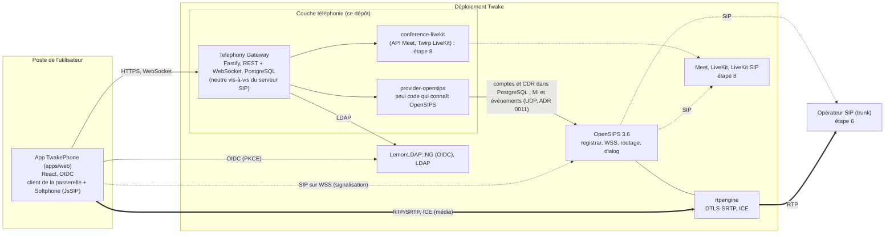
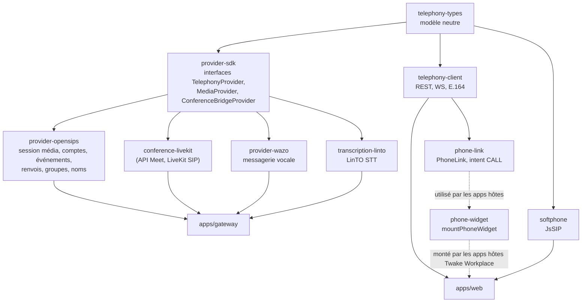
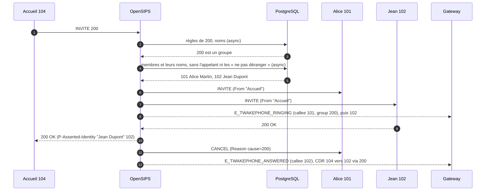

# Twake Phone : architecture et explication technique

Ce document décrit ce qui est réellement implémenté dans le dépôt (état à ce jour), pas seulement la cible du cahier des charges. Les écarts sont listés en §11, l'accès téléphonique aux salles Meet (Twake Visio) en §12 et le trunk SIP réel en §13. Le code du POC (app Phone Cozy, PBX de dev MiniPBX, `sip-media`, stack de dev) a été retiré à la PR 3c, son provider de référence (`provider-asterisk`, ARI) et le guide du PBX Asterisk externe qui l'accompagnait à la PR 4c ; ce que ce document en gardait est remplacé par ce que fait le MVP et par l'étape du plan qui refait chaque partie.

## 1. Vue d'ensemble

Trait plein : contrôle (REST, base de données). Pointillés : signalisation SIP. Double trait : audio.

**Deux zones.** La passerelle, ses providers et le serveur SIP sont déployés et exploités avec Twake (`docker/docker-compose.sip.yml` pour OpenSIPS, rtpengine et leur PostgreSQL). L'opérateur est **à l'extérieur** : joint par SIP et RTP, il peut être remplacé. Dans la zone Twake, seul `provider-opensips` connaît OpenSIPS ; c'est le seul provider de téléphonie depuis la PR 4c, qui a retiré `provider-asterisk`, le provider de référence du POC (ARI). Une ligne `asterisk` restée dans `provider_configs` est signalée au démarrage de la passerelle et son organisation n'a pas de provider : la supprimer, ou la remplacer par une configuration OpenSIPS.

**Deux plans séparés (cahier §25) :**

| Plan | Qui | Où |
|---|---|---|
| Contrôle : comptes, session média, présence, état des appels, événements, historique, renvois, groupes d'appel, noms affichés, réveil d'un navigateur sans fenêtre | Gateway et provider, via l'API REST/WebSocket du Gateway ; côté serveur SIP, les tables `subscriber`, `call_rules`, `call_groups`, `display_names` et `push_targets`, les CDR du module `acc`, les événements (`event_datagram`) et l'interface MI (`mi_datagram`) d'OpenSIPS | `apps/gateway`, `packages/provider-opensips` |
| Média et signalisation d'appel : SIP, ICE, DTLS-SRTP, attente, DTMF, transferts | Le navigateur directement vers le serveur SIP | `packages/softphone` (JsSIP) |

Le Gateway ne voit jamais l'audio.

## 2. Organisation du dépôt

| Paquet | Rôle | Dépend d'un fournisseur ? |
|---|---|---|
| `telephony-types` | `Call`, `CallState`, `Presence`, `Capabilities`, `TelephonyEvent`, `MediaSession`… | Non |
| `provider-sdk` | Contrat qu'un provider doit respecter (`originate`, `hangup`, `hold`, `subscribe`, `getCapabilities`…) | Non |
| `provider-opensips` | Session média `sip-webrtc` (URL WSS, domaine, poste, secret, ICE), comptes dans la table `subscriber` d'OpenSIPS (empreintes `ha1`), abonnement aux événements d'OpenSIPS par MI (`events.ts`) et suivi pur des appels et de la présence par poste (`tracker.ts`, ADR 0011), renvois et « ne pas déranger » dans la table `call_rules` (`call-rules.ts`, ADR 0013), groupes d'appel et noms de l'annuaire dans les tables `call_groups` et `display_names` (`call-groups.ts`, ADR 0014), postes à réveiller par une notification dans `push_targets` (`push-targets.ts`, ADR 0015), trunks et numéros directs dans les tables `trunks`, `dids`, `dispatcher` et `registrant`, plan de numérotation dans `dialplan` (`trunks.ts`, `numbering.ts`, ADR 0016). Aucune notion OpenSIPS n'en sort. | Oui, c'est son rôle |
| `provider-wazo` | Messagerie vocale sur Wazo Platform (étape 11a, ADR 0022) et parcours d'appel (11c-2, ADR 0028 : un groupe de wazo-confd par groupe séquentiel et par file) : une boîte par titulaire d'extension dans un contexte TwakePhone (wazo-confd), ses messages (wazo-calld), leurs événements (wazo-websocketd), lus pour le seul titulaire ; depuis l'étape 11d (ADR 0029), l'AMI d'Asterisk (appels en cours, `MixMonitor`, `ChanSpy`) et le serveur d'enregistrements pour la supervision. Aucune notion Wazo n'en sort. | Oui (Wazo), c'est son rôle |
| `transcription-linto` | Transcription d'un message par l'API HTTP de LinTO STT (étape 11b, ADR 0023), derrière `TranscriptionProvider` du SDK : `POST /transcribe`, délai, taille lue bornée, aucune redirection. | Oui (LinTO), c'est son rôle |
| `apps/gateway` | API publique `/api/v1`, annuaire LDAP, correspondances utilisateur↔poste, bus d'événements, registre des providers par tenant | Non |
| `telephony-client` | SDK front : REST (appels, historique, conférences), WebSocket avec reconnexion, normalisation et formatage E.164 | Non |
| `softphone` | Enveloppe JsSIP (§5) : enregistrement, appels, mute, hold, DTMF, transferts, compteurs RTP, reconnexion | Non |
| `phone-widget` | Monte le widget d'appel dans une app Twake Workplace (iframe d'intent) | Non |
| `phone-link` | `<PhoneLink>` et `requestCall` : rendre un numéro cliquable (intent `CALL`) | Non |
| `conference-livekit` | Accès téléphonique aux salles Meet : client de l'API externe de Meet, client Twirp de LiveKit (trunks SIP, participants, webhooks). Aucune notion LiveKit n'en sort. | Oui (LiveKit/Meet), c'est son rôle |
| `provider-ovh` | L'opérateur des trunks par son API (étape 10b, ADR 0021 ; contrat `OperatorProvider` de `provider-sdk`) : client signé de l'API d'OVHcloud, renvoi de repli des lignes (`forwardBackup`, `forwardNoReply`), CDR (`voiceConsumption`), numéros `0033…` mis en E.164. Écrit d'après la documentation publique et testé contre un faux serveur (`test/fake-ovh.mjs`), pas contre le vrai OVH. Aucune notion OVH n'en sort ; le rapprochement avec l'historique et l'état de la synchronisation, en base (`operator_state`, une seule passerelle relit OVH à la fois), sont dans la passerelle (`operator.ts`, `reconcile.ts`). | Oui (OVHcloud), c'est son rôle |
| `apps/web` | L'application TwakePhone (§6) | Non |

La règle d'architecture est tenue : tout ce qui touche à OpenSIPS (`subscriber`, `call_rules`, `call_groups`, `call_flows`, `display_names`, `push_targets`, `trunks`, `dids`, `dispatcher`, `registrant`, `dialplan`, realm, MI) reste dans `provider-opensips` (et dans la configuration d'OpenSIPS, `docker/opensips`), tout ce qui touche à LiveKit et Meet dans `conference-livekit`, tout ce qui touche à Wazo dans `provider-wazo` (et dans `docker/wazo`) ; `voicemail_boxes`, la table où OpenSIPS lit la boîte de chaque poste, est à `provider-opensips`. Remplacer le serveur SIP revient à écrire un autre provider.

## 3. Le Gateway

Fastify, TypeScript. Routes principales sous `/api/v1` :

| Route | Rôle |
|---|---|
| `GET /me`, `/me/endpoints`, `/me/media-session` | Identité, endpoints, session média (identité SIP + URL WSS) |
| `GET /capabilities` | Ce que le provider sait faire ; l'UI s'adapte |
| `GET/PUT /me/presence` | Présence normalisée (`available`, `busy`, `away`, `dnd`, `offline`) ; `PUT` répond la présence effective (ce que les autres voient) ; `away` et `dnd` peuvent avoir une fin (`until`, un an au plus) et un message (`message`, 140 caractères, une ligne), `choice` dit ce que la personne a choisi (ADR 0013) |
| `GET/PUT /me/forwarding` | Renvois de la personne vers le poste d'un collègue : `always`, `busy`, `noAnswer` (`target`, `delaySec` de 2 à 120) ; une cible qui n'est pas un poste de l'organisation, ou le sien, est refusée (400 avec `code`) ; 501 si le provider ne renvoie pas (capacité `forwarding`) |
| `GET/POST/DELETE /me/push-subscriptions` | Notifications d'appel sur ce navigateur (Web Push, ADR 0015) : `GET` dit si la plateforme les propose (`available`, capacité `push` et clés VAPID) et donne la clé publique (`publicKey`) ; `POST` garde l'abonnement du navigateur (`endpoint` d'un service de push accepté, en HTTPS sur 443 ; `keys.p256dh` et `keys.auth`), 10 par personne au plus, rien d'écrit quand il est connu, 409 `PUSH_SUBSCRIPTION_TAKEN` quand un autre tenant l'a ; `DELETE` l'oublie (`{"endpoint"}`). 20 changements par minute et par personne (429 au-delà), 404 sans poste, 501 sans notifications |
| `GET /presence` | Présence de tout le tenant, par poste, quand le provider la tient à jour (`realtime`) |
| `GET /admin/directory`, `POST /admin/directory/sync` | Source de l'annuaire, état et rapport de la synchronisation, synchronisation à la demande (administrateurs) |
| `GET/POST /admin/groups`, `PUT/DELETE /admin/groups/:number` | Groupes d'appel simultané de l'organisation (administrateurs, ADR 0014) : `GET` les liste avec leurs membres que personne ne tient (`vacant`) ; `POST` crée (`number`, `name`, `members` ; 409 `GROUP_EXISTS` si l'organisation a déjà ce numéro), `PUT` remplace un groupe existant (404 sinon) ; `name` une ligne de 64 caractères, `members` 1 à 12 postes de l'organisation (ou déjà membres), taille vérifiée avant toute recherche ; un numéro déjà pris (un poste, un compte de `subscriber`, le groupe d'une autre organisation) est refusé (409 `GROUP_NUMBER_TAKEN`, sans dire lequel), un membre qui n'est pas un poste aussi (400 `GROUP_MEMBER_NOT_EXTENSION`) ; vérification et écriture pendant qu'aucune synchronisation de l'annuaire ne tourne (10 s d'attente au plus, puis 503 `SYNC_RUNNING`, rien d'écrit) ; 501 si le provider n'a pas de groupes (capacité `groups`) |
| `GET /admin/trunks/status`, `GET /admin/users`, `POST /admin/alerts/:id/acknowledge` | Étape 7, pour les écrans d'administration (administrateurs) : l'état de chaque trunk (enregistrement, serveurs) que le provider lit dans OpenSIPS (MI `reg_list`, `ds_list` ; `available: false` quand il ne peut pas le dire, sans AOR ni mot de passe) ; les personnes qui ont un poste (identifiant, poste, nom, service) ; l'acquittement d'une alerte telle qu'elle a été vue (`lastAt` de sa dernière répétition affichée et `count`, le nombre de répétitions affiché, qu'une répétition augmente toujours même à la même milliseconde ; 409 `ALERT_CHANGED` si elle s'est répétée depuis, rien n'est acquitté sans avoir été vu ; qui et quand, le premier gardé ; une répétition après ouvre une nouvelle alerte ; `GET /admin/alerts?state=open\|acknowledged`). L'état des trunks est gardé 2,5 s par tenant (une lecture d'OpenSIPS pour tous les écrans ouverts ; oublié dès qu'un trunk est enregistré ou supprimé), une panne du MI écrite au journal quand elle commence et quand elle finit. Les trunks, numéros directs, droits et plafonds gardent leurs routes des étapes 6a et 6b (ADR 0016, 0017) ; `GET /admin/outbound` rend aussi la `version` lue, que `PUT /admin/outbound` vérifie quand elle est donnée (409 `OUTBOUND_STALE` si le réglage a changé depuis : un écran ouvert plus tôt n'annule jamais ce qu'un autre administrateur a fait), en base au moment d'écrire (un verrou PostgreSQL par tenant pour la transaction qui relit, remet le réglage au provider puis l'écrit, que l'écriture porte une version ou non : deux passerelles, ou un tour de 10 s écoulé, ne gardent jamais deux changements faits depuis la même version, et un changement refusé n'atteint jamais OpenSIPS ; le provider qui échoue, ou l'écriture, et il reçoit de nouveau ce qui est gardé) ; `PUT /admin/outbound/users/:id` prend aussi la `version` (l'app l'envoie toujours ; 409 si le réglage a changé depuis, l'affectation de cette personne comprise) et rend le réglage entier qu'il fait, avec sa version, et 32 profils au plus (400 `PROFILE_LIMIT`) |
| `POST /calls` (+ `Idempotency-Key`) | Crée un appel (click-to-call) |
| `GET /calls/history`, `DELETE /me/history` | Historique serveur de l'appelant (filtres, curseur) et effacement |
| `POST /calls/:id/{hangup,hold,resume,dtmf,transfer,answer,reject}` | Actions sur un appel, réservées à ses participants (voir ci-dessous) |
| `POST /ws-ticket`, `GET /ws` | Ticket à usage unique, puis flux d'événements temps réel : d'abord `{"type":"stream.ready"}` (la session est acceptée, le client peut relire l'état), puis ceux de l'utilisateur (appels) et ceux du tenant (`presence.changed`, avec le poste) |
| `POST /conferences`, `GET/DELETE /conferences/:id`, `POST /conferences/:id/participants`, `DELETE …/participants/:pid`, `POST …/participants/:pid/mute` | Accès téléphonique à une salle Meet (§12) ; pour la salle d'un appel (étape 8b), chaque participant lu porte son heure d'entrée en millisecondes (`joinedAt`, l'heure où la passerelle a composé son appel, sinon celle de LiveKit), et `GET` avec l'en-tête `X-Twake-Call` (le Call-ID de son propre appel) marque ce participant (`you`) |
| `POST /webhooks/livekit` | Webhooks LiveKit, authentifiés par signature (§12) |
| `/health`, `/ready`, `/docs`, `/openapi.json` | Exploitation |

Mécanismes :

- **Authentification** (`auth.ts`), choisie par `AUTH_MODE` (refus de démarrer si la configuration est incomplète) :
  - `cozy` (défaut) : le client envoie le jeton d'application Cozy qu'il a déjà et l'URL de son instance (`X-Cozy-Instance`). Le Gateway demande à **cette instance** (`GET /settings/instance`) à qui appartient le jeton : le stack fait autorité, il n'y a ni clé à partager ni seconde connexion. L'instance doit correspondre à `COZY_INSTANCE_PATTERN` (protection contre l'usage du Gateway pour joindre un hôte arbitraire). Un jeton inconnu donne 401, une panne du stack 503. Les jetons vérifiés sont mis en cache une minute.
  - `jwt` : jeton OIDC signé, vérifié sur le JWKS du SSO (émetteur, audience, expiration, algorithme).
  - Dans les deux cas l'identité porte aussi l'**e-mail** (attribut `email` de `/settings/instance`, revendication `email`), que §12 utilise pour agir chez Meet au nom de la personne.
  - `dev` : jeton `dev:<user>`, jamais en production (le Gateway refuse de démarrer avec `NODE_ENV=production`).
- **Ticket WebSocket** : un navigateur ne peut pas poser d'en-tête sur un WebSocket. Le client échange ses identifiants contre un ticket à usage unique valable 30 s (`POST /ws-ticket`), puis ouvre `/ws?ticket=…`. Aucun jeton durable ne circule dans une URL.
- **Persistance** (`store/`) : PostgreSQL (`provider_configs`, `user_mappings` avec service, source et date de synchronisation, `call_history`, `sip_credentials`, `conferences`, `favorites`, `user_presence`, `push_subscriptions`, `vapid_keys`), migrations SQL appliquées au démarrage. Toute méthode du `Store` prend le tenant. Un contrat de tests identique tourne sur l'implémentation mémoire et sur PostgreSQL, dont l'isolation entre tenants.
- **Présence choisie et renvois** (ADR 0013) : ce que la personne choisit (absent, « ne pas déranger », sa fin, son message) est rangé par tenant et par personne (`user_presence`), oublié à sa date, et remis au provider à son démarrage avec le poste du jour, puis après chaque synchronisation de l'annuaire qui change une attribution. Le provider OpenSIPS écrit les renvois et le « ne pas déranger » dans `call_rules`, qu'OpenSIPS lit à chaque INVITE (sans bloquer, avec un `statement_timeout` court) : renvoi immédiat, puis, pendant un « ne pas déranger », renvoi sur non-réponse, sinon sur occupation, sinon refus 480 (`Twake-Dnd: 1`) avec le message (`Twake-Dnd-Message`) que le softphone montre à qui a composé ce poste, et à lui seul ; trois renvois au plus, jamais vers l'appelant ni un poste déjà traversé. Chaque ligne garde le titulaire du poste et celui de chaque cible : à chaque changement d'attribution que la passerelle voit (son démarrage, une synchronisation), la ligne d'un poste qui change de titulaire est supprimée avec son « ne pas déranger », et un renvoi dont la cible change de titulaire aussi ; un nouveau titulaire n'hérite de rien. Un changement fait à la main dans la base, hors synchronisation, attend le prochain démarrage. Les écritures de présence et de renvois d'un tenant passent l'une après l'autre avec la remise au provider, chacune bornée (requêtes de 5 s au plus, 10 s d'attente au plus derrière la précédente) et refusée (409) si la personne ne tient plus le poste résolu avec la requête ; une base OpenSIPS ne sert qu'un tenant. OpenSIPS ne lit rien en `failure_route` : les règles des cibles de renvoi sont lues avant la sonnerie.
- **Notifications d'appel** (`push.ts`, ADR 0015) : à l'événement `call.wake` du provider (un appel retenu par OpenSIPS pour un poste sans fenêtre), la passerelle envoie à chaque navigateur abonné de la personne un message Web Push chiffré pour lui (`aes128gcm`), signé par ses clés VAPID, urgent, valable le temps de l'attente (bibliothèque `web-push`) ; il porte l'appelant (numéro, nom de l'annuaire), le groupe composé et l'identifiant de l'appel. Dès que l'appel n'attend plus la personne, un second message remplace la notification : appel manqué, répondu, pris par un collègue du groupe (`call.taken` du provider) ou terminé ; l'appel est noté avant la lecture des noms, et les messages d'un appel partent dans l'ordre. Un abonnement que le service de push dit disparu (404, 410) est supprimé, et le provider l'apprend pour cette personne seule (`setWakeableOne`, sinon `setWakeable`) ; ceux d'une personne qui n'a plus de poste partent à la réconciliation. Les clés VAPID viennent de l'environnement ou sont faites au premier démarrage, gardées chiffrées en base (`SECRETS_KEY`). Seuls les services de push des navigateurs sont joints (`PUSH_SERVICES`).
- **Appartenance des appels** : le Gateway retient, pour chaque appel, les utilisateurs dont les événements l'ont porté (et celui qui l'a lancé). Toute action `/calls/:id/…` d'un autre utilisateur répond 404, comme pour un appel inexistant. La table est en mémoire.
- **Tenants** : l'identité authentifiée fixe le tenant et l'utilisateur, jamais la requête. Le provider est celui du tenant (`registry.ts`), la correspondance utilisateur/extension est par tenant.
- **Annuaire** (`contacts.ts`, `ldap-directory.ts`) : les personnes que l'on peut appeler viennent du LDAP de l'organisation (`LDAP_*`), jamais mises en cache ; `GET /directory?q=` cherche chaque mot par préfixe sur nom, prénom, courriel, service et identifiant, et un numéro tapé par ses derniers chiffres ; sans `q`, il rend les premières personnes de l'annuaire (la liste à côté du clavier) ; la réponse dit si elle est tronquée. Un annuaire ne sert qu'un tenant (`LDAP_TENANT`) : les autres reçoivent 501, comme un déploiement sans annuaire (`/me` l'annonce dans `features.directory`). Une connexion liée par requête, avec délai de connexion et d'opération ; une panne du LDAP répond 503 sans en dire la cause au client. Les recherches sont limitées à 30 par 10 secondes et par utilisateur. Les favoris (`favorites`, 100 par personne) sont des identifiants de l'annuaire, résolus à la lecture : une personne qui quitte l'annuaire disparaît des favoris.
- **Synchronisation des comptes** (`directory-sync.ts`) : quand l'annuaire sait quel attribut porte le poste (`LDAP_ATTR_EXTENSION`), ses personnes deviennent des correspondances utilisateur ↔ poste (`user_mappings`, avec le nom, le service, `source = ldap` et la date), toutes les `LDAP_SYNC_INTERVAL` et à la demande (`POST /admin/directory/sync`). Le numéro d'un groupe d'appel n'est donné à personne (un conflit dans le rapport ; ADR 0014), et une création ou une modification de groupe attend la fin d'une exécution en cours (10 s au plus, puis 503 `SYNC_RUNNING`), la suivante attendant la sienne (`exclusive`). Une seule exécution à la fois par processus (`POST` répond 202, l'écran suit `GET /admin/directory`) ; le rapport (vus, avec poste, créés, mis à jour, retirés, conflits) est gardé en mémoire. L'annuaire fait foi pour les personnes qu'il connaît ; une correspondance manuelle d'une personne inconnue de l'annuaire n'est ni retirée ni dépossédée de son poste ; un poste donné à deux personnes reste à celle qui l'a déjà, sinon à la première listée ; un conflit ne coûte jamais sa correspondance à la personne (tout est tranché avant la première écriture) ; un listing vide ne retire rien (filtre ou compte lecteur en cause) ; les lignes à réécrire sont retirées avant les écritures, pour que deux personnes puissent échanger leurs postes. Les écritures ne sont pas dans une transaction et le verrou est en mémoire : avec plusieurs réplicas, deux exécutions simultanées se signalent des conflits que l'exécution suivante répare ; un verrou en base viendra avec l'exploitation multi-réplicas (ADR 0009).
- **Administrateurs** (`admin.ts`) : le rôle `ADMIN_ROLE` dans la revendication `JWT_ROLES_CLAIM` du jeton (aucune revendication lue si la variable est absente), ou un utilisateur de `ADMIN_USERS`. `/me` le dit dans `features.admin` ; les routes `/admin/*` répondent 403 aux autres. Hors mode `dev` (où l'en-tête `x-dev-roles` est cru, comme `x-dev-user`), rien dans une requête ne peut se déclarer administrateur.
- **En-têtes de sécurité** (`security.ts`) : toute réponse porte `Content-Security-Policy: default-src 'none'; frame-ancestors 'none'`, `X-Content-Type-Options`, `X-Frame-Options`, `Referrer-Policy` et `Cache-Control: no-store` (l'interface OpenAPI sous `/docs` garde une politique qui la laisse tourner) ; `Strict-Transport-Security` quand `HSTS_MAX_AGE` est renseigné (`0` le retire, `HSTS_INCLUDE_SUBDOMAINS=1` l'étend).
- **Historique** : chaque fin d'appel vue par le provider est enregistrée pour l'utilisateur concerné (`history.ts`, idempotent sur l'identifiant d'appel) ; avec OpenSIPS, les deux parties de l'appel reçoivent la leur (sortant, entrant, manqué, refusé), et l'app recharge les Récents à chaque fin d'appel reçue sur le WebSocket. `GET /calls/history` filtre par direction, statut (`missed`, `declined`, `answered`, `failed`), numéro, dates et pagine par curseur ; `DELETE /me/history` efface l'historique de l'appelant et répond `{ deleted, voicemailErasure? }` (`HistoryErasure` de `@twake/telephony-types`) : avec une messagerie, `asked` (l'effacement de ses messages est demandé à la Gateway qui écrit les boîtes, fait à sa prochaine passe) ou `limited` (au-delà des quelques effacements par heure permis à chacun : l'historique est effacé quand même, les messages pas cette fois).
- **Secrets SIP** (`sip-secrets.ts`) : un secret aléatoire par utilisateur, généré par le Gateway, écrit sur le serveur SIP par le provider (empreintes `ha1` dans `subscriber` pour OpenSIPS) puis conservé chiffré (AES-256-GCM) en base. Rien n'est stocké dans le front : le navigateur ne le reçoit que par l'appel authentifié `media-session`. Si l'écriture échoue, rien n'est enregistré.
- **Secrets de configuration** : la configuration d'un provider ne contient que des références (`env:OPENSIPS_DB_URL`), résolues au démarrage.
- **Registre de providers par tenant** (`registry.ts`) : point d'extension multi-tenant et multi-provider. Une configuration d'un type que la passerelle ne construit plus (`asterisk`, d'avant la PR 4c) est signalée au démarrage et ignorée : son tenant n'a pas de provider (404 sur ce qui en demande un).
- **Bus d'événements** (`events.ts`) : diffuse chaque appel à ses seuls participants et chaque changement de présence à tout le tenant ; la passerelle garde la présence courante par poste pour `GET /presence`. Mémoire aujourd'hui, interface prévue pour Redis (qui devra aussi porter la présence entre réplicas).
- **Prêt à fonctionner** : `/ready` est vert tant que tous les providers sont `CONNECTED` ou `DEGRADED` (les appels passent ; le corps donne alors `degraded`, leur nombre, et `reasons`, leurs raisons en quelques mots sans adresse), 503 sinon ; `originate` refuse (503) si la liaison PBX est coupée.
- Les journaux masquent les en-têtes d'autorisation et les tickets.

## 4. Ce qu'OpenSIPS fait de chaque appel (`provider-opensips`, `docker/opensips`)

Le provider de référence du POC (`provider-asterisk`, ARI, avec son pont d'appels et ses états d'appareil `Stasis:`) a été retiré à la PR 4c : le click-to-call par le serveur, qu'il était seul à faire, attend un provider qui le fasse (le softphone compose lui-même). Avec OpenSIPS, la passerelle ne pilote pas les appels : elle écrit des tables que la configuration d'OpenSIPS lit à chaque INVITE, sans bloquer (`sqlops` en asynchrone, `statement_timeout` court, rien en `failure_route`), et entend ce qui se passe par ses événements (ADR 0011).

| Table | Écrite par la passerelle quand | Lue par OpenSIPS pour |
|---|---|---|
| `subscriber` | une personne reçoit ou change de secret (la ligne porte son titulaire, `holder`) ; à la réconciliation, un compte écrit pour quelqu'un qui ne tient plus le poste est supprimé, et ses fenêtres retirées d'OpenSIPS (MI `ul_rm`) ; jamais une ligne sans titulaire, rien sur une liste de correspondances vide ni au-delà de max(10, un quart des comptes écrits) | l'authentification digest (`ha1`), et savoir qu'un numéro est un poste |
| `call_rules` | une personne règle ses renvois ou son « ne pas déranger » (ADR 0013) | renvoyer ou refuser l'appel |
| `call_groups` | un administrateur crée, change ou supprime un groupe (un poste que plus personne ne tient reste membre) | faire sonner les membres d'un groupe (ADR 0014) |
| `display_names` | chaque réconciliation (démarrage, synchronisation de l'annuaire) | montrer à chaque partie le nom que l'annuaire donne à l'autre (ADR 0014) |
| `push_targets` | une personne active ou coupe les notifications d'appel sur un navigateur (sa ligne seule), un service de push dit qu'un abonnement a disparu, chaque réconciliation (le poste et son titulaire ; une ligne dont le titulaire ne tient plus le poste part) ; `alive_until` repoussé à chaque renouvellement de l'abonnement aux événements, une fois que la passerelle a reçu l'événement `E_TWAKEPHONE_PROBE` qu'elle lève (elle entend OpenSIPS), ramené à maintenant à l'arrêt de la passerelle pour les lignes qu'elle a repoussées la dernière | retenir l'appel d'un poste sans fenêtre pendant que la notification réveille le navigateur (ADR 0015) |
| `trunks`, `dids` | un administrateur change un trunk ou un numéro direct (`setTrunks`, l'ensemble du tenant d'un coup, depuis `trunk_configs` et `direct_numbers` de la passerelle) | le trunk d'un appel sortant (celui du numéro direct de l'appelant, sinon le premier), son identifiant et le numéro présenté ; le poste ou le groupe d'un numéro appelé de l'extérieur (ADR 0016) |
| `dispatcher`, `registrant` | les mêmes changements, suivis de `ds_reload` ou `reg_reload` par MI seulement pour ce qui a changé | les serveurs de l'opérateur sondés et essayés dans l'ordre, ses adresses admises ; l'enregistrement du trunk |
| `dialplan` | jamais : remis par `trunk.sql` à chaque démarrage d'OpenSIPS (`numbering.ts`) | mettre un numéro en E.164, reconnaître une urgence, classer la destination d'un appel sortant |

### 4.1 Groupes d'appel simultané

Un groupe est un numéro à lui (jamais celui d'un poste ni d'un compte de `subscriber` : la passerelle refuse les deux sens, et un poste l'emporterait dans OpenSIPS) et 1 à 12 postes membres. Composé, il fait sonner à la fois les fenêtres enregistrées des membres, sauf l'appelant et les membres en « ne pas déranger », 12 au plus (`MAX_BRANCHES` de l'image OpenSIPS) : la première fenêtre de chaque membre d'abord, dans leur ordre, puis les deuxièmes, et ainsi de suite ; une fenêtre laissée de côté est écrite dans le journal d'OpenSIPS. La première qui répond prend l'appel, tm annule les autres avec `Reason: SIP;cause=200`, que le softphone rend « pris sur un autre poste ». Les renvois des membres ne s'appliquent pas, et un groupe n'est pas une cible de renvoi. Un membre qui refuse ne coupe pas ses collègues (`disable_6xx_block`, le script annulant lui-même les autres fenêtres d'un appel direct refusé, sauf celles qui n'ont encore rien répondu : leur `fr_timeout`, 5 s, retient alors le refus). Personne à faire sonner : 480 et un appel manqué pour le groupe. Personne ne prend l'appel : le refus seulement si toutes les fenêtres ont refusé, sinon 480 (un membre refuse ou est occupé, les autres ne répondent pas). Un poste que personne ne tient reste membre (l'écran le marque « poste libre ») et sonne de nouveau dès qu'il a un titulaire.

L'appelant garde le numéro du groupe dans ses Récents ; le membre qui répond a l'appel entrant ; si personne ne répond, chaque membre qui a sonné a un appel manqué, et `missed_calls` en a un pour le groupe. Un membre est « en communication » le temps de la sonnerie.

### 4.2 Noms de l'annuaire

Le nom qu'un téléphone affiche pour son correspondant ne vient plus de l'autre téléphone. OpenSIPS remplace le nom affiché du `From` par celui que l'annuaire donne à l'appelant (`uac_replace_from` sur le nom seul : l'URI, les étiquettes, l'authentification, `Replaces` et les transferts n'en dépendent pas ; un appelant sans nom dans l'annuaire n'en a pas), et pose dans la réponse 2xx un `P-Asserted-Identity` avec le nom et le poste de qui a répondu (le poste composé, la cible d'un renvoi, le membre d'un groupe) ; ceux que les téléphones envoient (`P-Asserted-Identity`, `P-Preferred-Identity`, `Remote-Party-ID`) sont retirés de l'INVITE, des requêtes en dialogue et de toutes les réponses relayées. Quand les noms n'ont pas pu être lus (base en panne, tables absentes), le `From` reste celui du téléphone et la réponse n'affirme que le poste : un appel n'attend ni n'échoue jamais pour un nom. Les renvois et le « ne pas déranger » ne dépendent pas de ces tables : une lecture en échec est refaite une fois (une connexion que la base a fermée se rouvre), et seulement quand la base dit qu'une de ces tables manque (`to_regclass`), la lecture est refaite sans elles et OpenSIPS cesse de les nommer pendant 30 s. Un numéro dont les règles n'ont pas pu être lues deux fois peut être un groupe : sans personne enregistré, 480, jamais 404. Les noms sont nettoyés à l'écriture et à la lecture (une ligne, ni guillemet ni barre oblique inverse) : ils ne vont que dans un nom affiché entre guillemets.

### 4.3 Réception sans fenêtre

Un appel vers un poste qui n'a aucune fenêtre enregistrée (ou seulement sur des WebSocket mortes) et qui est dans `push_targets` n'est plus refusé : OpenSIPS fait patienter l'appelant (180) et garde la transaction ouverte (`t_wait_for_new_branches`) le délai du renvoi sur non-réponse, sinon `PUSH_WAIT_SEC` (30 s par défaut), et lève `E_TWAKEPHONE_WAKE`. Le provider en fait `call.wake`, la passerelle envoie la notification ; la cliquer ouvre l'app sur `/?call=<id>`, qui se connecte, s'enregistre, et `event_routing` (`E_UL_CONTACT_INSERT` et `E_UL_CONTACT_UPDATE`, un onglet revenu avec le même Contact, filtrés sur le poste) fait sonner cette fenêtre dans la même transaction (`t_inject_branches`) ; une fenêtre enregistrée juste avant ce suivi sonne sans réveil. Personne au bout du délai : 408, traité comme une non-réponse (renvoi, sinon appel manqué) ; une fenêtre ouverte tard sonne encore le délai entier. Seulement tant qu'une passerelle écoute (`alive_until`), jamais pour un INVITE avec `Replaces`. Chaque destination sonne une fois par appel (`branch_route[tried]`). Dans un groupe, les membres réveillables sans fenêtre attendent avec les autres qui sonnent déjà, comptés par membre, chacun gardant sa place parmi les 12 ; un groupe dont toutes les fenêtres sont mortes réveille ses membres. Le navigateur doit tourner ; un navigateur quitté ne reçoit rien (ADR 0015).

### 4.4 Trunk vers l'opérateur

Étape 6a, ADR 0016. Un numéro composé que le premier jeu de `dialplan` reconnaît n'est pas un poste : il est mis en E.164 et classé (l'outre-mer avant le fixe et le mobile, même numéroté en +33 ; les indicatifs d'aucun pays, satellites compris, comme surtaxés ; 116xxx gratuits, 118xxx surtaxés). Un numéro d'urgence part toujours vers le trunk, tel que composé, depuis le numéro direct de l'appelant ; sans trunk (403) ou quand il échoue (503), `emergency` : appeler depuis un autre téléphone. Il ne dépend pas de la base (le trunk par défaut lu toutes les 15 s quand celui de l'appel ne peut être lu ou n'a aucun serveur en service), repart par le trunk par défaut quand le sien le refuse ou échoue, n'est jamais coupé par `TRUNK_MAX_CALL_SEC` et son téléphone n'est jamais interrogé. Un poste ou un groupe a 2 à 6 chiffres, le premier n'étant pas 0. Les numéros courts que le plan route ou refuse ne sont ni un poste, ni un groupe, ni la cible d'un numéro direct (la passerelle les refuse). Le reste sort si le trunk le permet (`allowed` : fixe, mobile, gratuit et 0806 à 0809 par défaut, l'outre-mer à la demande, l'étranger seulement vers les indicatifs que le trunk liste, `countries`, jamais le surtaxé ni les tranches surtaxées, à coût partagé ou personnelles connues d'un pays listé ; le plan nord-américain par zone, `1` pour les États-Unis et le Canada, `1876` pour la Jamaïque…), sinon il est refusé avant que rien ne parte (403 surtaxé, outre-mer ou étranger, 484 numéro incomplet, 503 sans trunk ou trunk qui ne marche pas), la raison dans `Twake-Call-Refused`, que le softphone rend (`endRefusal`) et l'app explique, et qu'OpenSIPS retire de toute réponse relayée. Un numéro direct de la plateforme sonne son poste ou son groupe sans passer par l'opérateur. Un appel qui sort prend le trunk du numéro direct de l'appelant (sinon le trunk par défaut), présente ce numéro (`From`, et `P-Asserted-Identity` si le trunk le veut), met le numéro appelé au domaine du trunk dans le `To`, ne laisse partir que les en-têtes qu'un appel demande (`route[trunk_headers]`), chacun une fois (400 sinon), et que du SDP (415 sinon), un `Contact` sans le poste (`route[trunk_contact]`), part du socket du trunk vers le premier serveur que `dispatcher` tient pour vivant, répond une fois par serveur au défi de l'opérateur (`uac_auth` ; sinon 503 `no-trunk`, jamais le défi au navigateur), et passe au serveur suivant seulement si celui-ci n'a rien répondu ou a répondu 5xx avant de sonner (180, 183 : le 100 ne compte pas) ; une redirection (3xx) devient 480. Les autres adresses de l'opérateur (`sources`) sont dans un jeu du `dispatcher` qu'aucun appel ne vise. rtpengine donne à l'opérateur du RTP/AVP simple limité aux codecs du trunk (G.711), au navigateur son DTLS-SRTP, y compris quand l'offre vient dans un 2xx (re-INVITE sans SDP, offre tardive). Rien dans un appel avec l'opérateur ne lui fait passer un appel : REFER refusé, `Replaces` vers un tel appel refusé (`transfer-external`, que l'app explique). Sur le socket du trunk, hors dialogue, seules les adresses du `dispatcher` sont admises ; dans un dialogue, une autre adresse l'est pour le côté de l'opérateur d'un de ses appels (BYE, re-INVITE, ACK, UPDATE, PRACK de sa passerelle média, toujours vers le téléphone de l'appel) ; un INVITE est mis en E.164, cherché dans `dids` (404 sinon), et suit ensuite le chemin de tout appel (renvois, « ne pas déranger » sans rien en dire à l'opérateur, groupes, réveil). Un appel avec l'opérateur se raccroche quand le téléphone de la plateforme ne répond plus aux OPTIONS qu'OpenSIPS lui envoie dans l'appel toutes les `CALL_PING_SEC` (onglet fermé, veille, réseau perdu ; un seul OPTIONS sans réponse en `CALL_PING_TIMEOUT_SEC` suffit, le média est alors libéré dans rtpengine), ou au bout de `TRUNK_MAX_CALL_SEC` (pas un appel d'urgence) ; jamais parce que l'app a perdu sa connexion à la passerelle. Le CDR et `missed_calls` portent les numéros en E.164 (`anonymous` pour un appelant masqué ou qui le demande, `Privacy: id` ou `user`) : l'historique et les Récents les montrent comme les autres. Les droits par profil, plafonds, `fraud_detection` et repli viennent en 6b (paragraphe suivant) ; la localisation des urgences reste à faire.

Étape 6b, ADR 0017. Pour chaque appel extérieur, une fois le trunk lu, OpenSIPS demande à part ce qui s'applique à l'appelant (`twake_outbound()`, une requête asynchrone bornée dans le temps) : les classes de son profil, parmi celles du trunk (403 `rights`), ses plafonds et ceux de l'organisation (appels simultanés par les profils de dialogue, sous un verrou ; appels et minutes du jour et du mois, jours et mois de Paris, lus dans `outbound_usage`, que des déclencheurs mettent à jour quand `acc` ou `missed_calls` écrit le CDR d'un appel marqué `out` : aucun CDR n'est relu pendant un appel, et un déclencheur n'attend jamais plus de 200 ms un verrou : ce qu'il n'a pas pu compter l'est au CDR suivant) : 403 `limit` ; les minutes restantes se partagent entre les appels en cours, dans PostgreSQL sous un verrou (`outbound_reservations`) : chaque appel reçoit à son départ ce qui reste divisé par les appels en cours plus lui (tout s'il est seul, jamais plus que la durée critique de son numéro), et est coupé quand c'est épuisé, refusé si c'est sous `TRUNK_MIN_CALL_SEC`. Puis les seuils de `fraud_detection` (403 `fraud` au seuil critique). Sans réponse à temps, l'appel est refusé (503 `policy-unavailable`). Un appel d'urgence ne fait jamais cette demande et son identité n'en dépend pas. Sans réglage, des plafonds par défaut bornent le coût (2 appels à la fois et 300 minutes par jour par personne, 20 et 3000 pour l'organisation, la durée d'un appel par les seuils de `fraud_detection`). Les dialogues sont gardés en base (`db_mode` 2) : OpenSIPS redémarré reprend les appels décrochés, leur durée maximale et leur CDR, rend les minutes réservées aux appels perdus (ceux qui sonnaient) et borne à 2 h les appels d'urgence repris ; les compteurs de `fraud_detection` repartent de zéro, les plafonds non. La passerelle garde les règles (`outbound_policies`), les remet au fournisseur à chaque changement et à son démarrage, et range les alertes (`telephony_alerts`, une par sorte, sujet et heure, avec leur nombre ; purgées après 90 jours) pour les administrateurs, jamais pour les personnes ; son journal ne nomme ni le numéro appelé ni la personne (le poste y est un HMAC à clé tirée de `SECRETS_KEY`). Un appel de l'opérateur que personne ne prend (sans réponse, occupé partout, injoignable) sonne le repli du numéro direct, sinon du trunk : un poste ou un groupe de la plateforme, jamais après un refus, un « ne pas déranger » ou le refus d'un groupe ; un numéro de la plage que personne n'a reçoit 404. Rien n'est renvoyé à l'opérateur (pas de 302) : un renvoi vers l'extérieur se programme chez lui.

### 4.5 Messagerie vocale

Étape 11a, ADR 0022. Un appel que rien d'autre ne prend va à la boîte de l'extension composée, sur l'Asterisk de Wazo, depuis un socket d'OpenSIPS qui n'entend que lui : après les renvois et le repli d'un numéro direct, sur un « ne pas déranger », occupé ou refusé (annonce « occupé »), sans réponse, sans personne à faire sonner ni fenêtre joignable (annonce « indisponible ») ; jamais pour un groupe, une salle, une conférence, un INVITE avec `Replaces` ni un appel annulé. OpenSIPS lit la boîte dans `voicemail_boxes` avec les règles du poste et la donne à Asterisk dans deux en-têtes qu'il est seul à poser (`X-Twake-Mailbox`, `X-Twake-Voicemail`), avec l'offre de rtpengine faite pour les fenêtres de la personne. Le repli d'un numéro direct vers un groupe que personne ne prend mène aussi à la boîte (le suivi quitte alors le groupe : personne ne l'a « pris »).

Les bornes des appels vers les boîtes sont celles d'OpenSIPS : par appelant (compté par une empreinte à clé de son numéro, jamais le numéro ; un numéro masqué à la demande de l'appelant compté comme le sien, sans être montré), pour ceux qui n'ont aucun numéro ensemble à une même boîte et à toutes (une part bornée des places, si bien que ceux qui ont un numéro en gardent toujours ; une alerte quand l'un de ces plafonds ou celui de la plateforme est atteint, aucune pour une part laissée à zéro exprès), pour tous et par heure, toujours par boîte (`VOICEMAIL_CALLS_*`, un appel compté dans l'heure seulement quand la boîte le prend ; les compteurs de l'heure repartent de zéro à chaque redémarrage d'OpenSIPS). Une boîte qui ne répond pas rend à l'appelant ce qu'il aurait eu sans elle ; un Asterisk muet écarte les boîtes 30 s. Un appel vers une boîte dure `VOICEMAIL_MAX_CALL_SEC` au plus, chaque boîte a ses bornes (nombre de messages, durée d'un message), et l'enregistrement passe en flux, plafonné ; un appelant de l'extérieur n'entend jamais l'extension. Pour l'appelant, l'appel a abouti (`E_TWAKEPHONE_VOICEMAIL`, CDR `via = voicemail`, « Messagerie vocale » dans ses Récents, « Messagerie de … » dans son panneau, `voicemail: true` dans ses webhooks) ; il ne compte ni dans les plafonds ni dans l'anti-fraude ; pour la personne, c'est un appel manqué (ou refusé), sans qu'elle soit jamais en communication avec sa boîte.

La passerelle synchronise les boîtes (`provider-wazo` : une par titulaire, reconnu par une empreinte HMAC, à un numéro qui est le sien et ne change jamais, si bien qu'elle la garde avec ses messages quelle que soit son extension et que Wazo ne déplace jamais une boîte ; la boîte de qui n'a plus d'extension est mise de côté avec ses messages, supprimée après 7 jours seulement une fois vide) sur la seule passerelle qui tient le bail de la messagerie du tenant (`voicemail:<tenant>`, pris seulement par une passerelle qui a Wazo, d'abord par une qui le joint à cet instant, et redemandé avant chaque écriture dans Wazo ou dans `voicemail_boxes`, une écriture dans Wazo bornée à 10 s : une passerelle qui l'a perdu en cours de tour s'arrête là), quand elle le prend, quand une passerelle, quelle qu'elle soit, a marqué un changement de titulaire (`voicemail:changed`, relu toutes les 2 s), quand un administrateur lève la garde et toutes les 5 minutes, hors du tour du tenant ; elle réessaie tant que Wazo ne répond pas sans rien vider (une alerte d'administration après 15 minutes d'échecs), et les donne à OpenSIPS ; une passerelle sans Wazo ne touche pas `voicemail_boxes`.

Une extension donnée à quelqu'un d'autre est retirée de `voicemail_boxes` par la passerelle qui fait le changement, après avoir marqué le changement (réessayé s'il échoue), avant tout changement dans Wazo, et aucun tour plus ancien ne la remet, de quelque passerelle qu'il soit : la base d'OpenSIPS écarte, dans la transaction de l'écriture, toute extension retirée après que le tour a lu les titulaires (un tour ainsi écarté est relancé après une pause d'une seconde), et refuse l'écriture d'un bail plus ancien que le dernier écrit (sa génération ; une passerelle refusée alors qu'elle le tient rend le bail, et le dit par une alerte quand elle est refusée encore sous le bail suivant ; la barrière se remet par `VOICEMAIL_FENCE_RESET`, qui garde la numérotation des retraits). Une extension laissée à personne garde sa ligne jusqu'au tour (au plus 15 minutes quand la synchronisation échoue, hors masse). Une mise de côté ou une suppression de masse (un annuaire revenu à moitié vide, un `LDAP_ATTR_ID` changé), comptée sur les boîtes en service, attend qu'un administrateur la confirme, pour les chiffres qu'il a vus (`/api/v1/admin/voicemail`, depuis n'importe quelle passerelle, avec ce que fera la levée, l'historique des levées et une alerte `held-back`) ; personne de nouveau n'a de boîte entre-temps, et une mise de côté levée reste réversible. Un événement de message va au titulaire de sa boîte telle que Wazo l'a maintenant.

Les messages sont gardés 30 jours (`VOICEMAIL_RETENTION_DAYS`), dans toutes les boîtes, celles mises de côté comprises. L'effacement de l'historique de l'étape 10 les efface aussi, dans ses boîtes mises de côté et sous son numéro dans le spool, par une demande que le tour de la passerelle qui tient le bail applique, sans jamais créer de boîte (avec Wazo, 5 demandes par heure et par personne, comptées par chaque passerelle, l'historique étant effacé au-delà ; un administrateur la fait pour une personne partie de l'annuaire, `POST /api/v1/admin/voicemail/erase`, 5 par heure pour le tenant). Quitter l'annuaire n'efface aucun message : la boîte va de côté, rendue à la personne listée de nouveau sous quelque forme que ce soit. Les boîtes connaissent chacun par son identifiant et son rang de titulaire (`voicemail:holder:<personne>`, tenu par `directory-sync.ts`) : un identifiant listé de nouveau seulement après une absence confirmée à chaque synchronisation pendant `VOICEMAIL_GRACE_DAYS` jours est quelqu'un d'autre, qui a une boîte neuve et vide ; celle d'avant reste de côté, jamais montrée, jusqu'à la fin de sa conservation. Avec `VOICEMAIL_RETENTION_DAYS=0` (aucune purge par l'âge), la boîte de quiconque est sans extension, encore dans l'annuaire ou non, est supprimée avec ses messages après le délai de grâce, jamais dans le tour qui l'a mise de côté, et ce délai est d'un jour au moins. La passerelle sert les messages de la personne et elle seule (`/api/v1/voicemails`, `voicemail.*` sur sa WebSocket). Wazo ne fait sonner personne : `mid_registrar` vient avec l'étape 11c.

Étape 11b, ADR 0023. Seule la passerelle qui tient le bail `voicemail:<tenant>` inscrit un nouveau message dans `voicemail_transcripts` (une ligne par message, avec le titulaire de la boîte), le fait transcrire par LinTO STT (`transcription-linto`) et envoie l'avis du bot Matrix au titulaire ; chaque écriture de cette table porte le bail et sa génération, refusée par la base dans la même requête si le bail n'est plus tenu. Une passerelle qui prend le bail reprend ce qui reste dû, et rattrape les événements manqués en comparant les boîtes à la table (à la prise du bail, à chaque reconnexion à Wazo, toutes les 15 minutes ; une ligne sans son message n'est effacée qu'après deux lectures à 10 minutes d'écart, et rien quand des boîtes se lisent vides d'un coup) ; l'identifiant de transaction de l'avis et l'empreinte du message dans son contenu évitent un doublon côté Matrix. Transcriptions et avis ont chacun leur file : un LinTO en panne (coupé un temps après trois échecs) ne retient ni les avis ni leurs retraits. Une seule salle par titulaire, que le bot quitte quand il ne s'en sert plus. Chaque passerelle lit les changements de la table (`TranscriptWatcher`) pour prévenir ses propres écrans, après avoir vérifié le titulaire. Bornes : durée de l'audio transcrit, taille de la file par organisation, retentatives comptées, alertes `voicemail` au plus une par heure. Un message supprimé, l'effacement d'une personne et la durée de conservation emportent la transcription et retirent l'avis (rédaction Matrix), que LinTO et le bot soient encore configurés ou non (sans bot, la réponse dit que les avis restent dans Chat) ; ni l'audio, ni le texte, ni le compte Matrix d'une personne ne vont dans les journaux ni dans les webhooks.

### 4.6 Enregistrement et supervision (étape 11d)

ADR 0029. **Seul un appel qui a un canal chez Wazo** est enregistré ou supervisé : un appel que Wazo place vers une ligne (11c-1), demain ceux de 11c-2. Un appel de personne à personne ne passe pas par Wazo (ADR 0027) et n'est pas couvert ; la supervision des files et des agents attend 11c-2, la présence des agents est celle de l'étape 4.

`provider-wazo` parle à l'AMI de l'Asterisk de Wazo par deux comptes (`system` et `reporting` pour les appels et `MixMonitor` ; `originate` seul pour `Originate`, parce qu'un compte qui a les deux lancerait n'importe quelle application) et à un serveur d'enregistrements (`GET`, `HEAD`, `DELETE /<locataire>/<uuid>` et `HEAD /sound/<nom>`, avec un jeton). Un appel est un canal `PJSIP/<extension>-…` d'une ligne, son identifiant l'identifiant unique d'Asterisk. Enregistrer : le serveur d'enregistrements dit d'abord si le son de l'annonce est sur la machine d'Asterisk (sinon rien n'est enregistré), puis l'annonce aux deux parties (le contexte `wazo-play-beep` de Wazo, `ChanSpy` en mode `B` sur un `Playback` : pas d'annonce, pas d'enregistrement), puis `MixMonitor` dans `<locataire>/monitor/<uuid>.wav`. Superviser : `Originate` d'un appel vers la ligne du superviseur, qui exécute `ChanSpy(<canal>,uqE)` (écouter), `…w` (souffler : l'appelé seul l'entend) ou `…B` (intervenir : les deux).

La passerelle (`apps/gateway/src/supervision.ts`) décide qui peut (un administrateur, `SUPERVISOR_ROLE`, `SUPERVISOR_USERS`), tient l'enregistrement de chaque enregistrement (`recordings`, un seul en cours par appel) et le journal (`supervision_log`, ni numéro ni parole), clôt un enregistrement dont l'appel a fini (à la lecture, ou au balayage de 10 minutes), efface ceux plus vieux que `RECORDING_RETENTION_DAYS` (30 jours) et ceux d'une personne qui efface son historique (ses enregistrements en cours sont arrêtés d'abord ; une ligne effacée ne garde rien de la personne). Ce qu'elle garde ne contient jamais de voix : l'audio est au serveur d'enregistrements. L'écran « Supervision » (`apps/web/src/pages/Supervision.tsx`) n'est proposé qu'aux superviseurs (`features.supervision` de `GET /me`).

## 5. Le softphone (`packages/softphone`)

Réécrit à l'étape 3 sur JsSIP (ADR 0003) : `UA` et `RTCSession`. Il ne fait que le **média et la signalisation SIP**, jamais le contrôle d'appel métier. L'app (`apps/web/src/softphone.tsx`, `SoftphoneProvider`) le monte une fois au-dessus du routeur, dès que la passerelle donne une session `sip-webrtc`, et affiche l'état d'enregistrement dans l'en-tête et le panneau d'appel (`CallPanel`) au-dessus des pages.

- Récupère à chaque démarrage `GET /me/media-session` : URL WSS, domaine SIP, poste, secret, serveurs ICE.
- Un `SoftCall` par appel (`new`, `ringing`, `connected`, `held`, `ended` avec sa raison : raccroché, refusé, occupé, sans réponse, injoignable, annulé, échec) : répondre, refuser (603), raccrocher, attente et reprise (re-INVITE), micro, DTMF (RFC 4733 par défaut, INFO sur demande ; les INFO reçus sont remontés), `stats()` (compteurs RTP, utilisés par les e2e pour prouver que l'audio circule).
- **Reconnexion** : JsSIP rouvre le WebSocket et se réenregistre seul quand le réseau ou le serveur tombe ; sur un enregistrement refusé (secret tourné, compte retiré), le softphone redémarre avec une session neuve de la passerelle, avec backoff (de même quand un REGISTER se perd avec sa connexion). Il garde le même Contact et la même instance d'un redémarrage à l'autre : le nouvel enregistrement remplace celui que l'ancien agent a pu laisser sur une connexion morte, que la désinscription à la déconnexion n'aurait pas retiré.
- Se désinscrit à la déconnexion de l'app (prouvé par le e2e : 404 ensuite) et, au mieux, à la fermeture de la page (`pagehide`, le WebSocket se ferme en même temps) ; un contact mort (connexion partie sans désinscription) vaut 477 « Send failed » (émis par le module tm d'OpenSIPS) à l'appelant, rendu « injoignable » (un 408, la fin d'une attente sans réponse, est rendu « n'a pas répondu ») ; la déconnexion de l'app attend la confirmation de la désinscription avant de quitter la page.
- Un élément audio par appel, deux appels au plus : celui en cours et celui en attente. Un appel passé pendant un appel est une consultation (l'appel en cours est mis en attente d'abord) ; un second appel entrant reçoit 486 (pas de double appel pour l'instant).
- **Transferts** (ADR 0010) : direct par REFER (le correspondant appelle le poste visé et rend compte par NOTIFY ; échec, ou silence de 30 s, rendu au transférant, qui reprend son correspondant), supervisé par REFER avec `Replaces` après consultation ; un REFER reçu est suivi sans demander s'il vise un poste composable du domaine local (`Referred-By` recopié), un INVITE avec `Replaces` remplace l'appel visé sans sonner. Une consultation qui finit sans transfert rend l'appel en attente d'elle-même. Les erreurs du softphone sont des codes (`CallError`) que l'app traduit. L'app : bouton Transférer (direct ou consulter d'abord), puis « Transférer X à Y » ou « Annuler la consultation ».
- **Périphériques** : le softphone ouvre lui-même le micro de chaque appel (flux passé à JsSIP) : le micro choisi dans les réglages en `exact` (Chromium ignore `ideal`), le défaut s'il n'est pas là ; il relâche ce qu'il a ouvert à la fin de l'appel. Changement de micro pendant l'appel par `replaceTrack` (sans renégociation, mute conservé, bascules sérialisées) ; un casque débranché termine sa piste, l'appel repart sur le micro choisi ou le défaut, et reprend le micro choisi quand il revient (`devicechange`) ; sortie de la voix et de la sonnerie par `setSinkId` (Chromium, Edge, Firefox 116+ ; sinon la sortie système). Le choix reste dans le navigateur (`localStorage`), pas sur le serveur ; un périphérique choisi mais absent reste choisi et l'écran le dit. Avant la première autorisation du micro, les navigateurs ne listent rien d'utilisable : l'écran propose de l'autoriser.
- **Sonnerie** : deux brèves tonalités toutes les quatre secondes, faites en WebAudio (rien à charger, rien à autoriser dans la CSP) et jouées par un élément audio pour suivre la sortie choisie ; sonne tant qu'un appel entrant sonne (pas pour un INVITE avec `Replaces`, répondu d'emblée). Toutes les fenêtres enregistrées de la personne sonnent (fourche parallèle d'OpenSIPS) ; la première qui répond prend l'appel, les autres lisent « pris sur un autre poste ».
- **Son bloqué** : quand le navigateur exige un geste avant tout son (page rechargée sans clic), le softphone le détecte (`play()` refusé pour `NotAllowedError`, `AudioContext` qui ne démarre pas : les navigateurs laissent `resume()` en attente jusqu'au geste, le softphone n'attend que 500 ms), l'app affiche « Activer le son », et le premier clic ou la première touche n'importe où lève le blocage (réarmé tant que le geste n'a pas suffi). Une lecture interrompue par la fin d'un appel ou de la sonnerie n'est pas un blocage. Hors sonnerie, le contexte audio est suspendu. Les e2e ne le jouent pas (Chromium piloté par Playwright autorise le son sans geste) ; tests unitaires de la sonnerie sur un `AudioContext` factice et du softphone sur une sonnerie factice.
- Le nom affiché sur un appel entrant est celui du `From`, qu'OpenSIPS pose depuis l'annuaire (§4.2) ; sur un appel sortant, le nom et le numéro de qui a répondu viennent du `P-Asserted-Identity` de la réponse (un renvoi, un transfert ou un groupe disent qui a décroché). Un appel entrant annulé avec `Reason: SIP;cause=200` finit « pris sur un autre poste » (`answered-elsewhere`), pas manqué.
- Un seul tenant par serveur OpenSIPS pour l'instant : `subscriber` n'a pas de colonne de tenant (`use_domain 0`) et `lookup("location")` route entre tous les postes enregistrés. Le multi-tenant SIP viendra avec l'administration (étape 7).

## 6. L'application TwakePhone (`apps/web`)

L'application Phone du POC (`apps/phone`, app Cozy dans Twake Workplace : `PhoneProvider`, contacts par cozy-client, flags, cible `/intents` pour le widget et l'intent `CALL`) a été retirée à la PR 3c, conformément à l'ADR 0006 ; ses principes qui tiennent toujours (une seule source d'état, une interface qui suit les `capabilities`, l'historique lu depuis la passerelle) vivent dans `apps/web`, et son intégration dans une autre app (grille d'apps, liens `tel:`, widget) est refaite pour Twake Chat à l'étape 9.

Depuis l'étape 2, l'application cible est `apps/web` : React 18 construit par rsbuild sans dépendance Cozy, connexion OIDC (PKCE, jeton de rafraîchissement, `oidc-client-ts`), client de la passerelle (`telephony-client`), fr et en, socle RGAA. Sa configuration (`config.json` : passerelle, fournisseur d'identité, indicateur de ressource) est lue au démarrage, ce qui fait un seul build pour toutes les plateformes.

En production, `apps/web/server` (Node sans dépendance, `docker/Dockerfile.web`) sert le build, génère `config.json` depuis l'environnement et pose les en-têtes : une CSP qui ne connaît que les scripts et styles du build, la passerelle (REST et WebSocket) et le fournisseur d'identité, plus `CONNECT_SRC` (le WSS du serveur SIP à l'étape 3) ; `frame-ancestors` limité aux origines de `FRAME_ANCESTORS` (celles de Twake Chat à l'étape 9, `'none'` sinon, avec `X-Frame-Options: DENY`) ; `Permissions-Policy` qui n'ouvre que le micro, pour cette origine ; `Referrer-Policy: no-referrer` ; HSTS sur demande (`HSTS_MAX_AGE`, `HSTS_INCLUDE_SUBDOMAINS=1`). Les valeurs de `FRAME_ANCESTORS` et `CONNECT_SRC` sont vérifiées au démarrage (une source CSP chacune, rien qui puisse clore la directive) ; un chemin mal encodé répond 400 et une erreur interne 500, sans arrêter le serveur. La page construite embarque aussi une CSP en balise `meta`, plus large (elle ne connaît pas la passerelle), pour un hébergement statique qui ne poserait pas d'en-tête. Le navigateur applique les deux. L'e2e `yarn e2e:web` passe par ce serveur : la politique testée est celle livrée.

L'écran d'administration (`/admin`, visible aux seuls administrateurs annoncés par `/me`) montre la source de l'annuaire sans secret, l'état de la synchronisation et son dernier rapport (dont les personnes à qui l'annuaire donne le numéro d'un groupe), et la lance à la demande ; il liste, crée, modifie et supprime les groupes d'appel (`RingGroups.tsx`), et dit quand la plateforme n'en a pas. Depuis l'étape 7, l'administration a une navigation par rubrique (`pages/admin/`) : comptes (l'annuaire), trunks (avec leur état, relu 5 s après chaque réponse tant que l'onglet est visible), numéros directs, groupes d'appel, droits d'appel, plafonds et seuils, alertes. Chaque formulaire vérifie ce que la passerelle vérifie, avec les mêmes règles (`admin/validate.ts`), avant l'envoi, et dit chaque refus de la passerelle à côté du champ qu'il nomme, dans la langue de l'interface ; le mot de passe d'un trunk n'y est jamais rendu. Les droits et les plafonds sont envoyés avec la version lue (obligatoire dans le client de l'app, affectation d'une personne comprise) : si un autre administrateur les a changés entre-temps, rien n'est enregistré, l'écran les relit et le dit. Chaque réglage reçu de la passerelle (lu, écrit, relu après un refus) est montré tel quel par tous les champs : rien de ce qui a été saisi avant n'est envoyé avec sa version. Plafonds et seuils montre alors ce qu'ils sont et dit ce qui avait été saisi, à refaire ; le profil en cours de modification est relu s'il a changé (et la page le dit) ou dit supprimé. Les alertes affichées sont relues toutes les 30 s (la première page, onglet visible, jamais pendant une action de l'administrateur ni tant que le focus est dans la liste, au départ comme à l'arrivée de la réponse, et pas du tout si on le décoche) et sur demande ; seule la réponse de la dernière lecture demandée est affichée. Un groupe, un trunk ou une plage supprimés entre-temps sont dits disparus (la liste est relue), pas « non permis par la plateforme ». Après une suppression ou un acquittement, le focus va au message qui le dit ; « Non » ou Échap le rend au bouton Supprimer.

Messagerie vocale (étape 11a, ADR 0022) : l'onglet « Messagerie vocale » (`pages/Voicemail.tsx`) paraît quand `/capabilities` annonce `voicemail` (relu à chaque reconnexion) et que la personne a un poste, avec le nombre de messages non lus ; il liste ses messages (qui, quand, durée, nouveau ou lu), en ajoute un qui arrive sans recharger (événements `voicemail.*`, annoncé aux technologies d'assistance avec son heure et le nombre de non lus ; un événement arrivé pendant la première lecture la refait), le joue dans la page (l'enregistrement lu avec le jeton de la personne, joué depuis une URL `blob:`, d'où `media-src 'self' blob:` dans la CSP), le marque lu, le supprime après confirmation (le focus au message suivant, ou au titre ; chaque bouton nomme le message par son auteur et son heure), et « Rappeler » compose le numéro du correspondant (depuis le navigateur quand il est en ligne et libre, sinon le clavier rempli). Les Récents de l'appelant disent « Messagerie vocale », son panneau d'appel « Messagerie de … ». Depuis l'étape 11b (ADR 0023), chaque message a sa transcription sous lui (en cours, son texte, ou la raison de son absence), que le lecteur désigne par `aria-describedby` : c'est l'alternative textuelle du critère 4.1 du RGAA, dont la dérogation tombe ; son arrivée (`voicemail.transcribed`) est annoncée une fois.

Notifications d'appel (étape 5, ADR 0015) : un service worker (`public/sw.js`, portée `/`, sans cache ni gestionnaire `fetch`, `worker-src 'self'` dans la CSP) affiche les messages Web Push un par un (« Appel de Alice Martin (101) », remplacé par « Appel manqué », « Répondu », « Pris par … » ou « Appel terminé ») ; rien quand une fenêtre de l'app à l'écran fait sonner l'appel elle-même (elle répond à sa question, `twakephone.ring`) ; au clic, prévient une fenêtre de l'app déjà ouverte (`twakephone.open` : déconnectée, elle se connecte sur l'appel) et l'amène au premier plan, ou en ouvre une sur `/?call=<id>`, qui se connecte d'elle-même. Dans Réglages, la carte « Notifications d'appel » (`NotificationSettings.tsx`, `push.ts`) demande l'autorisation du navigateur au clic sur « Activer », jamais avant, abonne le navigateur avec la clé publique de la passerelle et lui remet l'abonnement ; « Désactiver » et la déconnexion l'oublient ; à l'ouverture de l'app, un abonnement fait par quelqu'un d'autre sur ce navigateur est résilié, et un abonnement fait avec une ancienne clé de la passerelle est refait. Cachée quand la plateforme ne les propose pas.

## 7. Le widget dans les autres applications (`phone-widget`, `phone-link`)

Le problème : chaque app Twake Workplace tourne sur sa propre origine (`user1-drive`, `user1-mail`…). Il n'existe donc aucun contexte JavaScript partagé. Solution : l'application **hôte** passe par le mécanisme d'**intent** de Cozy, que sert l'app Twake Workplace de TwakePhone (`apps/workplace`, ADR 0032).

- **`apps/workplace`** : la coquille Cozy (slug `phone`), sur le modèle de `cozy-twakechat`. Barre Twake, et TwakePhone (`apps/web`) dans une iframe à l'adresse du drapeau `phone.embedded-app-url` (`allow="microphone; autoplay; clipboard-write"`, `cozy-external-bridge-container` : `#/bridge/?dial=…` devient `/?dial=…` dans le cadre). Encadrée, l'app web se connecte dans une fenêtre (`signinPopup`, le fournisseur d'identité refusant d'être encadré) et ouvre le clavier sur les numéros que son parent lui poste (`embedded.ts`, message `twakephone.dial`, accepté de `window.parent` seulement). Encadrée, elle lit aussi les contacts de la personne dans Workplace par le pont (`workplaceContacts.ts`, `fetchJSON`) : ils nomment, après l'annuaire, les numéros des Récents, de la messagerie et du panneau d'appel, sans jamais passer par la passerelle. Son service `/intents` sert l'intent `CALL` : il valide le numéro et le confie à une fenêtre Twake Phone visible (`BroadcastChannel` + Web Lock, `dialRelay.js`), sinon répond « non pris ». Projet à part, avec son lockfile ; e2e `apps/workplace/test/workplace.e2e.mjs` (faux cozy-stack).
- **`@twake/phone-widget`** : `mountPhoneWidget({ client })` crée un conteneur fixe, `overflow: hidden`, de taille 0 au repos, crée l'intent `OPEN io.twake.phone.widget` par `cozy-interapp`, pose `allow="microphone; autoplay"` sur l'iframe **avant** son insertion (le navigateur le lit à ce moment ; l'autorisation du micro est celle de l'**origine de l'hôte**), et grandit à la demande du service (`resizeClient`). L'import de `cozy-interapp` est résolu quelle que soit la sémantique du bundler. Il s'enregistre sous un symbole global pour que `phone-link` le trouve. Son service (la carte d'appel) n'existe pas depuis le retrait du POC : reste à faire (ADR 0032).
- **`@twake/phone-link`** rend un numéro cliquable (`<PhoneLink number>`, ou `requestCall()` hors React). Le numéro est validé et normalisé (E.164) : un texte qui n'est pas un numéro n'est jamais confié à personne. Trois chemins, du plus direct au plus lent : la page porte le widget, et `requestCall` lui parle directement (surtout **pas** un second intent : l'écouteur de `cozy-interapp` lève « Invalid event id » dès que deux intents répondent depuis la même origine, ce qui détruirait le widget) ; sinon l'intent `CALL`, qui passe le numéro à une fenêtre Twake Phone visible ; sinon l'app Twake Phone ouverte sur `#/bridge/?dial=<numéro>`. Dans tous les cas, le clavier est rempli et rien n'est composé sans « Appeler » (ADR 0031).

Étape 9 (ADR 0031) : l'app web accepte `/?dial=<numéro>` (clavier rempli par `toDialTarget`, « Appeler » au focus, rien de composé par le lien seul, un texte qui n'est pas un numéro refusé et dit) ; Twake Chat l'ouvre depuis ses numéros et sa grille d'apps, Twake Workplace par sa coquille (ADR 0032).

Leçons du POC, gardées pour le widget : dans une iframe sans hauteur, la feuille de style globale de l'app hôte écrase la racine à 0 (le service doit mesurer son contenu) ; chaque fenêtre qui porte le softphone est un contact SIP de la même extension, toutes sonnent et la première qui répond prend l'appel ; une demande d'appel n'est acceptée que d'une origine de la même instance.

## 8. Le serveur SIP de développement (`docker/`)

Le PBX de dev du POC (MiniPBX avec un overlay WebRTC et ARI, la stack Twake Workplace clonée et corrigée, LiveKit SIP) a été retiré à la PR 3c. Le MVP tourne sur `docker/docker-compose.sip.yml` : OpenSIPS 3.6 (registrar, WS et WSS, digest sur `subscriber`, routage entre postes, `dialog`), rtpengine (DTLS-SRTP, ICE) et un PostgreSQL ; la configuration et ses limites sont dans [docker/README.md](../docker/README.md). C'est la même stack que la CI (`yarn e2e:sip`). Depuis la PR 4a, la passerelle s'abonne aux événements d'OpenSIPS (`mi_datagram`, `event_datagram`) et OpenSIPS écrit les CDR (`acc`) : l'annuaire montre la présence des collègues, les Récents viennent du serveur SIP (ADR 0011) ; depuis la PR 4b, OpenSIPS lit les renvois dans `call_rules` (ADR 0013), et depuis la PR 4c les groupes d'appel et les noms de l'annuaire dans `call_groups` et `display_names` (ADR 0014) ; depuis l'étape 5, il retient l'appel d'un poste sans fenêtre listé dans `push_targets` (ADR 0015). L'étape 6 ajoute le trunk et l'anti-fraude, l'étape 8 LiveKit SIP pour Meet, l'étape 11a Wazo pour la messagerie vocale (ADR 0022).

## 9. Chemin des données, de bout en bout

| Étape | Protocole | Chemin |
|---|---|---|
| Connexion | OIDC (PKCE) | App, LemonLDAP::NG |
| Annuaire, favoris, capacités, session média, historique | HTTPS (REST) | App, Gateway (LDAP pour l'annuaire) |
| Événements temps réel | WebSocket | Gateway, App (`/api/v1/ws`) |
| Comptes SIP, CDR, renvois, groupes, noms affichés, postes à réveiller | SQL | Gateway/provider, tables `subscriber`, `acc`, `missed_calls`, `call_rules`, `call_groups`, `display_names` et `push_targets` d'OpenSIPS (les quatre dernières lues par `sqlops` pendant l'INVITE) ; trunks et numéros directs dans `trunks`, `dids`, `dispatcher` et `registrant` |
| Notification d'un appel sans fenêtre ouverte | Web Push (RFC 8030, chiffré RFC 8291, VAPID RFC 8292) sur HTTPS | Gateway, service de push du navigateur (FCM, Mozilla, WNS, Apple), service worker de l'app |
| Événements d'OpenSIPS, abonnement et relecture d'état | JSON-RPC sur UDP (`event_datagram`, `mi_datagram`), boucle locale | OpenSIPS, provider-opensips |
| Signalisation SIP : enregistrement, appels, attente, DTMF, transferts | SIP sur WSS | Navigateur, OpenSIPS |
| Audio | RTP/SRTP (DTLS), ICE | Navigateur, rtpengine |
| Appels de l'opérateur (étape 6a) | SIP/UDP sur le socket du trunk (5070 par défaut) + RTP/AVP (G.711) | Opérateur, OpenSIPS, rtpengine |
| Boîtes et messages (étape 11a) | HTTPS (wazo-auth, wazo-confd, wazo-calld), WebSocket (wazo-websocketd) ; SQL (`voicemail_boxes`) | Gateway/provider-wazo, Wazo ; Gateway/provider-opensips, OpenSIPS |
| Appel vers une boîte (étape 11a) | SIP/UDP sur le socket de Wazo (5095 par défaut) + DTLS-SRTP par rtpengine | OpenSIPS, Asterisk de Wazo, rtpengine |
| Appel vers un parcours d'appel (étape 11c-2) | SIP/UDP sur le socket de Wazo, avec `X-Twake-Flow` ; puis l'appel de Wazo vers la ligne de chaque membre (socket des lignes, ADR 0027) ; SQL (`call_flows`) ; HTTPS (groupes de wazo-confd) | OpenSIPS, Asterisk de Wazo, rtpengine ; Gateway/provider-opensips, OpenSIPS ; Gateway/provider-wazo, Wazo |
| Appels en cours, enregistrement, supervision (étape 11d) | TCP (AMI d'Asterisk, deux comptes), HTTP(S) (serveur d'enregistrements, jeton) | Gateway/provider-wazo, Asterisk de Wazo ; Gateway/provider-wazo, serveur d'enregistrements |
| Appel d'un superviseur (étape 11d) | SIP/UDP sur le socket de lignes (5096 par défaut) + DTLS-SRTP par rtpengine | Asterisk de Wazo, OpenSIPS, rtpengine |
| Transcription d'un message (étape 11b) | HTTP(S) (`POST /transcribe` de LinTO STT) | Gateway/transcription-linto, LinTO STT |
| Avis dans Twake Chat (étape 11b) | HTTPS (API client-serveur de Matrix) | Gateway (bot), serveur Matrix de l'organisation |
| Salles Meet, dial-in, dial-out (étape 8) | HTTPS (API externe de Meet), Twirp, webhooks signés, SIP | Gateway, Meet, LiveKit, LiveKit SIP, OpenSIPS |

## 10. Tests

| Commande | Ce qui est vérifié |
|---|---|
| `yarn test` | Unitaires (vitest) : types, client (E.164, backoff, lien Meet), softphone, provider OpenSIPS (`subscriber`, empreintes, `call_rules`, abonnement MI contre un faux OpenSIPS en UDP, suivi des appels, des renvois, des groupes et de la présence avec les événements tels qu'OpenSIPS les envoie, fin d'une présence choisie, `call_groups`, `display_names` et `push_targets` avec isolation entre tenants, réveil d'un poste sans fenêtre, plan de numérotation (mise en E.164, classes, urgences), tables du trunk et rechargements par MI, sections de la configuration d'OpenSIPS), Gateway (REST, WS, authentification, annuaire, synchronisation et numéros de groupe réservés, groupes réservés aux administrateurs, appartenance des appels, conférences, webhooks, abonnements Web Push et messages chiffrés et signés vérifiés par un service de push de test, trunks et numéros directs réservés aux administrateurs, mot de passe jamais rendu), `conference-livekit` (jetons, trunks, API Meet), `phone-link`, app web et son serveur ; `provider-wazo` contre un faux Wazo (HTTP et WebSocket), routes de la messagerie ; en Python (`docker/wazo/tests`, sans Docker) : le remplaçant de wazo-sysconfd et le contrôle d'écoute de la stack Wazo |
| `TEST_DATABASE_URL=… yarn test` | Le même contrat de stockage contre PostgreSQL (isolation entre tenants, conférences, favoris, trunks et numéros directs) |
| `yarn e2e:web` | L'app web dans Chromium, servie par son serveur de production : OIDC, administration, annuaire, en-têtes de sécurité (sans Docker) |
| `yarn e2e:sip` | Trois personnes dans Chromium, Firefox ou Edge (`BROWSER`, deux moteurs : Edge est un Chromium) à travers OpenSIPS et rtpengine (Docker Compose) : enregistrement WSS, appel, RTP dans les deux sens, attente, DTMF, transferts, périphériques, sonnerie, seconde fenêtre, reconnexion après coupure, désinscription ; présence dans l'annuaire (en communication en moins de 3 s), Récents des deux côtés, CDR dans `acc`, appel abandonné rendu manqué ; renvois immédiat, sur non-réponse (aussi avec une fenêtre en communication et l'autre sans réponse) et sur occupation, abandon pendant la sonnerie du renvoi, transfert supervisé vers un poste qui renvoie, « ne pas déranger » avec et sans renvoi (message lu par l'appelant, jamais celui d'un collègue vers qui l'appel a été renvoyé), renvoi qui ne mène nulle part, sa fin à sa date par la passerelle, lignes d'`acc` et `missed_calls` d'un appel renvoyé, boucle de renvois arrêtée, navigateur dans un autre fuseau que la base ; noms de l'annuaire des deux côtés, préférés à celui du téléphone ; groupe d'appel créé dans Administration (403 pour les autres), trois membres qui sonnent, le premier qui répond prend l'appel, les autres « pris sur un autre poste », membre en « ne pas déranger » laissé de côté, appel abandonné (manqués des membres, `missed_calls` du groupe), groupe supprimé ; notifications activées dans Réglages, app fermée : message Web Push en moins de 3 s (vérifié et déchiffré par un service de push de test), notification du service worker cliquée par un `notificationclick` dans le worker (Chromium et Edge), app ouverte sur l'appel qui sonne et répond, fenêtre à l'écran qui sonne sans notification, fenêtre déconnectée prévenue au clic qui se connecte sur l'appel, renvoi sur non-réponse (notification remplacée par l'appel manqué) ou appel manqué au bout du délai, abonnement disparu (410) supprimé ; et des agents SIP du test (`sip-ua.mjs`, en UDP et en WebSocket) : fenêtres sur des WebSocket mortes puis CANCEL (487 aussitôt), onglet revenu avec le même Contact, fenêtre réveillée qui renouvelle son enregistrement en sonnant (une sonnerie), fenêtre enregistrée pendant la lecture de `push_targets` (verrouillée jusqu'à ce que la lecture attende), puis sa WebSocket morte avant que l'appel soit retenu (CANCEL : 487 aussitôt), `Replaces` et ligne qui n'est plus vivante (477 aussitôt), groupe dont un membre ouvre deux fenêtres, groupe dont toutes les fenêtres sont mortes, `push_targets` sans `alive_until` (le groupe sonne, la colonne revient au démarrage du fournisseur), groupe plein de 12 membres (la seconde fenêtre d'un membre ne prend pas la place d'un collègue réveillé) ; `alive_until` d'une ligne écrite par la passerelle, ramené à maintenant à son arrêt, pas celui d'une ligne qu'une autre passerelle garde ; trunk vers un opérateur simulé à deux serveurs (`sip-trunk.mjs`, en UDP, derrière un NAT simulé : `TRUNK_ADVERTISE`) réglé par l'API d'administration : urgence sans trunk refusée, enregistrement et appel sous défi (407, 401 sur le second serveur), sondes OPTIONS, outre-mer refusé par défaut puis permis, appel vers un 06 39 98 depuis le clavier (premier serveur, numéro direct présenté, `To` au domaine de l'opérateur, RTP/AVP G.711, son dans les deux sens, DTMF en RFC 4733, attente et reprise, re-INVITE sans SDP de l'opérateur), REFER de l'opérateur et transfert d'Alice refusés, CDR et historique en E.164, appel entrant sur un numéro direct (appelant en neuf chiffres, son, CDR, Récents), appel entrant en offre tardive sous `Privacy: id` puis app fermée (les OPTIONS dans l'appel restent sans réponse, l'appel est raccroché), CANCEL de l'opérateur, 112 acheminé puis refusé par l'opérateur (« appelez depuis un autre téléphone »), plage de numéros directs sur 112 refusée, numéro direct composé qui sonne à l'intérieur, étranger, surtaxé et numéro incomplet refusés avant l'opérateur avec la raison dans l'app, bascule vers le second serveur sur 503 mais pas après une sonnerie, `Twake-Call-Refused` de l'opérateur retiré, défi répété rendu en « pas de trunk », serveur muet mis hors service, requête d'une adresse inconnue hors d'un appel avec l'opérateur (403) ou appel vers un numéro hors des plages (404) ; la messagerie sur le Wazo de la stack (étape 11a) : boîtes faites quand Wazo répond enfin, message laissé en « ne pas déranger » et arrivé en direct, écouté, lu, rappelé, supprimé ; requêtes d'un autre sur ce message (404) ; refus, non-réponse après un renvoi, personne sans fenêtre, boîte que Wazo n'a pas ; appel de l'opérateur vers une boîte avec ses propres `X-Twake-*` (média, durée bornée, CDR, ni plafond ni alerte) ; repli d'un numéro direct vers un groupe occupé (la boîte du numéro, personne du groupe ne l'a pris) ; dialplan d'Asterisk et sa trace (l'extension jamais dite à l'extérieur) ; boîte qui suit sa titulaire quand elle change d'extension et quand deux personnes échangent les leurs ; la stack Wazo n'écoute que sur la boucle locale, vérifié aussi pendant un appel vers une boîte |
| `node apps/web/test/trunk.sip.mjs` | Le trunk sans navigateur, contre le script réel d'OpenSIPS (même stack que `yarn e2e:sip`) : téléphones SIP en UDP et en WebSocket (`sip-phone.mjs`), opérateurs simulés qui envoient 100 Trying d'abord ; numéros réservés, bascule sur 180 et non sur 100, en-têtes retirés, pays permis, offre tardive vers l'opérateur, BYE d'une adresse non déclarée, `Privacy: user`, 116xxx et 118xxx, 3xx, refus d'un 112 par l'opérateur, téléphone endormi ou parti (OPTIONS dans l'appel), urgence quand la base ne répond pas ou que les serveurs du trunk sont tombés, sources jamais appelées |

Les e2e du POC sur sa propre stack (`yarn e2e:live` contre MiniPBX par ARI, `yarn e2e:widget` dans un hôte `cozy-interapp`, `platform.e2e.mjs` pour Meet sur la plateforme) sont partis avec lui ; Meet par téléphone est rejoué sur OpenSIPS à l'étape 8.

**Enseignement.** Les tests qui simulent le réseau ne suffisent pas pour ce qui traverse plusieurs services : l'essai sur la plateforme a trouvé des défauts invisibles aux tests unitaires (voir §12 et §13). Une erreur `tsc` dans un fichier de test fait aussi échouer le build Docker du Gateway et laisse l'ancien conteneur : lire toute la sortie d'un `docker compose build`.

## 11. Écarts avec le cahier des charges et limites

Fait (dans le dépôt, ou par le POC avant son retrait) : abstraction fournisseur, capabilities, présence normalisée et bidirectionnelle (OpenSIPS depuis l'étape 4, Asterisk au POC), événements, renvois et « ne pas déranger », groupes d'appel simultané, noms affichés venus de l'annuaire, séparation contrôle/média, softphone WebRTC, click-to-call, widget inter-apps, authentification OIDC, secrets SIP par utilisateur, persistance PostgreSQL avec isolation par tenant, historique serveur, intent `CALL` et `PhoneLink`, appartenance des appels, accès téléphonique aux salles Meet (dial-in, dial-out, événements), appels entrants et sortants par un trunk SIP réel, messagerie vocale sur Wazo (étape 11a), transcrite par LinTO STT avec un avis dans Twake Chat par un bot Matrix (étape 11b).

Pas encore fait :

- **Mode `jwt` non éprouvé en réel** : implémenté et testé avec une clé locale, mais aucun client OIDC n'est déclaré dans LemonLDAP ; le mode `cozy` était celui de la stack du POC ; `yarn e2e:web` joue le mode `jwt` avec un fournisseur OIDC de test.
- **Secrets SIP non éphémères** : un secret par utilisateur, pas un identifiant par session. La rotation existe (`rotate`) mais rien ne la déclenche encore. Un secret renouvelé est repris par le softphone, qui se ré-enregistre avec une session neuve.
- **Redis** (bus multi-réplica), administration des providers par une interface, tenants multiples hors bootstrap.
- **Renvois** : vers un poste seulement (l'extérieur vient avec le trunk, étape 6), pas de renvoi d'un appel déjà en cours, ni d'horaires (la messagerie vocale, depuis l'étape 11a, prend l'appel après les renvois) ; les renvois restent au poste quand il change de titulaire (ADR 0013).
- **Groupes d'appel** : sonnerie simultanée seulement, 12 fenêtres et 12 membres au plus, sans débordement (renvoi du groupe sans réponse, messagerie) ; la sonnerie en cascade et les files d'attente sont les « parcours d'appel » de Wazo (étape 11c-2, ADR 0028) ; le CANCEL envoyé aux autres fenêtres garde le nom affiché d'origine du `From` ; le refus d'un appel direct attend jusqu'à 5 s une fenêtre muette (ADR 0014).
- **Appels** : transfert par l'API de la passerelle (le softphone transfère lui-même depuis l'étape 3), historique de présence, politiques de numérotation et quotas (un appel externe n'est pour l'instant limité par rien côté Gateway), enregistrement.
- **Appels externes** : trunk, numéros directs et plan de numérotation français depuis l'étape 6a (§4.4), prouvés contre un opérateur simulé seulement ; droits par profil, plafonds bornés par défaut, seuils de `fraud_detection` et repli intérieur des numéros directs depuis l'étape 6b (ADR 0017), numéro de site présenté par un appel d'urgence depuis l'étape 6c (ADR 0024 : lu par OpenSIPS dans la requête du trunk, gardé en mémoire pour une base qui ne répond pas, aucun `Geolocation`), alertes listées et acquittées dans l'écran Alertes depuis l'étape 7 (webhooks à l'étape 10), renvoi vers l'extérieur sur indisponibilité et quand personne ne répond tenu chez l'opérateur par la passerelle depuis l'étape 10b (API d'OVHcloud, ADR 0021, non vérifié contre le vrai OVH) ; reste la localisation des urgences (acheminées avec l'adresse que l'opérateur associe au numéro présenté), et `drouting` quand plusieurs opérateurs coexisteront (étape 7) ; trunks, numéros directs, droits, plafonds et seuils administrés dans l'app depuis l'étape 7 (ou par l'API) ; renvois vers l'extérieur pas encore permis, ni transfert d'un correspondant extérieur ; `Contact` des navigateurs pas caché à l'opérateur.
- **Meet** : le pont téléphonique du POC est retiré (voir §12) ; à l'étape 8 restent aussi à faire : transférer un appel en cours vers une salle, configuration LiveKit et Meet par tenant (un seul LiveKit et une seule application Meet par déploiement, via l'environnement), expliquer dans l'UI qu'une salle vide n'est pas joignable par téléphone.
- **Appartenance des appels en mémoire** : un redémarrage du Gateway en cours d'appel fait répondre 404 aux actions Gateway de cet appel (le softphone, lui, agit directement). À persister avec Redis.
- **Droits dans une salle** : l'API externe de Meet n'indique pas le rôle de la personne ; toute personne ayant accès à la salle peut ouvrir son panneau téléphone, inviter, couper un micro ou retirer quelqu'un.
- **Valeurs de développement** : les identifiants PostgreSQL de la stack SIP (`docker/`) et le certificat auto-signé d'OpenSIPS sont des valeurs de démonstration. Aucune ne doit servir en production ; la configuration réelle passe par l'environnement ou un coffre (`env:NOM` dans `provider_configs`).
- **Widget** : la bibliothèque côté hôte reste, sans service (la carte d'appel) depuis le retrait du POC ; `PhoneLink` et l'intent `CALL` sont servis par l'app Twake Workplace depuis l'étape 9 (§7, ADR 0032), non publiée sur le registre Cozy et non essayée sur un vrai LemonLDAP::NG.
- **Réception hors fenêtre** : le navigateur doit tourner (un navigateur quitté ne reçoit rien) ; les services de push réels ne sont pas joués en CI, et Firefox ne reçoit pas le message de test dans son service worker (pas de moyen DevTools) ; le texte de la notification suit la langue du navigateur ; un appelant peut entendre sonner jusqu'au délai pour quelqu'un qui ne viendra pas, jusqu'à environ deux fois quand la personne ouvre l'app tard ; le CANCEL immédiat après des fenêtres mortes tient à un détail interne du module tm d'OpenSIPS, épinglé par l'e2e (ADR 0015).
- **Mode CTI (click-to-call)** : `provider-opensips` ne place pas d'appel ; depuis l'ADR 0033, `POST /calls` fait sonner la ligne Wazo de la personne (son téléphone de bureau, Linphone, ses fenêtres) puis la lui fait appeler (REFER, une seule exception dans OpenSIPS). Sans ligne chez Wazo, 501 comme avant. La passerelle ne suit pas cet appel (pas de canal) ; non essayé avec un vrai Linphone.

## 12. Visio : accès téléphonique aux salles Meet

Le POC avait livré le dial-in par PIN et le dial-out sur sa propre stack (Asterisk ↔ LiveKit SIP, Meet comme serveur de Twake Visio), éprouvés par un e2e sur la plateforme ; ce pont et cet e2e sont partis avec le PBX de dev à la PR 3c. Ce qui reste et tient : `packages/conference-livekit` (client de l'API externe de Meet avec jeton délégué par e-mail, client Twirp de LiveKit pour les trunks SIP et les participants, webhooks signés), les routes `/conferences` et `/webhooks/livekit` de la passerelle, la table `conferences`, et leurs tests unitaires. Le MVP ne l'expose pas encore : l'étape 8 rebranche LiveKit SIP derrière OpenSIPS (numéro d'accès, PIN natif de Meet, dial-out, conférence audio, passage d'un appel à deux en visio) et refait l'e2e sur cette stack. Les principes gardés : Meet possède salles, droits, PIN et règles de dial-in, la passerelle est une *application* de Meet et ne duplique rien ; une salle n'est joignable par téléphone que tant qu'elle est ouverte ; le numéro affiché par Meet doit être un vrai numéro E.164.

## 13. Trunk SIP réel : ce que la ligne de développement du POC a appris

Le trunk du POC était branché sur MiniPBX (retiré à la PR 3c) ; le MVP en a un depuis l'étape 6a (OVHcloud ou tout trunk SIP standard, sur OpenSIPS avec `dispatcher`, `dialplan` et `uac_registrant`, ADR 0016). Trois constats, mesurés derrière un NAT domestique sur une ligne freepro à deux serveurs d'appel, sont repris tels quels pour cette étape :

1. **Le port source 5060 est inutilisable derrière certains NAT.** Depuis ce port, aucun paquet SIP (OPTIONS ou REGISTER) n'obtenait de réponse de l'opérateur ; depuis n'importe quel autre port, la réponse était immédiate. Le trunk restait « Registered » puis tombait en « Rejected », et aucun appel n'arrivait. La couche responsable (box, NAT de Docker Desktop ou opérateur) n'a pas été identifiée : le serveur SIP doit pouvoir écouter ailleurs que sur 5060.
2. **Un NAT n'admet que les destinations à qui l'on a écrit récemment.** Avec deux serveurs d'appel, l'INVITE peut venir de celui auprès duquel on n'est pas enregistré : il faut un keepalive (OPTIONS toutes les 15 s) vers chaque serveur de l'opérateur pour garder les deux accès ouverts.
3. **Ne pas renseigner d'adresse externe.** Déclarer l'IP publique ou celle de la machine n'aide pas (l'opérateur répond sur la connexion de l'enregistrement) et a fait cesser les réponses à l'enregistrement.

Les enregistrements ne doivent pas être forcés à répétition pendant les essais : l'opérateur cesse de répondre à une adresse qui en envoie trop.

Comment l'étape 6a les applique : le trunk a son socket UDP (`TRUNK_LISTEN_IP:TRUNK_PORT`, 5070 par défaut, refusé s'il est celui des téléphones), d'où partent enregistrement, sondes et appels (1) ; `dispatcher` sonde chaque serveur de l'opérateur par OPTIONS toutes les 15 s depuis ce socket (`probe_mode` 1), même ceux qu'il ne choisit pas (2) ; aucune adresse annoncée sauf `TRUNK_ADVERTISE` (3 ; elle vaut alors pour l'enregistrement, le `Via` et le `Record-Route`, et, OpenSIPS étant un proxy qui fait du Record-Route, le BYE d'un opérateur derrière un NAT 1:1 reste à vérifier au pilote) ; la passerelle ne demande `reg_reload` que quand l'enregistrement d'un trunk a changé.
