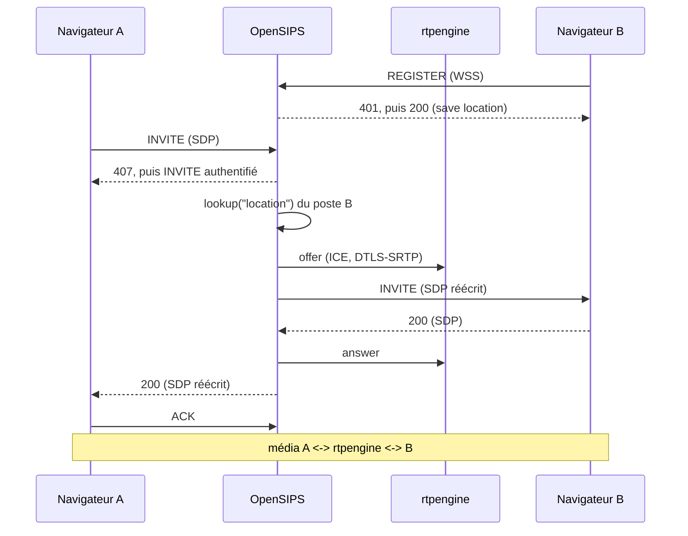

# ADR 0004 : OpenSIPS 3.6 et rtpengine tiennent les appels, devant l'IPBX

Date : 2026-10-13. Révisé : 2026-11-14. État : acceptée. Remplacé par : aucun. Décidé dans le fil de discussion du projet du 13 octobre 2026.

## Contexte

Le POC branchait le navigateur directement sur le PBX et déclarait le trunk dans le PBX : aucun garde-fou avant l'opérateur. Le plan initial empilait Flexisip (frontal des clients) et un SBC. Il faut aussi répondre à une question honnête : pourquoi un serveur SIP de plus devant Asterisk ou Wazo ?

## Décision

- OpenSIPS 3.6 (`FROM opensips/opensips:3.6` dans `docker/opensips/Dockerfile`) avec rtpengine est le serveur SIP de la plateforme. Flexisip est retiré. La 3.4 est en fin de vie depuis mai 2026 ([versions](https://opensips.org/about/available-versions/)).
- Il est registrar des navigateurs : WSS (`proto_wss`), `auth_db` sur `subscriber`, `usrloc` + `registrar`, plusieurs fenêtres par poste.
- Il route les appels entre navigateurs sans IPBX (`lookup("location")`), tient les renvois et groupes (tables `call_rules`, `call_groups`, ADR 0013 et 0014), retient l'appel d'un navigateur fermé pendant le Web Push (`route[hold]`, ADR 0015).
- Il décide des droits, plafonds et refus avant l'opérateur (`route[outbound_policy]`, `fraud_detection`, ADR 0016 et 0017), tient le trunk (`dispatcher`, `uac_registrant`), écrit le CDR (`acc`) et envoie ses événements à la passerelle (`event_datagram`, ADR 0011).
- Il garde ses dialogues en base (`dialog` `db_mode 2`) : un redémarrage ne coupe pas les appels en cours (hors appels non répondus, voir le code).
- rtpengine est le seul chemin du média (ICE et DTLS-SRTP côté navigateur, RTP simple côté opérateur).
- Wazo vient derrière OpenSIPS pour ce qu'OpenSIPS ne fait pas : messagerie, SVI, files, enregistrement (ADR 0005).
- Écart : l'ADR annonçait `pike`, `ratelimit`, HEP vers Homer, renvois et NPD par `dialplan`/`drouting`. Le code n'a aucun `loadmodule` de `pike`, `ratelimit` ni `proto_hep`/`siptrace` ; `dialplan` ne sert qu'à la numérotation ; `drouting` est chargé pour le seul arbre de préfixes de `fraud_detection`, aucun appel n'est routé par lui (`opensips.cfg.tpl:325-328`). Pas de limite de débit sur les REGISTER (`docker/README.md:49`).
- Écart : `usrloc` est en `single-instance-no-db` (`opensips.cfg.tpl:144`) : les enregistrements sont en mémoire, les fenêtres se réenregistrent après un redémarrage.
- Écart : `auth_db` `use_domain 0` (`opensips.cfg.tpl:133`) : un seul domaine SIP, pas de multi-domaine ; le SaaS le demande (ADR 0036).

## Séquence

Appel entre deux navigateurs, sans IPBX ni Wazo (`opensips.cfg.tpl`: `www_authorize` 865, `proxy_authorize` 992, `lookup` 3580, `rtpengine_offer` 431, `rtpengine_answer` 454).

## Compromis

- Gagné : les appels internes ne touchent ni Asterisk ni Wazo, donc un redémarrage ou une panne de Wazo ne les coupe pas ; les refus se font avant l'opérateur ; l'appel survit à un redémarrage d'OpenSIPS.
- Perdu / coût : un serveur de plus à exploiter, un langage de script à apprendre, une compétence rare.
- Limite connue : pour une seule organisation de quelques centaines de postes, Wazo seul aurait suffi pour les fonctions de base (appels, renvois, groupes, trunk). Ce qu'OpenSIPS ajoute vraiment : le réveil par Web Push avec l'appel retenu, la politique avant l'opérateur, l'indépendance vis-à-vis de Wazo, les dialogues en base. Le refaire autour de Wazo demanderait d'écrire à la main, entre le navigateur et Asterisk, le réveil par push avec appel retenu et les refus avant l'opérateur (non essayé). Les atouts « opérateur » (multi-domaine, anti-flood, traçage HEP) ne sont pas en service. Aucun chiffre de capacité : rien n'est mesuré.
- Ce que Wazo seul aurait apporté : le multi-tenant d'origine, une seule brique SIP, une compétence plus courante, et pas de script OpenSIPS de 4 662 lignes à maintenir.
- Compétence OpenSIPS à acquérir ; Kamailio reste le repli.

## Alternatives écartées

- Asterisk seul : le réveil d'un navigateur par Web Push et les refus avant l'opérateur seraient à écrire dans le dialplan ou en AGI ; un redémarrage d'Asterisk coupe les appels en cours (non vérifié ici).
- Wazo seul : Wazo est Asterisk plus des API ; il a un push pour son app mobile, pas vérifié pour le Web Push d'un navigateur avec l'appel retenu (non vérifié). Il suffirait pour une organisation sans ce besoin.
- Kamailio : même famille, même rôle ; écarté pour l'outillage d'administration (non vérifié ici) ; repli si l'équipe n'adopte pas OpenSIPS.
- FreeSWITCH : un serveur média de plus, aucun gain sur le chemin SIP (non vérifié ici).
- Flexisip + IPBX : un serveur SIP de plus pour rien dès que Linphone sort du jeu (ADR 0002).

## Code

`docker/opensips/opensips.cfg.tpl`, `docker/opensips/Dockerfile`, `packages/provider-opensips/src`.
