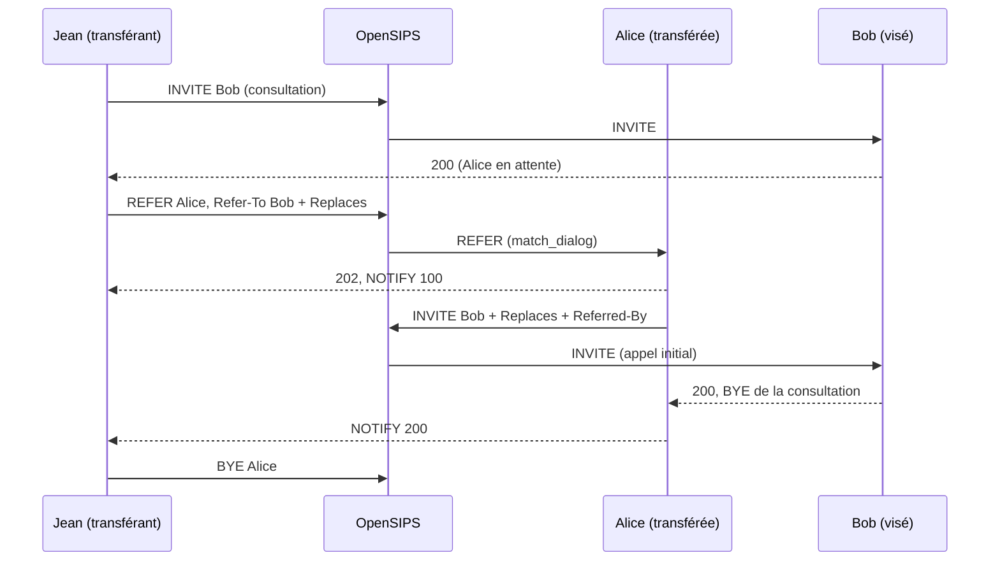

# ADR 0010 : les softphones transfèrent par REFER et Replaces, OpenSIPS reste un proxy

Date : 2026-10-14. Révisé : 2026-11-14. État : acceptée. Remplacé par : aucun.

## Contexte

Le transfert supervisé était le risque technique de l'étape 3 : un REFER avec `Replaces` doit traverser OpenSIPS et rtpengine, et le navigateur visé doit rattacher l'INVITE au bon dialogue. Le repli était un transfert piloté par la passerelle (MI ou B2BUA).

## Décision

- Les transferts sont faits par les softphones (JsSIP, `packages/softphone`) en SIP standard ; OpenSIPS les relaie sans les comprendre.
- Transfert direct : le transférant met son correspondant en attente et lui envoie un REFER (RFC 3515) vers le poste visé. Le correspondant appelle ce poste, rend compte par NOTIFY (100, 180, 200 ou l'échec), le transférant raccroche à l'appel passé ou reprend son correspondant.
- Transfert supervisé : le transférant consulte le poste visé (second appel, le premier est mis en attente), puis envoie un REFER dont le `Refer-To` porte `Replaces` avec le dialogue de la consultation (RFC 3891, RFC 5589). Le poste visé répond sans sonner et raccroche la consultation.
- OpenSIPS : REFER et NOTIFY sont des requêtes en dialogue admises par `match_dialog()` ; l'INVITE avec `Replaces` est un appel initial ordinaire (authentification, `lookup("location")`, rtpengine). Aucune logique de transfert dans la configuration.
- Le navigateur suit un REFER seulement si le `Refer-To` est un poste ou numéro composable de son domaine SIP et s'il a moins de deux appels (`MAX_CALLS`) ; sinon il refuse (603). Il recopie `Referred-By` (RFC 3892).
- Un transfert attend 30 s au plus le NOTIFY final (`TRANSFER_TIMEOUT_MS`), puis le transférant reprend son appel. Une consultation sans transfert rend l'appel en attente au transférant.
- Pas de transfert aveugle sans attente, pas de transfert d'un appel qui sonne encore, pas de va-et-vient entre deux appels.

## Séquence

Transfert supervisé de bout en bout ; tracé depuis `opensips.cfg.tpl:583` (`match_dialog`), `:1038` (INVITE `Replaces`) et `packages/softphone/src/index.ts:735,1279`.

## Compromis

- Gagné : aucune pièce de plus, aucun état d'appel côté serveur ; rtpengine ne voit que des appels ordinaires.
- Perdu / coût : un REFER n'est suivi que par un softphone qui le comprend.
- Limite connue : seul le correspondant d'un appel établi peut envoyer un REFER (dialogue créé par OpenSIPS : Call-ID et deux tags aléatoires). Raccrocher la consultation pendant un transfert supervisé est impossible (le poste visé remplace son dialogue).
- Écart : l'ADR disait qu'un transfert vers l'extérieur ou depuis Wazo passerait par le même REFER ; le code refuse tout REFER dans un appel avec l'opérateur, LiveKit SIP ou une ligne Wazo (403, `Twake-Call-Refused: transfer-external`, `opensips.cfg.tpl:661`, ADR 0016).

## Alternatives écartées

- Transfert piloté par la passerelle (MI, B2BUA) : une pièce de plus et un état serveur, pour un besoin que les navigateurs couvrent ; gardé comme repli pour les trunks.
- `Replaces` porté par OpenSIPS (`dialog` + `topology_hiding`) : masque les identités de dialogue aux navigateurs, sans intérêt ici.

## Code

`docker/opensips/opensips.cfg.tpl`, `packages/softphone/src/index.ts`, `apps/web/test/sip.e2e.mjs` (trois navigateurs, RTP compté après chaque transfert).
