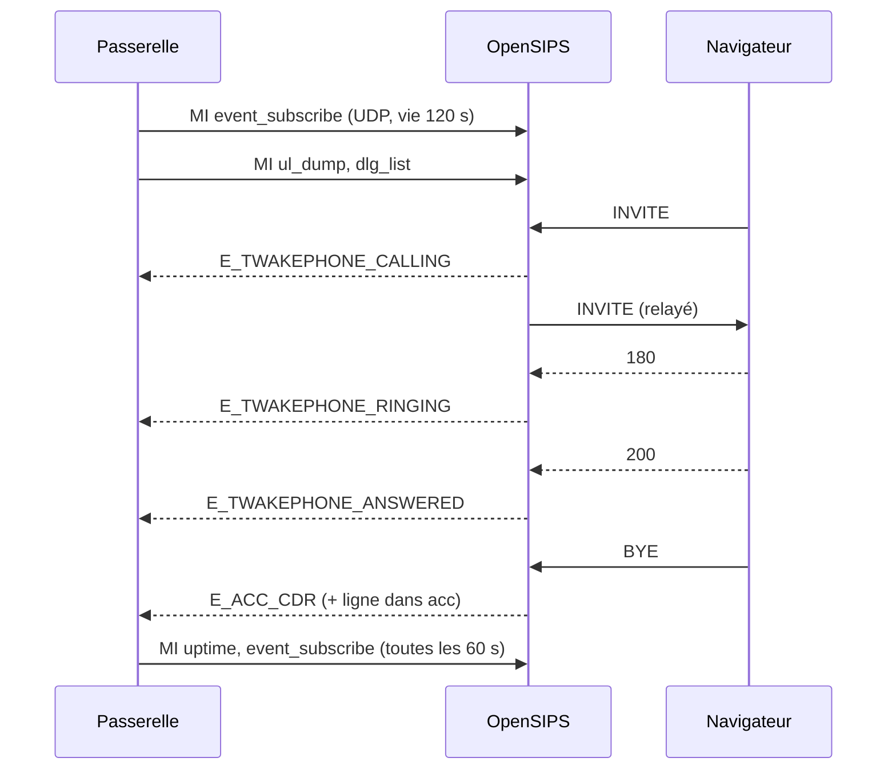

# ADR 0011 : OpenSIPS pousse ses événements à la passerelle, qui l'interroge par MI ; le CDR fait foi

Date : 2026-10-14. Révisé : 2026-11-14. État : acceptée. Remplacé par : aucun. Décidée à la PR 4a (étape 4), dans le fil de discussion du projet, après une sonde sur la stack locale.

## Contexte

Le softphone appelle sans la passerelle (ADR 0002, 0010). Or la présence des collègues, l'historique, le click-to-call et les renvois exigent qu'elle sache ce qui se passe sur le serveur SIP. OpenSIPS offre des événements poussés, des requêtes depuis le script, ou le sondage de son interface de gestion (MI).

## Décision

- Événements (`event_datagram`, JSON-RPC sur UDP) : la passerelle s'abonne par MI (`event_subscribe`), renouvelle à mi-vie. Écoutés : `usrloc` (`E_UL_CONTACT_INSERT`, `_UPDATE`, `_DELETE`, `E_UL_AOR_DELETE`), les nôtres levés par la configuration (`E_TWAKEPHONE_CALLING` avant le relais, `_RINGING` au premier 180/183, `_ANSWERED` au 200) et ceux de `acc` (`E_ACC_CDR`, `E_ACC_MISSED_EVENT`). Chacun porte appelant et appelé tels que composés.
- MI (`mi_datagram`, sans authentification) : l'abonnement, puis la relecture de l'état (`ul_dump`, `dlg_list`) à chaque (ré)abonnement ou quand `uptime` montre un redémarrage. Il écoute sur `MI_LISTEN_IP` (boucle locale), jamais sur `LISTEN_IP` ; `entrypoint.sh` refuse une adresse publique sauf `MI_ALLOW_PUBLIC=1`.
- CDR en base : tables `acc` et `missed_calls` (`SUBSCRIBER_SCHEMA`), écrites par OpenSIPS seul, référence des appels passés.
- `provider-opensips` : `CallTracker` (sans entrée-sortie) traduit en `call.created`, `.ringing`, `.connected`, `.ended`/`.failed` pour chaque partie, et `presence.changed` par poste. Un appel naît du CALLING, de la relecture, ou du premier événement qui nomme les deux parties.
- Présence d'un poste : en communication, sinon hors ligne (sans enregistrement), sinon le choix de la personne, sinon disponible. Elle vaut pour tout le tenant (`GET /presence`, diffusion WebSocket).
- Fin d'appel : 487 ou non répondu = manqué pour l'appelé ; 603 ou 600 = refusé pour les deux ; 486 = manqué pour l'appelé, occupé pour l'appelant ; 404 ou 477 : seul l'appelant lit l'échec.
- Côté passerelle : `call_history` est écrit avant `call.ended` ; si elle ne suit plus, les présences sont jetées avant les fins d'appel (`queue.ts`).
- La passerelle n'accepte que les datagrammes de l'adresse du MI et d'`OPENSIPS_EVENTS_FROM` ; une adresse seule vue rend le fournisseur `DEGRADED`.

## Séquence

Tracé depuis `opensips.cfg.tpl:3319` (`route[calling]`), `:4457`, `:4482` et `packages/provider-opensips/src/events.ts:235,350,386`.

## Compromis

- Gagné : rien ne bloque la signalisation (le datagramme part sans attendre) ; le CDR reste exact quoi qu'il arrive aux événements.
- Perdu / coût : UDP perd des datagrammes ; un appel dont la fin manque reste « en communication » jusqu'à la relecture suivante. OpenSIPS et la passerelle doivent être sur un réseau de confiance, sans chiffrement ni authentification, et synchronisés (NTP) : l'échéance d'un enregistrement est une heure d'OpenSIPS.
- Limite connue : `ul_dump` et `dlg_list` doivent tenir dans un datagramme MI (limite d'UDP, non mesurée) ; au-delà la relecture échoue et le fournisseur reste `DEGRADED` (MI sur TCP, `mi_http`, en suite). Un seul consommateur par fournisseur : plusieurs réplicas demandent un bus partagé (ARCHITECTURE §3). Les fenêtres d'une même personne ne sont pas distinguées. L'historique `call_history` est alimenté par ces événements ; `acc` n'est pas rejoué.
- Écart : l'ADR listait trois événements maison ; le code en abonne d'autres (`E_TWAKEPHONE_FORWARDED`, `_DND`, `_WAKE`, `_VOICEMAIL`, `_LIMIT`…, `provider-opensips/src/index.ts:44-64`).
- Écart : l'ADR disait que `/ready` répond toujours 200 ; le code répond 503 si un fournisseur n'est ni `CONNECTED` ni `DEGRADED` (`apps/gateway/src/app.ts:1706-1716`).

## Alternatives écartées

- `event_route` ou `rest_client` vers l'API : une requête HTTP par événement dans le chemin de signalisation, et une authentification côté OpenSIPS.
- `event_rabbitmq` ou `event_jsonrpc` : un broker de plus, ou une connexion TCP à exposer ; à revoir avec les réplicas.
- Lire `acc` seul : l'historique, pas la présence ni le temps réel.
- Module `presence` (SUBSCRIBE/NOTIFY) : la présence serait dans le navigateur, or la passerelle en a besoin.

## Code

`docker/opensips/opensips.cfg.tpl`, `docker/opensips/entrypoint.sh`, `packages/provider-opensips/src/events.ts`, `tracker.ts`, `subscriber.ts`, `apps/gateway/src/main.ts` (`OPENSIPS_EVENTS_*`).
