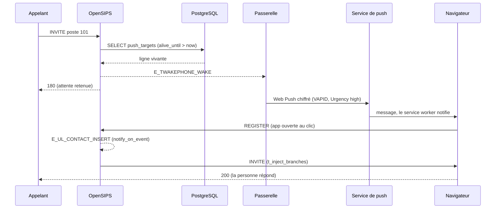

# ADR 0015 : sans fenêtre ouverte, OpenSIPS retient l'appel pendant que la passerelle réveille le navigateur par Web Push

Date : 2026-10-15. Révisé : 2026-11-14. État : acceptée. Remplacé par : aucun.

## Contexte

Jusqu'à l'étape 4, un appel n'arrive que dans une fenêtre ouverte de l'app ; sans elle, l'appelant reçoit tout de suite « injoignable » (404). L'étape 5 doit prévenir la personne navigateur lancé, sans fenêtre : la notification ouvre l'app sur l'appel, qu'elle prend (FR-B10). OpenSIPS reste un proxy (ADR 0010) ; la passerelle connaît les personnes (ADR 0009) et entend OpenSIPS (ADR 0011).

## Décision

- Abonnement : à l'activation des notifications dans Réglages seulement, le navigateur s'abonne à son service de push (RFC 8030, RFC 8291) et remet l'abonnement à la passerelle (`POST /v1/me/push-subscriptions`, table `push_subscriptions`) ; `DELETE` et la déconnexion l'oublient. Un abonnement déjà pris par un autre tenant : 409 `PUSH_SUBSCRIPTION_TAKEN`. Seuls les services de push des navigateurs sont admis (`PUSH_SERVICES`), en HTTPS.
- `push_targets` (base d'OpenSIPS) : les postes dont le titulaire a un navigateur abonné (`extension`, `tenant_id`, `holder`, `alive_until`). La passerelle repousse `alive_until` seulement quand son `E_TWAKEPHONE_PROBE`, levé par MI, lui revient. OpenSIPS ne lit que les lignes vivantes : une passerelle arrêtée ne fait attendre personne.
- Retenir l'appel : sans fenêtre (ou seulement des WebSocket mortes), OpenSIPS lit `push_targets`. Le poste y est : la transaction attend (`t_wait_for_new_branches`), l'appelant entend un 180, OpenSIPS lève `E_TWAKEPHONE_WAKE`. L'attente est le délai du renvoi sur non-réponse, sinon `PUSH_WAIT_SEC`. Jamais pour un INVITE `Replaces`.
- La fenêtre qui s'enregistre dans l'attente (`notify_on_event`) sonne dans la même transaction (`t_inject_branches`) ; chaque destination ne sonne qu'une fois. Au bout du délai : 408, traité comme non-réponse (renvoi, sinon appel manqué). Un CANCEL met fin à l'attente (487).
- Groupes : les membres sans fenêtre mais abonnés sont réveillés aussi, dans les 12 destinations d'une transaction (ADR 0014) ; tout se compte par membre.
- Envoi : la passerelle traduit `E_TWAKEPHONE_WAKE` en Web Push chiffré (`aes128gcm`), signé VAPID (RFC 8292), `Urgency: high`, `TTL` = l'attente, sujet `call`. Contenu : appelant, nom, groupe, identifiant d'appel, fin d'attente, rien d'autre. 404 ou 410 : abonnement supprimé. Un second message remplace la notification (manqué, « Répondu », « Pris par », « Appel terminé »). Clés VAPID : `VAPID_*_KEY`, sinon une paire gardée en base (`vapid_keys`, chiffrée par `SECRETS_KEY`).
- Navigateur : un service worker (`/sw.js`) n'affiche rien si une fenêtre sonne déjà. Au clic il ouvre `/?call=<id>` : la fenêtre se connecte, s'enregistre, l'appel retenu sonne, la personne répond d'un clic.
- Dépendance : `web-push` 3.6.7, MPL-2.0 (`node_modules/web-push/package.json`).

## Séquence

Tracé depuis `opensips.cfg.tpl:2686` (`wake_next`), `:2728` (`hold`), `:2760` (`WAKE`, puis 180), `:2844` (`woken`) et `apps/gateway/src/push.ts:197`.

## Compromis

- Gagné : réception sans onglet, sans B2BUA ni SDK tiers.
- Perdu / coût : le coût est pour l'appelant. Pour une personne abonnée sans fenêtre (navigateur quitté compris), il entend sonner le délai entier avant « n'a pas répondu » ou le renvoi, au lieu de « injoignable ».
- Limite connue : le navigateur doit tourner (Chromium, Edge, Firefox) ; un navigateur quitté ne reçoit rien. L'attente (`t_wait_for_new_branches`) dépend de l'ordre interne de tm d'OpenSIPS 3.6 : à revérifier à chaque version.

## Alternatives écartées

- Push du registrar d'OpenSIPS (RFC 8599) : suppose un contact laissé enregistré.
- INVITE suspendue par la passerelle (B2BUA ou HTTP) : OpenSIPS cesserait d'être un proxy.
- Décrocher au clic : micro ouvert sans geste de plus.
- SDK Firebase : un seul service de push, et du code tiers dans une page à CSP stricte.

## Code

`docker/opensips/opensips.cfg.tpl`, `packages/provider-opensips/src/push-targets.ts`, `apps/gateway/src/push.ts`, `apps/gateway/src/app.ts` (`/me/push-subscriptions`), `apps/web/public/sw.js`.
