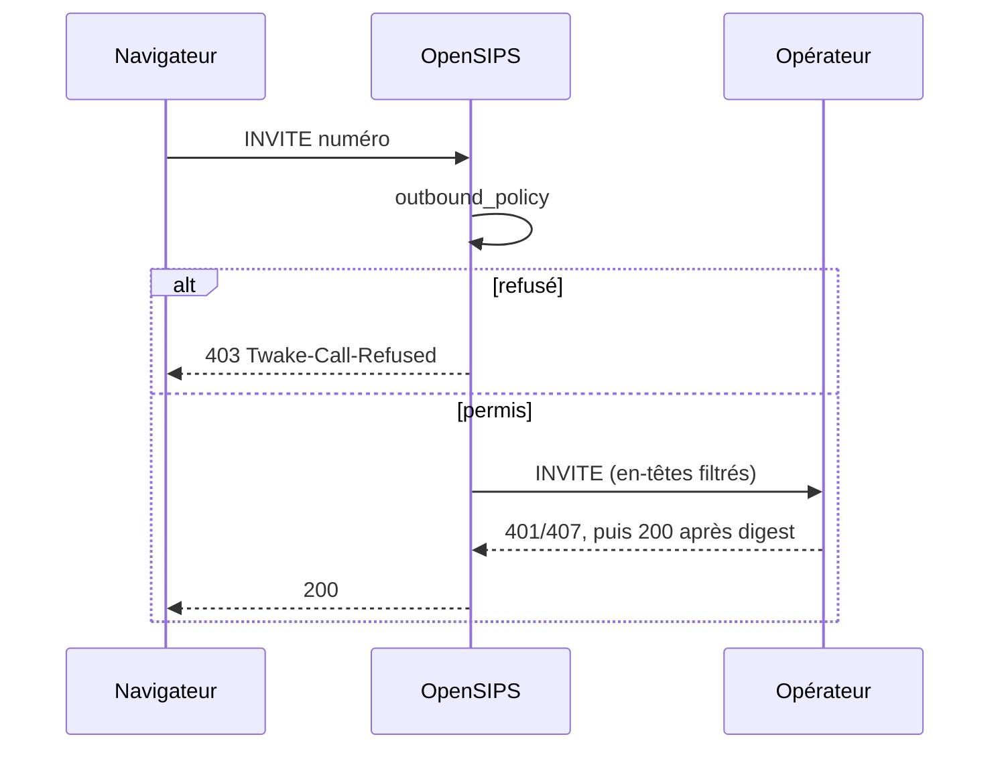

# ADR 0016 : le trunk passe par OpenSIPS, tout numéro non permis est refusé avant l'opérateur

Date : 2026-10-15. Révisé : 2026-11-14. État : acceptée. Remplacé par : aucun.

## Contexte

L'étape 6 relie OpenSIPS 3.6, sans Asterisk (ADR 0004), au réseau téléphonique par un trunk SIP : OVHcloud par défaut, tout trunk standard doit convenir. Il faut composer, recevoir, acheminer les urgences, et ne jamais laisser sortir un numéro surtaxé ou non permis, détours compris.

## Décision

- Routage : un trunk est un jeu de `dispatcher`, sondé par OPTIONS toutes les 15 s ; trois sondes perdues le sortent du choix. Repli sur le serveur suivant seulement sur 408 ou 5xx avant toute réponse provisoire. Tous serveurs tombés : 503 `no-trunk`. Trunk par défaut sans numéro direct ; aucune route par préfixe ; un seul tenant de trunks par base (409). Code : `trunks.ts`, `opensips.cfg.tpl:1704`, `:2034`.
- Numéros : `dialplan` en quatre jeux (E.164, classement, formes de l'opérateur, zones nord-américaines) écrits par `numbering.ts` ; surtaxes par pays : `PREMIUM_BY_COUNTRY` (`numbering.ts:71`). Poste ou groupe : `EXTENSION_FORMAT` (`telephony-types/src/index.ts:152`) ; numéros courts réservés (`RESERVED_NUMBER`, `:142`) refusés comme poste, groupe ou cible de numéro direct.
- Ce qui sort : tout ce qui n'est pas permis est refusé avant toute transaction, raison dans `Twake-Call-Refused` (retiré des réponses relayées). `allowed` par trunk : fixe, mobile, gratuit et 0806 à 0809 par défaut ; outre-mer et étranger sur ajout d'un administrateur, l'étranger par liste d'indicatifs (`countries`), jamais les surtaxes. Surtaxé 403, incomplet 484. Code : `:1428`.
- Vers l'opérateur : en-têtes filtrés (`:1927`), `Contact` sans partie utilisateur (`:1960`), un seul `From`/`To`/`Call-ID`/`CSeq` (400), SDP seul (415), 3xx non suivi (480).
- Aucun REFER ni `Replaces` dans un appel avec l'opérateur (403 `transfer-external`).
- Urgences (15, 17, 18, 112, 114, 115, 119, 191, 196, 197, 116000, 116117) : toujours permises, avec le numéro direct ou le numéro par défaut ; repli par le trunk par défaut (`route[emergency_fallback]`, `:2106`) ; sans la base (`timer_route[default_trunk]`, `:1528`) ; jamais interrogées ni coupées par `TRUNK_MAX_CALL_SEC`.
- Authentification : trunk `register` (`uac_registrant`) ou `ip`, défi 401/407 relevé par `uac_auth` ; un défi insatisfaisable n'atteint jamais le navigateur. Mot de passe chiffré (`SECRETS_KEY`) ; OpenSIPS reçoit le HA1 si `realm` est donné, sinon le mot de passe en clair.
- Socket : UDP IPv4 à lui, `TRUNK_LISTEN_IP:TRUNK_PORT` (5070), `TRUNK_ADVERTISE` derrière un NAT. Hors dialogue, seuls INVITE, ACK, OPTIONS d'une adresse du `dispatcher` ; dans un dialogue, une autre adresse n'est admise que sur `Record-Route`, pour BYE, re-INVITE, ACK, UPDATE, PRACK.
- Média : rtpengine, codecs du trunk seuls (G.711 par défaut), sans transcodage (ADR 0030).
- Appels qui ne finissent pas : OPTIONS dans le dialogue côté téléphone (`CALL_PING_SEC` 30 s, `CALL_PING_TIMEOUT_SEC` 15 s), 408 ou 481 termine l'appel ; plafond `TRUNK_MAX_CALL_SEC` (4 h). Code : `:4301`.
- Configuration : `/v1/admin/trunks` et `/v1/admin/dids`; échec : 502 et retour à l'état d'avant.
- Trunk vers le PABX d'un client : possible si le PABX joue l'opérateur (enregistrement ou reconnaissance par adresse, `trunks.ts`). Pas de routage par plage de postes ; UDP en clair ; numérotation française en dur. Proposé, jamais essayé contre un vrai PABX.
- Écart : l'ADR disait `drouting` attendu pour plusieurs opérateurs. Il est déjà chargé pour l'arbre de préfixes de `fraud_detection` seulement (`opensips.cfg.tpl:325-328`).

## Séquence

Politique avant toute transaction (`opensips.cfg.tpl:1428`).

## Compromis

- Gagné : l'opérateur ne voit que des appels permis ; le trunk reste un proxy.
- Perdu / coût : mot de passe en clair sans `realm` ; pas de transcodage ; UDP clair.
- Limite connue : prouvé contre un opérateur simulé (`apps/web/test/sip-trunk.mjs`, `trunk.sip.mjs`), pas contre OVHcloud ni un PABX. Urgences : sans `Geolocation` (ADR 0024).

## Alternatives écartées

- `drouting` : `dispatcher` suffit avec un trunk par défaut.
- B2BUA : contraire à l'ADR 0004.
- Liste d'interdits : un oubli ferait sortir un surtaxé.
- Relayer un REFER filtré : l'opérateur décide seul de ce qu'il appelle.

## Code

`docker/opensips/opensips.cfg.tpl`, `packages/provider-opensips/src/{trunks,numbering}.ts`, `packages/telephony-types/src/index.ts`.
