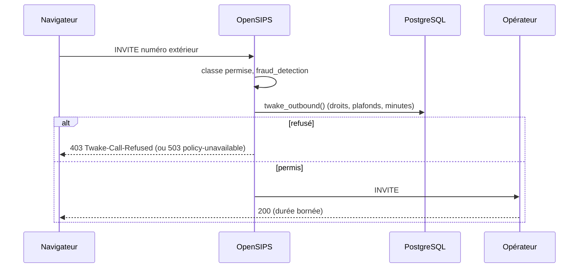

# ADR 0017 : droits, plafonds et seuils décidés par OpenSIPS avant l'opérateur ; le repli d'un numéro direct sonne à l'intérieur

Date : 2026-10-15. Révisé : 2026-11-14 (première révision le 2026-10-16). État : acceptée. Remplacé par : aucun. Décidée à la PR de l'étape 6b, dans le fil de discussion du projet.

## Contexte

L'ADR 0016 refuse ce que le trunk n'appelle pas. Il reste à dire qui peut appeler quoi et combien, à repérer un compte volé qui appelle en rafale, et à ne pas perdre un appel entrant que personne ne prend. Tout doit tenir passerelle arrêtée : OpenSIPS décide seul. Les urgences restent hors de tout.

## Décision

- Droits : la passerelle garde des profils (`outbound_policies`, `/v1/admin/outbound`) qui listent des classes de l'ADR 0016 ; aucune classe = appels internes seulement. Le profil restreint seulement ; sans profil, le trunk seul. Refus : 403 `Twake-Call-Refused: rights`, rien n'est envoyé à l'opérateur, événement `E_TWAKEPHONE_RIGHTS`.
- Requête à part : `route[trunk_out]` ne lit que le trunk et le numéro présenté ; droits et plafonds sont une seconde requête asynchrone (`twake_outbound()`, `route[outbound_query]`) que l'urgence ne fait jamais. Réponse absente à temps : 503 `policy-unavailable`, jamais laissé passer.
- Plafonds bornés par défaut (`OUTBOUND_CAP_DEFAULTS`, par personne et pour l'organisation : appels simultanés, minutes par jour et par mois) ; un administrateur les relève. Atteint : 403 `limit`, `E_TWAKEPHONE_LIMIT`. Simultanés : profils de dialogue `trunk_caller` et `trunk_out`, sous verrou. Consommé : `outbound_usage`, tenu par un déclencheur sur `acc` qui ne retient ni ne fait échouer jamais un CDR. Jours et mois en `Europe/Paris`.
- Minutes partagées : chaque appel reçoit à son départ ce qui reste, divisé par les appels en cours plus un, borné par la durée critique de son numéro, et réservé (`outbound_reservations`). Une part sous `TRUNK_MIN_CALL_SEC` refuse l'appel.
- Seuils de volume : `fraud_detection`, par appelant et règle (France, autres, outre-mer), avertissement et critique (`FRAUD_DEFAULTS`). Critique : 403 `fraud`.
- Redémarrage : dialogues en base (`db_mode` 2), réservations perdues libérées (`twake_outbound_restart()`). Seuls les compteurs de `fraud_detection` repartent de zéro.
- Alertes : `E_FRD_*`, `E_TWAKEPHONE_LIMIT`, `_RIGHTS`, `_EMERGENCY` arrivent à la passerelle (`alert.raised`), gardées dans `telephony_alerts`, `GET /v1/admin/alerts`. Alerte `emergency` à la répétition d'appels d'urgence d'un poste, jamais un refus.
- Repli d'un numéro direct : un poste ou un groupe (`fallbackTarget`), jamais de 302 ni de numéro extérieur ; il sonne après la cible quand elle n'a pas répondu, était occupée ou injoignable, jamais après un refus, un « ne pas déranger », un CANCEL ou un 404. Il sonne une fois. Pas la cible du numéro (409 `FALLBACK_LOOP`), et existante (400 `FALLBACK_TARGET`). Le renvoi vers un mobile se programme chez l'opérateur.
- Urgences : ni droits, ni plafonds, ni seuils ; CDR marqués `emergency`, sans effet sur les compteurs. Localisation : celle de l'ADR 0016.

## Séquence

Le refus précède toute requête à l'opérateur ; tracé depuis `opensips.cfg.tpl:1689-1693`, `:1817` (`outbound_loaded`).

## Compromis

- Gagné : tout se décide dans OpenSIPS, passerelle arrêtée ; une installation neuve est bornée avant tout réglage. Prouvé contre le script réel (`apps/web/test/trunk.sip.mjs`).
- Perdu / coût : forfait prépayé assumé : un appel seul reçoit tout le reste, un second de la même personne est refusé (`limit`) s'il ne reste plus `TRUNK_MIN_CALL_SEC`.
- Limite connue : un renvoi chez l'opérateur sur non-réponse jouerait contre le repli intérieur ; son automatisation vient avec `provider-ovh` (étape 10). Pas de port réservé aux urgences dans rtpengine.

## Alternatives écartées

- Droits et plafonds dans la passerelle : un appel ne passe pas par elle.
- Droits lus dans la requête du trunk : une requête lente enverrait une urgence par le mauvais trunk.
- Compter dans les CDR ou en mémoire : coût croissant, ou perdu au redémarrage.
- Repli par 302 vers l'opérateur : l'appel échappe aux plafonds et aux CDR.
- « Hairpin » : exigerait un B2BUA ; OpenSIPS est un proxy.

## Code

`docker/opensips/opensips.cfg.tpl` (`trunk_out`, `outbound_*`), `packages/provider-opensips/src/outbound.ts`, `apps/gateway/src/outbound.ts`, `packages/telephony-types/src/index.ts`, `apps/web/test/trunk.sip.mjs`.
