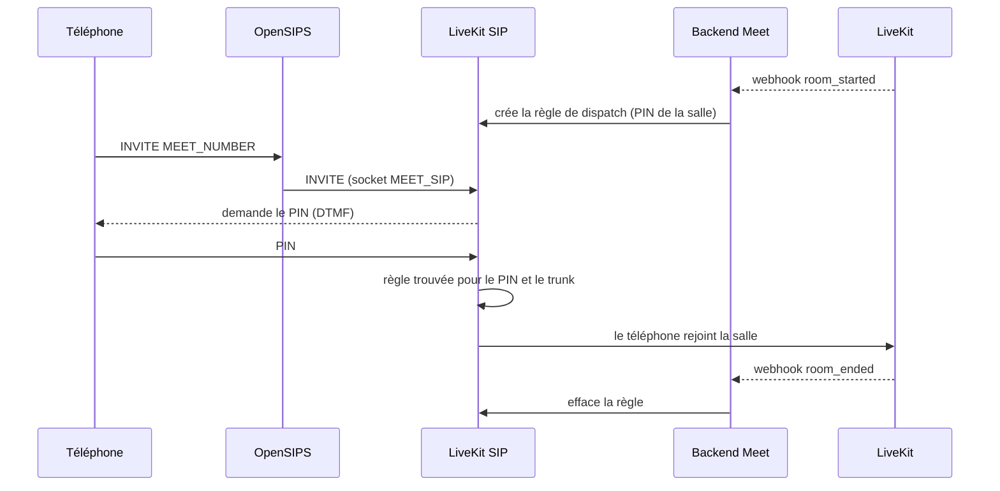

# ADR 0018 : Meet entre par la téléphonie de Meet upstream, LiveKit SIP derrière OpenSIPS

Date : 2026-10-16. Révisé : 2026-11-14. État : acceptée, code pas encore aligné. Remplacé par : aucun.

## Contexte

L'étape 8a avait fait entrer les appels dans Meet par LiveKit SIP, avec un trunk, des règles de dispatch, des PIN et un dial-out écrits par notre passerelle. Le 2026-11-13, Clément a décidé de passer par la téléphonie de Meet upstream ([telephony.md](https://github.com/suitenumerique/meet/blob/main/docs/features/telephony.md)) et de ne plus tenir ce modèle chez nous. Meet est sous licence MIT ([source](https://github.com/suitenumerique/meet)), LiveKit et LiveKit SIP sous Apache-2.0 ([livekit](https://github.com/livekit/livekit), [sip](https://github.com/livekit/sip)).

## Décision

- Décision du 2026-11-13 : le backend de Meet tient le PIN et crée puis efface la règle de dispatch de LiveKit à `room_started` et `room_ended`. Un seul trunk. Entrée seulement, pas de dial-out. Pas d'entrée avant le premier participant WebRTC.
- Des PR sur `suitenumerique/meet` si un besoin manque ; rien n'est forké.
- LiveKit SIP reste derrière OpenSIPS (socket à lui `MEET_LISTEN_IP:MEET_PORT`, `MEET_SIP`) et rtpengine reste des deux côtés de l'appel : à confirmer avec Meet upstream.
- Un numéro d'accès, `MEET_NUMBER` (8000 par défaut), mène aux salles depuis un poste ou depuis l'opérateur (`target` d'une plage de `dids`).
- Code pas encore aligné : `packages/conference-livekit` fait encore l'ancien modèle, décrit ci-dessous, jusqu'à son remplacement.
- Dépendants à revoir : ADR 0019, 0025 et 0026 reposent sur le dial-out (la salle appelle une personne ou un numéro) ; le rappel depuis la salle n'existe pas dans Meet upstream.

## Séquence

Modèle cible, tiré de la doc de Meet upstream (https://github.com/suitenumerique/meet/blob/main/docs/features/telephony.md). Le passage par OpenSIPS est à confirmer avec Meet upstream.

## Code actuel, ancien modèle

- Stack de dev : `livekit/livekit-server` v1.13.7, `livekit/sip` v1.17.0 et Redis 7.4.2, versions figées (`docker/docker-compose.sip.yml`).
- Le socket de LiveKit SIP n'entend que `MEET_SIP` (403 sinon), refuse tout sauf INVITE sous défi et OPTIONS (405) ; OpenSIPS renvoie ses requêtes par le socket d'origine (`caller_sock`).
- Le PIN (10 chiffres, `crypto.randomInt`) et la règle `dispatch_rule_direct` de chaque salle sont écrits par la passerelle ; elle les relit toutes les 30 s (`checkTtlMs`), supprime les règles qui ne servent plus (`conference-sweep.ts`) et garde un seul PIN par salle (`replaceConferencePin`).
- Essais de PIN et appels à la fois comptés par OpenSIPS (`cachedb_local`, profils de dialogue) : `MEET_PIN_TRIES` (10) et `MEET_PIN_TRIES_ALL` (300) sur 10 minutes, `MEET_CALLS_PER_CALLER` (2), `MEET_CALLS_ALL` (100) ; refus 403 `pin-tries`, 486 `meet-busy`, 503 `meet-full` ; alertes `E_TWAKEPHONE_PIN` et appels simultanés. `MEET_INBOUND_ADDRESSES` est obligatoire.
- Média : G.722, G.711 et DTMF RFC 4733 vers LiveKit SIP, sans transcodage ; les `o=` de LiveKit SIP sont ramenés à 63 bits pour Firefox ; interface de rtpengine non choisie vers LiveKit SIP, vérifié seulement sur la boucle locale (ADR 0030).
- Dial-out : le trunk sortant de LiveKit vise OpenSIPS (`MEET_OUTBOUND_ADDRESS`) avec un compte hors `subscriber` (`MEET_SIP_USER`, `MEET_SIP_PASSWORD`) ; chaque appel porte une autorisation de la passerelle (`dial_out_grants`, en-tête `X-Twake-Grant`, 30 s, une seule fois) ; l'appel suit les droits et plafonds du poste demandeur, jamais une urgence (403), jamais le numéro d'accès (482), jamais `Replaces` ; limite 10 par minute et par personne (429 `DIAL_OUT_LIMIT`).
- Durée : `MEET_MAX_CALL_SEC` (7200 s) borne l'appel par LiveKit SIP et par OpenSIPS (`$DLG_timeout`), car LiveKit SIP répond 200 à tout OPTIONS.
- Réponse de la passerelle : 201, 409 `DIAL_FAILED`, 480, 502 `CONFERENCE_UNAVAILABLE` ; salles nommées par elle (`twake-` + 16 hexa), 20 par heure et 50 ouvertes par personne, 1000 par organisation (429 `CONFERENCE_LIMIT`).
- L'API de Meet (`MEET_URL`, `MEET_CLIENT_ID`, `MEET_CLIENT_SECRET`) reste derrière sa configuration et n'est pas jouée en CI. Les journaux de LiveKit montrent les PIN : `warn` recommandé.

## Compromis

- Gagné : un seul modèle de PIN et de salle, celui de Meet ; moins de code à nous à garder en phase avec LiveKit.
- Perdu / coût : plus de dial-out ni de rappel depuis la salle, donc les conférences d'appel (ADR 0019, 0025, 0026) perdent leur chemin ; pas d'entrée avant le premier participant WebRTC.
- Limite connue : rien n'est vérifié contre une instance de Meet (règles de PIN, numéro montré) ni contre un vrai trunk OVHcloud ; un numéro d'accès par plateforme (une base OpenSIPS sert un tenant, ADR 0016) ; comptes de PIN en mémoire, remis à zéro au redémarrage ; un attaquant qui change de numéro à chaque appel n'est pas borné en nombre d'essais, l'alerte le signale.

## Alternatives écartées

- LiveKit SIP branché directement sur le trunk de l'opérateur : l'opérateur verrait deux plateformes, les droits et plafonds seraient contournés.
- Un compte `subscriber` pour LiveKit SIP : il pourrait s'enregistrer et être appelé.
- Un en-tête signé (HMAC) plutôt qu'une ligne en base : rejouable jusqu'à son échéance.
- Un numéro direct par salle : numéros rares et payants pour des salles éphémères.
- Le média du navigateur directement vers LiveKit SIP : il ne parle que RTP simple, rtpengine est le seul chemin du média (ADR 0004).

## Code

`packages/conference-livekit`, `docker/docker-compose.sip.yml`, `docker/opensips/opensips.cfg.tpl` (`MEET_*`, `failure_route[meet_failed]`), `apps/gateway/src/conference-sweep.ts`.
