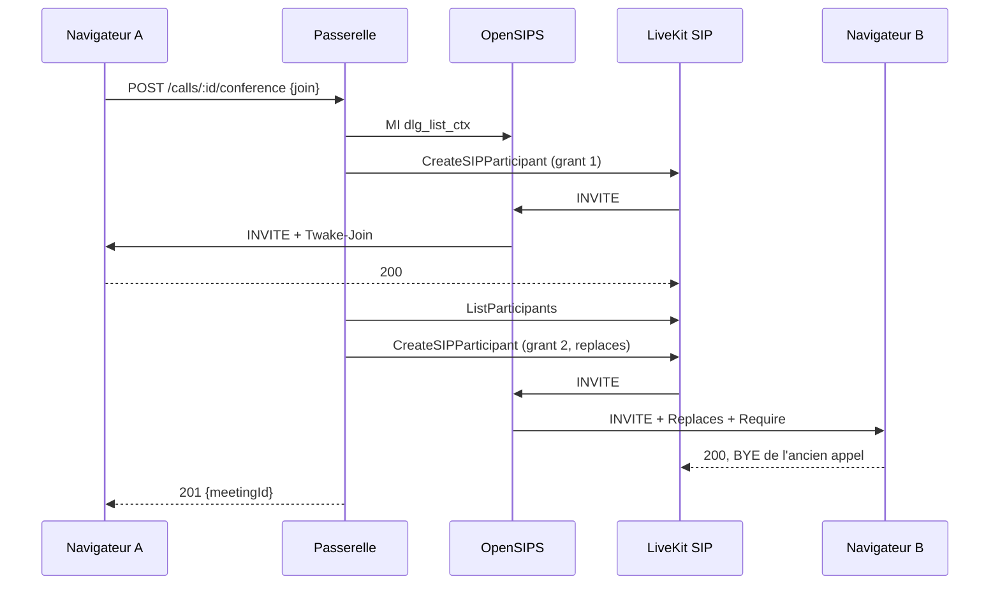

# ADR 0019 : « Ajouter un participant » : un appel entre deux postes devient une conférence dans une salle LiveKit

Date : 2026-10-16. Révisé : 2026-11-14. État : proposée. Remplacé par : aucun. Décidée à la PR de l'étape 8b, dans le fil de discussion du projet.

## Contexte

OpenSIPS est un proxy, pas un B2BUA : il ne peut ni mixer l'audio ni changer ce qu'il y a derrière un appel en cours. LiveKit mixe des salles (ADR 0018). JsSIP sait remplacer un appel par un autre (`Replaces`, RFC 3891). La salle appelle donc les deux participants, chacun sous une autorisation de la passerelle.

## Décision

- Le panneau d'appel offre « Ajouter un participant ». La fenêtre tire un jeton (`expectConference`) et appelle `POST /api/v1/calls/:id/conference` (`:id` = Call-ID SIP). Elle refuse si l'appel est en attente ou si une conférence se prépare déjà.
- La passerelle ne croit pas le navigateur : l'appel doit être attribué à la personne par les événements d'OpenSIPS, et le dialogue est lu chez OpenSIPS (MI `dlg_list_ctx`, répondu, entre deux postes). Refus : appel d'une salle, de la messagerie, d'urgence ou masqué (`CONFERENCE_EXTERNAL`) ; dialogue que `Replaces` ne sait pas écrire ; conférence déjà en cours (verrou en mémoire du processus).
- La salle `twake-call-…` est à la passerelle, au nom de la personne, sans PIN ni règle de dispatch. Elle compte dans les plafonds de salles et d'appels de salle de la personne.
- Deux appels de salle sous autorisation à usage unique (`dial_out_grants`) : d'abord le poste de la personne (en-tête `Twake-Join`, seule la fenêtre au jeton répond), puis, si elle est dans la salle, l'autre poste avec `Replaces` et `Require: replaces`. L'autre navigateur répond et termine l'ancien appel ; il refuse s'il tient l'appel en attente ou consulte. Si un appel échoue, la salle est supprimée et l'appel d'origine reprend tel quel.
- `route[conference_leg]` appelle seulement les fenêtres du poste visé : ni règles, ni renvois, ni groupes, jamais le réseau public. OpenSIPS retire `Replaces`, `Twake-Join`, `Twake-Room` et `Twake-Conference` de tout ce que LiveKit SIP ou un téléphone envoie.
- Avant chaque autorisation, la passerelle relit le trunk sortant de LiveKit (`ListSIPOutboundTrunk`) ; après chaque appel, elle compare l'appel qui a pris l'autorisation (`used_by`) à celui que LiveKit annonce. Un détournement est coupé (`dlg_end_dlg`), signalé (502 `CALL_DIVERTED`, alerte) ; un appel sans réponse n'en est pas un.
- Troisième participant et suivants : `POST /conferences/:id/participants`, avec les droits et plafonds de la personne.
- Le CDR des appels de salle vers un poste porte `via = conference` ; l'historique et Récents disent « Conférence ».
- Chaque participant lit la liste (`GET /conferences/:id`) ; seule la personne qui a fait la conférence voit les numéros publics en clair. Elle coupe un micro, retire quelqu'un, quitte ou « Terminer pour tous » (`DELETE /conferences/:id`). Si elle part alors qu'un participant extérieur reste, la passerelle termine la salle (webhook `participant_left` relu chez LiveKit, ou balayage `conference-sweep.ts`).

## Séquence

Il vient de `apps/gateway/src/app.ts:3373` (route) et `:3392` (`makeConference`), et de `docker/opensips/opensips.cfg.tpl:1256` (`route[conference_leg]`).

## Compromis

- Gagné : aucun B2BUA ; un navigateur ne peut pas faire remplacer l'appel d'un autre.
- Limite connue : qui a une clé LiveKit peut réécrire le trunk sortant, recevoir les INVITE avec leur autorisation ou entrer dans une salle par l'API ; le détournement est coupé après coup. La clé vaut l'accès aux conférences.
- Limite connue : le refus pendant une attente n'existe que dans le softphone web  ; non fait : conférence depuis une consultation.
- Écart : l'ADR disait « appel avec l'opérateur : `CONFERENCE_EXTERNAL` ». Le code le prend en charge (la salle rappelle le numéro, ADR 0025, `apps/gateway/src/app.ts:3400`).
- Code pas encore aligné (décision du 2026-11-13, ADR 0018) : Meet et LiveKit passeront par la téléphonie de Meet upstream (PIN et dispatch tenus par Meet, un trunk, entrée seulement). `packages/conference-livekit` gère encore trunks, règles, PIN et dial-out. Cette conférence dépend du dial-out vers les postes, absent de Meet upstream : à trancher avec l'ADR 0018.

## Alternatives écartées

- Un B2BUA : un composant de plus au cœur de l'appel (ADR 0004, 0018).
- Un `REFER` vers la salle : l'autre partie déciderait d'y aller.
- Dialogue donné par le navigateur : il pourrait nommer l'appel d'un autre.
- Une salle Meet avec PIN : la conférence doit marcher sans Meet.

## Code

`apps/gateway/src/app.ts`, `packages/conference-livekit/src/index.ts`, `packages/provider-opensips/src/dial-out-grants.ts`, `docker/opensips/opensips.cfg.tpl`.
