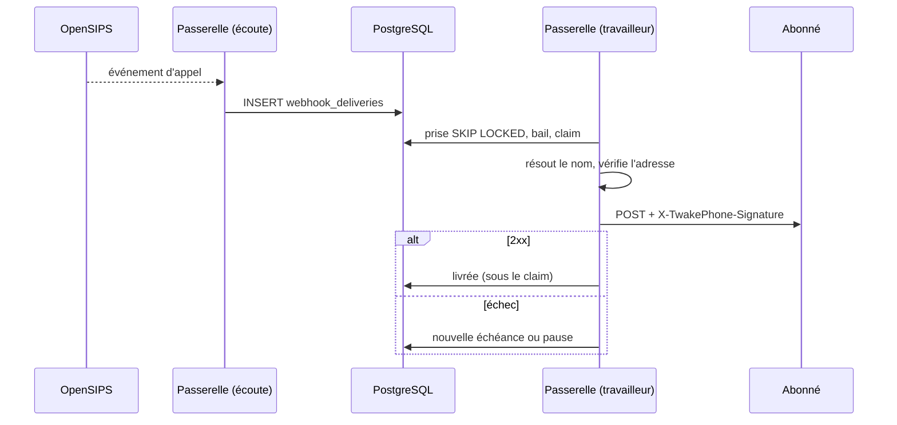

# ADR 0020 : un hub de webhooks signés dans la passerelle, livrés au moins une fois depuis une file PostgreSQL

Date : 2026-10-16. Révisé : 2026-11-14. État : proposée. Remplacé par : aucun. Décidée à la PR de l'étape 10a, dans le fil de discussion du projet.

## Contexte

Les outils d'une organisation (CRM, supervision, ticketing) veulent les événements de la téléphonie. Plusieurs passerelles entendent chacune OpenSIPS et partagent une base. Un administrateur choisit l'adresse de destination : la passerelle devient une porte vers le réseau de l'exploitant (SSRF). Un abonné lent ne doit pas retarder les autres organisations.

## Décision

- Modèle `WebhookEvent` (`packages/telephony-types/src/index.ts:777`), distinct de `TelephonyEvent` (interne) : `call.*`, `presence.changed`, `trunk.degraded`, `trunk.recovered`, `voicemail.created`, `voicemail.transcribed` (sans texte ni audio, ADR 0023). `quality.alert` reste refusé.
- La file est la table `webhook_deliveries`, une ligne par événement et par abonnement, unique sur `(subscription_id, event_id)`. L'identifiant d'un événement d'appel est un SHA-256 de l'organisation, du type, de l'appel et de la personne : toutes les passerelles obtiennent le même.
- Une seule passerelle publie présence et trunks : celle qui tient le bail `webhook-state` (`webhook_leases`). L'état est daté par la base (`clock_timestamp()`), jamais par une passerelle ; un état plus ancien que le gardé n'est pas écrit.
- `trunk.degraded` et `trunk.recovered` : le bail relit l'état des trunks périodiquement (`apps/gateway/src/trunk-health.ts`), et ne retient un état que vu deux relevés de suite.
- Livraison : un travailleur par passerelle prend les livraisons `FOR UPDATE SKIP LOCKED` sous un bail à jeton (`claim`) ; une livraison abandonnée redevient due. Des plafonds par abonnement et par organisation, partagés entre passerelles, empêchent un abonné muet d'occuper plus que sa part.
- Un 2xx livre. Sinon, relances à attente exponentielle (`WEBHOOK_MAX_ATTEMPTS`, `WEBHOOK_RETRY_BASE_MS`), pause de l'abonnement après des échecs de suite, désactivation après une journée d'échecs (alerte `webhook`), échec `backlog` au-delà d'un plafond d'attente.
- Requête : POST JSON du corps exact, signé `X-TwakePhone-Signature: t=<s>,v1=<HMAC-SHA256 de "t.corps">` (`apps/gateway/src/webhook-delivery.ts`), plus `X-TwakePhone-Event`, `-Event-Id`, `-Delivery` et `Idempotency-Key` (= id de l'événement). Après un nouveau secret, un second `v1` signe avec l'ancien pendant 24 h ; `?grace=0` le coupe.
- Secret `whsec_` chiffré par `SECRETS_KEY` (AES-256-GCM, lié à l'organisation et à l'abonnement), montré une seule fois. Sans `SECRETS_KEY`, les routes répondent 501.
- Contre la SSRF : URL `https`, hôte dans les domaines autorisés de l'organisation. À chaque livraison : port du schéma ou `WEBHOOK_PORTS`, résolution par c-ares, refus des adresses privées, de boucle, réservées, de ses propres interfaces et de `WEBHOOK_DENY_NETWORKS`, connexion à l'adresse vérifiée, aucune redirection. L'exploitant ouvre des réseaux précis à une organisation (`WEBHOOK_PRIVATE_NETWORKS`, lu strictement) ; `WEBHOOK_ALLOW_HTTP` sert aux tests. Le journal ne distingue pas les causes d'injoignabilité.
- Routes administrateur sous `/api/v1/webhooks` (domaines, abonnements, secret, reprise, test, journal, rejeu : `apps/gateway/src/app.ts:2774`). Tests et rejeux sont limités en base.
- Données personnelles : `DELETE /me/history` efface les livraisons terminées de la personne et sa présence gardée. Le journal est purgé après 30 jours.

## Séquence

Il vient de `apps/gateway/src/webhooks.ts:769` (en-têtes) et `apps/gateway/src/webhook-delivery.ts` (signature, garde).

## Compromis

- Gagné : ni Redis ni courtier ; au moins une fois ; isolation entre organisations.
- Perdu / coût : l'ordre d'arrivée n'est pas garanti (l'abonné trie sur `occurred_at`) ; un datagramme d'OpenSIPS perdu donne un événement non publié.
- Limite connue : la garde SSRF ne couvre que la passerelle ; les domaines autorisés, posés par l'administrateur, ne le protègent pas de lui-même : seule la garde réglée par l'exploitant le fait. Un changement de bail retarde présence et trunks.
- Écart : l'ADR disait `voicemail.*` non demandables ; le code les accepte.
- Aucune mesure de charge n'a été faite.

## Alternatives écartées

- Redis Streams ou RabbitMQ : un service de plus pour une file que PostgreSQL tient déjà.
- Livrer depuis le flux sans file : une passerelle qui tombe perd ce qu'elle n'a pas envoyé.
- Signer le corps sans horodatage : rejeu possible.
- Dater les présences par la passerelle qui entend : horloges différentes ; un publieur sous bail, sur l'horloge de la base, l'évite.

## Code

`apps/gateway/src/webhooks.ts`, `apps/gateway/src/webhook-delivery.ts`, `apps/gateway/src/trunk-health.ts`, `apps/gateway/migrations/013_webhooks.sql`, `packages/telephony-types/src/index.ts`.
