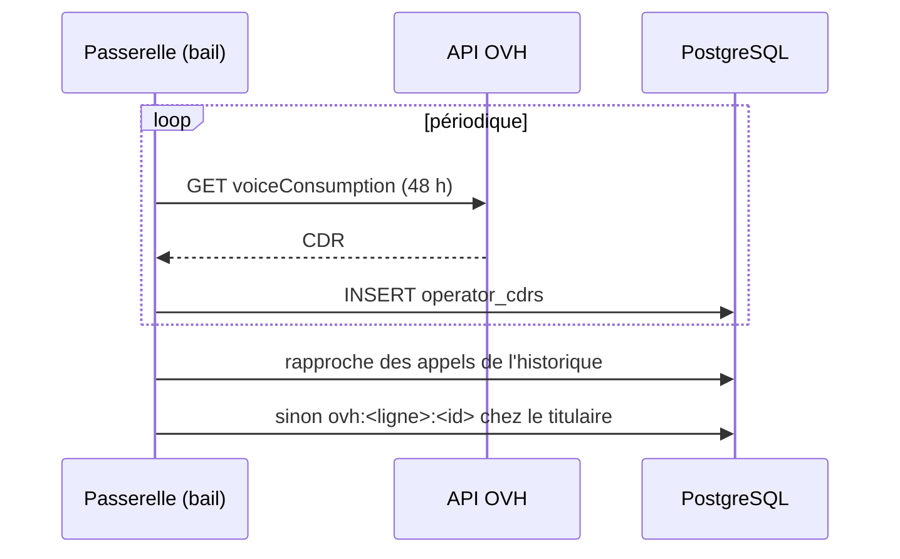

# ADR 0021 : `provider-ovh` : l'API d'OVH tient le renvoi de repli des lignes du trunk et fournit les CDR rapprochés de l'historique

Date : 2026-10-17. Révisé : 2026-11-14. État : proposée. Remplacé par : aucun.

**Rien n'est vérifié contre le vrai OVHcloud.** Le client est écrit d'après la documentation publique de l'API et joué contre un faux serveur (`packages/provider-ovh/test/fake-ovh.mjs`).

## Contexte

Le trunk vers OVH (ADR 0016) porte les appels, mais le renvoi vers un numéro extérieur quand la plateforme ne répond plus ou que personne ne décroche (ADR 0017) se règle à la main dans le manager d'OVH. Et l'historique ne connaît que ce qu'OpenSIPS a vu : un appel reçu par OVH pendant une panne n'y est pas (FR-D4 : 99 % des appels rapprochés).

## Décision

- Contrat `OperatorProvider` (`provider-sdk`) : lire les renvois d'une ligne, écrire le renvoi de repli, lister et lire les CDR. `packages/provider-ovh` l'implémente (`OvhOperator`, `OvhClient`) ; rien d'OVH n'en sort.
- Client : requêtes signées comme OVH le documente (`X-Ovh-*`, `packages/provider-ovh/src/client.ts`), horloge d'OVH lue sur `/auth/time`, une seule nouvelle tentative sur `QUERY_TIME_OUT`, aucune redirection. Les refus sont rangés en six cas que l'écran traduit ; aucune clé dans les journaux.
- Clés par l'environnement seulement, pour `DEFAULT_TENANT` : `OVH_APPLICATION_KEY`, `OVH_APPLICATION_SECRET`, `OVH_CONSUMER_KEY`, `OVH_BILLING_ACCOUNT` (les quatre ou aucune), `OVH_ENDPOINT`. Jamais en base ni rendues par l'API. Le jeton n'a que les droits utiles, bornés au groupe de facturation.
- `Trunk.operator` nomme les lignes OVH et, si l'administrateur le demande, un `fallback` (numéro E.164, sur indisponibilité, sur non-réponse). Sans `fallback`, la passerelle ne touche à rien chez OVH. Avec : posé à l'enregistrement, relu et comparé champ par champ, relu périodiquement et remis s'il a changé dans le manager. Elle n'écrit que les champs de renvoi des options de la ligne. Remplacer un renvoi existant demande une case cochée après lecture seule.
- Le retrait du renvoi est tenu : écrit d'abord en base (`operator_state`), rejoué par chaque relevé, 202 tant qu'OVH ne l'a pas. Il ne retire que ce que la plateforme a posé : si OVH a autre chose, le retrait est clos `changed` avec alerte. Il remet le renvoi d'avant, sauf s'il violerait les règles d'un repli. Un administrateur peut abandonner un retrait.
- Refus : repli vers un numéro direct, une ligne ou un numéro de trunk (`OPERATOR_FALLBACK_LOOP`) ; une ligne dans deux trunks (`OPERATOR_LINE_SHARED`) ; renvoi sans opérateur (`OPERATOR_NONE`).
- Pas de bascule pilotée à la panne : `forwardBackup` d'OVH renvoie de lui-même, passerelle arrêtée. `trunk.degraded` (ADR 0020) dit seulement ce qui est posé, jamais le numéro.
- CDR : relevés périodiques sur les dernières 48 heures par la passerelle qui tient le bail, ligne par ligne, chacun lu une fois et gardé 90 jours (`operator_cdrs`). Pas d'événements temps réel (`eventToken` trop peu documenté).
- Rapprochement peu après la lecture : même sens, même numéro distant en E.164, heure à 60 s près, durée proche, un CDR par appel. Un appel entrant vu par OVH seul entre dans l'historique du titulaire du numéro direct (`ovh:<ligne>:<id>`), sauf si la plateforme a déjà un appel, si le numéro a changé de mains, ou si la personne a effacé son historique. Un renvoi d'OVH vers le repli est écrit manqué `forwardedToFallback`. `GET /calls/history` dit la source (`sources`).
- `DELETE /me/history` efface aussi les numéros des CDR rapprochés (réglés `erased`) ; les traces utiles au rapprochement sont gardées 4 jours puis purgées (`OPERATOR_KEPT_MS`).
- État en base (`operator_state`) : toutes les passerelles montrent la même chose. `POST /admin/operator/sync` relève tout de suite, limité en base.
- Alertes `operator` : clés refusées, rapprochement sous 99 % sur 7 jours.

## Séquence

Il vient de `apps/gateway/src/operator.ts` et `packages/provider-ovh/src/operator.ts`.

## Compromis

- Gagné : le repli ne dépend plus d'une saisie manuelle ; l'historique dit ce que l'opérateur a vu.
- Perdu / coût : une organisation, un compte OVH, par l'environnement. La migration `016` réécrit `call_history` sur un gros historique.
- Limite connue : une requête d'administrateur écrit chez OVH depuis la passerelle qui la reçoit ; d'où la relecture des trunks avant et après chaque `PUT`. Un écart avec la vraie API se verra au premier branchement.

## Alternatives écartées

- Bascule à la panne par la passerelle : resterait posée si elle tombait.
- Rapprocher à la volée dans `GET /calls/history` : une lecture ferait des requêtes à OVH.
- Clés en base dès maintenant : un administrateur d'organisation aurait le compte de l'exploitant.

## Code

`packages/provider-ovh/src/`, `apps/gateway/src/operator.ts`, `apps/gateway/src/trunks.ts`, `apps/gateway/migrations/015_operator_cdrs.sql`.
