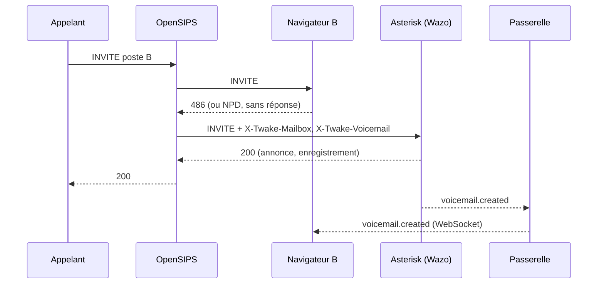

# ADR 0022 : la messagerie vocale sur Wazo derrière OpenSIPS : socket dédié, boîte de l'extension composée, une boîte par titulaire

Date : 2026-10-18. Révisé : 2026-11-14. État : proposée. Remplacé par : aucun. Précisée par les ADR 0027 (lignes Wazo) et 0028 (parcours d'appel) ; précise l'ADR 0005. Décidée à la PR de l'étape 11a, dans le fil de discussion du projet.

## Contexte

Un appel que la personne ne prend pas (« ne pas déranger », occupé, refusé, sans réponse, sans fenêtre) doit aller à sa boîte, et le message arriver dans l'onglet « Messagerie vocale ». Ce que les étapes 3 à 10 ont mis dans OpenSIPS reste valable, y compris sans Wazo (`WAZO_SIP` vide : aucun socket).

## Décision

- OpenSIPS décide seul du chemin de chaque appel ; Wazo ne tient que les boîtes. Il reçoit l'appel par un socket UDP dédié (`WAZO_LISTEN_IP:WAZO_PORT`) qui n'entend que l'Asterisk de Wazo, jamais de REFER. Le média passe par rtpengine.
- La boîte est celle de l'extension composée, quel que soit le renvoi suivi, quand rien d'autre ne prend l'appel. Jamais pour un groupe composé, une salle Meet, une conférence, un `Replaces`, un appel à soi-même ou annulé.
- Une boîte absente ou muette rend à l'appelant le refus d'origine. OpenSIPS lit `voicemail_boxes` et passe la boîte par `X-Twake-Mailbox` et `X-Twake-Voicemail`, qu'il pose seul et retire de tout INVITE entrant : l'appelant extérieur n'entend jamais l'extension interne.
- Pour l'appelant, l'appel a abouti (CDR `via = voicemail`, webhook `voicemail: true`) ; pour la personne, c'est un appel manqué.
- Bornes et plafonds par appelant, par boîte, pour les appelants sans numéro et pour toute la plateforme, comptés par OpenSIPS (`VOICEMAIL_*`, valeurs dans `docker/opensips/entrypoint.sh`). Un dépassement rend ce qu'aurait eu l'appelant sans boîte et lève une alerte `voicemail`. Un appelant est compté sur une empreinte HMAC de son numéro, jamais sur le numéro ; un numéro masqué l'est sur celui que l'opérateur envoie encore.
- Une boîte par personne qui tient une extension, à un numéro à elle (jamais celui d'une extension), pour un utilisateur Wazo anonyme (empreinte HMAC de son identifiant). Rien de la personne n'est dans Wazo. La boîte suit la personne : un changement d'extension ou de nom ne la déplace pas ; où elle est jointe n'est gardé que dans `voicemail_boxes` (`provider-wazo`, `VoicemailProvider`).
- Qui perd son extension a sa boîte mise de côté avec ses messages, rendue s'il revient. Rien n'est effacé pour une absence de l'annuaire plus courte que `VOICEMAIL_GRACE_DAYS` ; passé ce délai, le même identifiant est quelqu'un d'autre (boîte neuve, l'ancienne purgée par la conservation). Limite : un identifiant réattribué avant le délai est pris pour la même personne.
- Garde de masse : une mise de côté ou une suppression de plus de la moitié des boîtes est retenue (alertes `held-back`, `held-back-remove`) jusqu'à confirmation d'un administrateur (`/api/v1/admin/voicemail/release`). Changer `LDAP_ATTR_ID` compte comme une masse.
- Une seule passerelle écrit les boîtes d'un tenant : celle qui tient le bail `voicemail:<tenant>`. Le retrait d'une extension est numéroté (`voicemail_withdrawals`), et la base refuse (`VOICEMAIL_FENCED`) un jeton plus ancien que le dernier écrit (`voicemail_writers`). Le jeton est la génération du bail, pas une horloge. Remise à la main : `VOICEMAIL_FENCE_RESET`.
- La passerelle n'écrit dans Wazo que ce qui change une boîte (créer, mettre de côté, rendre, supprimer), une à la fois, car chaque écriture recharge Asterisk par wazo-sysconfd. `live_reload` est écarté.
- Le compte de la passerelle a des droits limités (`TWAKE_ACL`, `docker/wazo/bootstrap.py`), mais wazo-auth n'a que des jokers : il peut créer et supprimer tout utilisateur de son organisation Wazo, qui doit donc être à lui.
- API : `/api/v1/voicemails` (liste, audio, lu, suppression) pour la seule boîte de la personne ; capacité `voicemail` seulement si OpenSIPS a aussi Wazo (`wazo_on`). RGAA 4.1 levé par l'ADR 0023.
- Données personnelles : conservation `VOICEMAIL_RETENTION_DAYS` ; `DELETE /me/history` et `POST /api/v1/admin/voicemail/erase` font effacer les messages par la passerelle qui écrit, jamais par celle qui reçoit la demande.
- Stack de dev et CI : Wazo 26.10 par images officielles épinglées, sur la boucle locale (`docker/wazo/`).

## Séquence

Il vient de `docker/opensips/opensips.cfg.tpl` (recherche `X-Twake-Mailbox`) et de `docker/wazo/asterisk/extensions.conf`.

## Compromis

- Gagné : un seul décideur d'appel ; sans Wazo, rien ne change ; rien de la personne dans Wazo.
- Perdu / coût : chaque écriture de boîte recharge Asterisk ; un vrai Wazo n'a pas été mesuré.
- Limite connue : non vérifié sur un Wazo installé par paquets ni avec un Asterisk sur une autre machine (il faudrait TCP ou TLS et une authentification).
- Écart : l'ADR disait « pas de `mid_registrar` », « Wazo n'appelle personne », « rien n'est écrit dans Wazo ». Avec l'ADR 0027 le code charge `mid_registrar` (`opensips.cfg.tpl:156`), a un second socket (`:75`) et `provider-wazo` écrit une ligne par extension.

## Alternatives écartées

- `mid_registrar` dès 11a : il changerait le chemin de chaque appel sans besoin.
- Wazo décide de prendre l'appel : deux serveurs décideraient du même appel.
- Effacer les messages de quiconque quitte l'annuaire : une liste incomplète effacerait des messages de gens présents.

## Code

`packages/provider-wazo/src/index.ts`, `packages/provider-opensips/src/voicemail-boxes.ts`, `apps/gateway/src/voicemail.ts`, `docker/opensips/opensips.cfg.tpl`.
