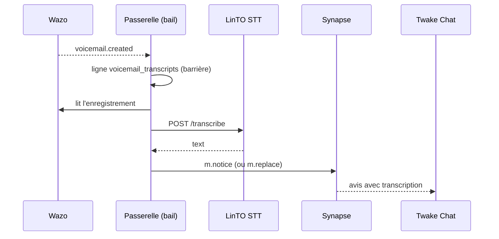

# ADR 0023 : transcription des messages par LinTO STT, avis dans Twake Chat par un bot Matrix, faits par la passerelle qui écrit les boîtes

Date : 2026-10-18. Révisé : 2026-11-14. État : proposée. Remplacé par : aucun. Suit l'ADR 0022.

## Contexte

La démo de l'étape 11 est « un appel en NPD tombe sur la messagerie, le message transcrit arrive dans Chat ». Il faut transcrire le message, montrer le texte sous l'enregistrement (ce qui lève la dérogation au critère 4.1 du RGAA) et prévenir la personne dans Twake Chat, un client Matrix. Les règles de l'ADR 0022 s'appliquent : effacement RGPD, conservation, bail et barrière, ni audio ni texte dans les journaux.

## Décision

- LinTO STT par son API HTTP : `packages/transcription-linto` envoie le WAV à `POST /transcribe` et lit `text`. Le SDK définit `TranscriptionProvider` : un autre service se branche au même endroit. Réglages `LINTO_*`.
- Dev et CI : le vrai LinTO STT (image épinglée, petit modèle français vérifié par SHA-256, `docker/linto/`) et un Synapse épinglé (`docker/synapse/`). Le jeton du bot vient de l'environnement seulement (`MATRIX_BOT_TOKEN`).
- Une seule passerelle transcrit et prévient : celle qui tient le bail `voicemail:<tenant>`. Elle inscrit chaque message dans `voicemail_transcripts`. Chaque écriture passe le bail et sa génération (`FencedLease`) ; une passerelle qui prend le bail reprend ce qui reste dû.
- Les événements manqués sont rattrapés par une réconciliation des boîtes avec la table (prise du bail, reconnexion de Wazo, périodique). Une ligne dont le message manque n'est effacée qu'après deux réconciliations espacées (`orphanConfirmMs`). Un Wazo qui répond des boîtes vides ne fait rien effacer : alerte `transcription-held`, levée par un administrateur (`POST /api/v1/admin/voicemail/transcripts/release`).
- Deux files par organisation, transcriptions et avis : un LinTO lent ne retient pas les avis, qui partent sans texte après une attente bornée. Les échecs sont retentés avec arrêt progressif, puis alertes `transcription-*` et `notice-*`.
- Un message trop long, ou au-delà du plafond d'attente de l'organisation, est gardé sans transcription (`none`, raisons `too-long`, `busy`, `failed`, `untracked`), son avis est envoyé quand même.
- La personne voit `transcript` dans `GET /voicemails` (`pending`, `done`, `none`) et reçoit `voicemail.transcribed`. Le texte est l'alternative textuelle du message (RGAA 4.1), dans sa langue.
- Le bot est un compte Matrix ordinaire, pas un appservice. Pour chaque personne, une salle à lui (`private_chat`, `is_direct`, lui seul invite, sans chiffrement) où il envoie un `m.notice` : appelant, date, durée, transcription ou raison, lien « Écouter dans TwakePhone ». La salle est créée une fois ; invitation refusée ou salle quittée : pas de réinvitation pendant 30 jours.
- Un avis ne sort jamais du serveur de l'organisation : le compte est vérifié par son profil. Le compte Matrix vient de `LDAP_ATTR_MATRIX`, sinon de `MATRIX_USER_TEMPLATE`, sinon pas d'avis. Un avis parti sans texte est complété par `m.replace`, après les mêmes contrôles.
- Le nom donné par l'appelant n'est pas vérifié : l'avis le dit « annoncé par l'appelant », filtré, sans lien. `MATRIX_NOTICE_TEXT=off` retire la transcription de l'avis.
- Effacement : un message supprimé, `DELETE /me/history` ou `POST /api/v1/admin/voicemail/erase` emportent la transcription et retirent l'avis par une rédaction Matrix ; la conservation `VOICEMAIL_RETENTION_DAYS` s'applique aussi. Sans bot, les avis déjà envoyés restent (`chatNotices: "not-withdrawn"`).
- Webhooks : `voicemail.created` et `voicemail.transcribed` (ADR 0020), jamais le texte ni l'audio. Journaux : ni audio, ni texte, ni identifiant Matrix d'une personne.

## Séquence

Il vient de `apps/gateway/src/voicemail-transcripts.ts`, `packages/transcription-linto/src/index.ts` et `apps/gateway/src/matrix.ts`.

## Compromis

- Gagné : un seul appel à LinTO et un seul avis par message, quelle que soit la passerelle ; le texte ne sort pas vers des tiers.
- Perdu / coût : pas de chiffrement de bout en bout ; le serveur Matrix garde l'historique de la salle, et l'avis passe par ses notifications push et courriels.
- Limite connue : un événement perdu plus loin que la WebSocket de Wazo n'est rattrapé qu'à la réconciliation périodique. L'activation par personne et l'annonce à l'appelant (FR-G4) viennent plus tard.

## Alternatives écartées

- Transcrire dans chaque passerelle : autant d'appels et d'avis que de passerelles.
- Texte dans les webhooks : il sortirait de la plateforme sans le titulaire.
- Un appservice Matrix : plus de droits que nécessaire.
- Un faux LinTO en CI : le vrai tient dans le temps d'un runner.

## Code

`packages/transcription-linto/src/index.ts`, `apps/gateway/src/voicemail-transcripts.ts`, `apps/gateway/src/matrix.ts`, `apps/gateway/migrations/019_voicemail_transcripts.sql`, `docker/linto/`, `docker/synapse/`.
