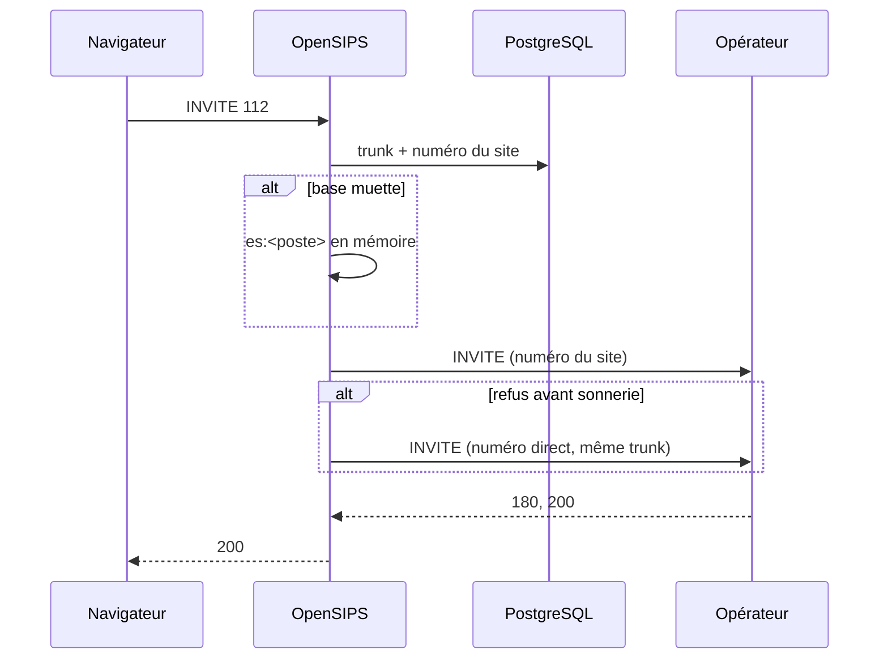

# ADR 0024 : un appel d'urgence présente le numéro du site de l'appelant, lu par OpenSIPS seul ; aucun `Geolocation`

Date : 2026-10-19. Révisé : 2026-11-14. État : proposée. Remplacé par : aucun. Complète les ADR 0016 (urgences) et 0017 (FR-C9). Décidée à la PR de l'étape 6c, dans le fil de discussion du projet.

## Contexte

Un appel d'urgence présente le numéro direct de l'appelant, sinon le numéro par défaut du trunk. L'opérateur rattache ce numéro à l'adresse déclarée de la ligne, et les secours reçoivent cette adresse : une organisation à plusieurs sites n'en a qu'une. Il faut dire, par site, quel numéro présenter. OpenSIPS décide seul : une urgence ne dépend ni de la passerelle ni d'une requête lente (ADR 0017).

## Décision

- Un site (`sites`, `site_members`, `/v1/admin/sites`) a un nom, une adresse postale (texte), un trunk, un numéro E.164 présenté et des membres. Une personne est dans un site au plus. Les sites sont écrits dans les tables d'OpenSIPS `emergency_sites` et `emergency_site_users`, lues directement par le script, comme `dids` : aucun rechargement.
- Le numéro d'un site est un numéro direct du trunk qui sonne un poste ou un groupe : l'opérateur n'accepte comme appelant qu'un numéro de sa ligne, et les secours le rappellent. Il doit sonner une réception, pas une personne seule. L'exploitant le déclare chez l'opérateur avec l'adresse.
- `route[trunk_out]` : pour un appel d'urgence, la requête du trunk (une jointure de plus, aucune requête à part) prend le trunk du site de l'appelant et présente, dans l'ordre, le numéro du site, le numéro direct, le numéro par défaut. Les autres appels sont inchangés. Les reprises de l'ADR 0016 restent.
- Base muette : `timer_route[default_trunk]` garde en mémoire (`cachedb_local`, clés `dn:` et `es:`) les numéros directs et ceux des sites, chaque lecture avec sa génération ; `route[default_trunk]` les lit d'abord. Un site sur un autre trunk que le trunk par défaut n'a pas de repli.
- Le lien d'une personne à son site est son identifiant, joint par `subscriber.holder`. Une personne sans compte ne présente rien ; une personne partie de l'annuaire sort du site à l'enregistrement suivant.
- Si l'opérateur refuse le numéro du site avant toute sonnerie, l'appel repart une fois sur le même trunk avec le numéro direct, sinon celui du trunk (`route[emergency_fallback]`). Jamais après une sonnerie ou une erreur de serveur : les secours seraient appelés deux fois.
- La passerelle garde un site valide : elle refuse de changer ou retirer un numéro qu'un site présente (`SITE_NUMBER_IN_USE`) et de supprimer un trunk qui porte des sites (`TRUNK_HAS_SITES`).
- L'app dit la vérité : `GET /v1/me/emergency-site` ne donne le site que si OpenSIPS a le compte écrit pour la personne (`holdsAccount`) ; sinon les réglages disent que son numéro direct ou celui de l'organisation est présenté.
- Pas de `Geolocation` ni de PIDF-LO (RFC 6442) : par valeur, un corps multipart que l'ADR 0016 refuse vers l'opérateur ; par référence, une URI que les centres français ne lisent pas ; un opérateur qui ne lit pas l'en-tête risque de refuser l'appel.

## Séquence

Il vient de `docker/opensips/opensips.cfg.tpl:1461` (`route[trunk_out]`), `:1492` (`route[default_trunk]`) et `:2106` (`route[emergency_fallback]`).

## Compromis

- Gagné : l'adresse juste par site ; l'urgence ne dépend jamais de la passerelle.
- Perdu / coût : un membre d'un site ne présente plus son numéro direct ; le rappel va à la réception. Qui veut le rappel direct n'est pas mis dans un site.
- Limite connue : l'app ne sait pas où est la personne (un site « Télétravail » reste une affectation manuelle). L'exploitant déclare l'adresse de chaque numéro chez l'opérateur ; les obligations légales de localisation ne sont pas validées au-delà d'un pilote (`docker/pilot/README.md`). Rien n'est vérifié contre un vrai opérateur.

## Alternatives écartées

- `Geolocation` ou PIDF-LO : voir plus haut.
- Un site par plage de numéros directs : un site a plusieurs personnes et plages.
- Lire le site dans une requête à part : une requête lente retarderait une urgence.
- Rattacher le site au poste : un poste qui change de main garderait l'adresse de l'ancien titulaire.

## Code

`docker/opensips/opensips.cfg.tpl`, `packages/provider-opensips/src/trunks.ts`, `apps/gateway/src/app.ts` (`/admin/sites`, `/me/emergency-site`), `apps/gateway/migrations/020_sites.sql`.
