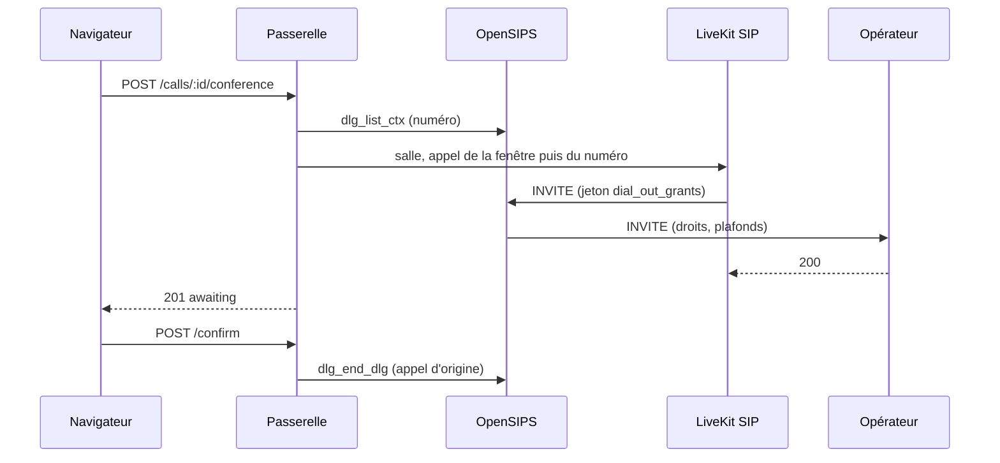

# ADR 0025 : un appel avec l'opérateur devient une conférence en rappelant son numéro depuis la salle

Date : 2026-10-19. Révisé : 2026-11-14. État : proposée. Remplacé par : aucun. Décidée à la PR de l'étape 8c, dans le fil de discussion du projet.

## Contexte

L'ADR 0019 fait d'un appel entre deux postes une conférence avec `Replaces`. Avec l'opérateur c'est impossible : OpenSIPS est un proxy sans B2BUA (ADR 0004, 0018) et un opérateur n'exécute pas `Replaces`. La salle doit donc rappeler l'autre partie, sans perdre le vrai correspondant au profit d'un répondeur.

## Décision

- Le geste est celui de 0019 : `POST /calls/:id/conference`. La passerelle lit le dialogue chez OpenSIPS (MI `dlg_list_ctx`), jamais chez le navigateur. Le numéro rappelé est `$dlg_val(dialled)` (appel passé) ou `$dlg_val(cli)` (appel reçu), jamais le `From`, qui garde un numéro masqué par `Privacy`.
- Refus `CONFERENCE_EXTERNAL` (409), sans rien appeler : appel de salle, boîte vocale, numéro masqué, non-numéro, urgence.
- La salle appelle la fenêtre, puis le même numéro, par `dial_out_grants` et `route[meet_source]` : droits, plafonds et refus de la personne s'appliquent comme à tout appel du poste.
- Numéro occupé, sans réponse ou refusé : 409 `DIAL_FAILED`, salle supprimée, appel d'origine rétabli.
- Si le numéro décroche, rien n'est raccroché seul (une messagerie décroche aussi). L'appel d'origine est gardé, muet, et la fenêtre demande « Entendez-vous votre correspondant ? ».
- `POST /conferences/:id/confirm` termine l'appel d'origine par OpenSIPS (MI `dlg_end_dlg`), au Call-ID enregistré à la création (`originCall`). `POST /conferences/:id/cancel` termine la salle et rend l'appel.
- Confirmer et annuler s'excluent : `origin_call` et `decision` (migration 021), `Store.decideConference`, écriture atomique, le premier gagne (`CONFERENCE_CANCELLED` ou `CONFERENCE_CONFIRMED`), le même geste rejoué réussit.
- Pas de minuteur : si la fenêtre disparaît, la garde de propriétaire de 0019 ferme la salle (webhook `participant_left`, ou `watchOwner` en mémoire).

## Séquence

Source : `apps/gateway/src/app.ts:3373` (appel), `:3484` (confirmation), `docker/opensips/opensips.cfg.tpl:1195`.

## Compromis

- Gagné : aucun B2BUA ; une seule voie de contrôle (0017).
- Coût : l'autre partie reçoit un second appel ; les minutes réservées de l'appel d'origine et du rappel comptent deux fois jusqu'à la confirmation ; un refus `limit` près du plafond est possible.
- Limite connue : `cli` vient du `From` de l'opérateur, non authentifié ; un numéro permis peut être rappelé sur la foi d'un appelant, et la personne voit le numéro avant de confirmer. CDR des appels de la salle vers le public : `via = meet`.
- Meet : décision du 2026-11-13, voir ADR 0018. Le rappel depuis la salle est un dial-out, absent de la téléphonie de Meet upstream (https://github.com/suitenumerique/meet/blob/main/docs/features/telephony.md : entrée seulement). Code pas encore aligné : `packages/conference-livekit` fait encore le dial-out chez nous.

## Alternatives écartées

- `Replaces` ou REFER vers l'opérateur : aucun opérateur ne les exécute.
- Rappeler par le numéro direct de la personne : c'est le numéro de l'autre partie qui doit sonner.
- Garder l'ancien appel muet pour toujours : deux appels vers le même correspondant.
- Lire le `From` du dialogue : rappellerait un numéro masqué.

## Code

`apps/gateway/src/app.ts`, `apps/gateway/src/store/` (`decideConference`), `apps/gateway/migrations/021_conference_decision.sql`, `packages/provider-opensips/src/index.ts`, `docker/opensips/opensips.cfg.tpl`.
