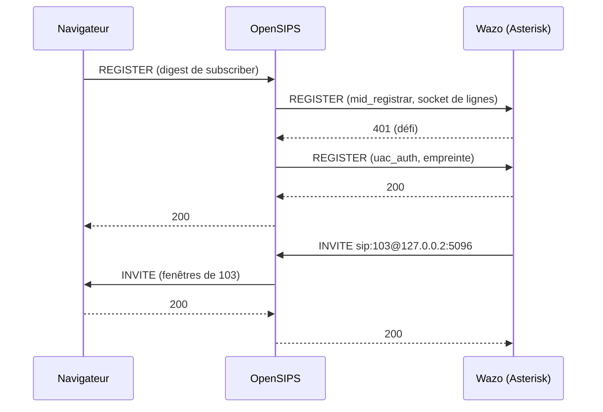

# ADR 0027 : Wazo fait sonner les navigateurs par `mid_registrar`, sur un socket de lignes à part

Date : 2026-10-19. Révisé : 2026-11-14. État : proposée. Remplacé par : aucun. Précise 0005 et 0022 ; 0028 s'y appuie.

## Contexte

Wazo ne fait sonner qu'une ligne (un endpoint PJSIP enregistré), pas un navigateur. Pour les SVI, files et groupes séquentiels (0028), Wazo doit voir un contact par extension, avec les fenêtres derrière OpenSIPS. Tout ce qui existe (étapes 3 à 11b) reste dans OpenSIPS.

## Décision

- Aucun appel interne ne passe par Wazo : deux serveurs ne décident jamais du même appel. Seul un INVITE que Wazo place fait sonner les fenêtres (`route[rules_step]`, CDR `via = wazo`).
- Une ligne par extension (`provider-wazo`, `syncLines`) : endpoint wazo-confd nommé comme l'extension, étiquette `TwakePhone`, mot de passe = 32 premiers hexa de HMAC-SHA-256(`WAZO_LINE_KEY`, extension), recalculé des deux côtés (`s.sha256_hmac`). Rien de la personne chez Wazo. Un changement d'extension écrit chez Wazo. Les lignes sont retirées de `wazo_lines` avant d'être retirées chez Wazo.
- `mid_registrar` (mode 2, AOR throttling) seulement avec `WAZO_LINES=1` et l'extension dans `wazo_lines` ; sinon `save("location")` comme avant. Les contacts restent dans `location` (lookup, Web Push, présence).
- Socket de lignes à part (`WAZO_LINES_LISTEN_IP:WAZO_LINES_PORT`, 127.0.0.2:5096), autre adresse que le socket des boîtes (127.0.0.1:5095) : Asterisk identifie le premier par IP (trunk), le second comme une ligne.
- Les enregistrements ne dépendent jamais de Wazo : un REGISTER que Wazo ne prend pas coûte un 503 à cette fenêtre, puis Wazo est écarté (serveur muet : toutes les extensions 30 s, `wazo_lines_mute_until` ; ligne refusée : cette extension 5 min).
- Une désinscription (`expires=0`, `Contact: *`) se fait à OpenSIPS seul, tout de suite (correction de 0028 §7) ; le contact de Wazo expire (`outgoing_expires` 600 s).
- Éteint sans `WAZO_LINES=1` ou sans `WAZO_SIP`.

## Séquence

Source : `docker/opensips/opensips.cfg.tpl:883` (REGISTER), `:3972` (`wazo_register_failed`), `docker/opensips/entrypoint.sh:274` (socket).

## Compromis

- Gagné : Wazo voit un état d'enregistrement par extension ; le chemin des étapes 3 à 11b est inchangé.
- Coût : chaque ligne est un rechargement de PJSIP chez Asterisk ; 3 écritures par extension.
- Limite connue : la première fenêtre qui s'enregistre alors que Wazo est tombé attend le délai d'un REGISTER (5 s) et reçoit un refus. Un REFER d'un appel de Wazo est refusé. Pas de rotation de `WAZO_LINE_KEY`. Wazo sur une autre machine : `WAZO_LINES_LISTEN_IP` doit être l'adresse d'OpenSIPS. Non vérifié : Wazo installé par paquets ; la charge.
- Droits du compte de la passerelle : `confd.endpoints.sip.*` et `confd.lines.*` (`TWAKE_ACL`) ; wazo-auth n'a pas de droit plus fin.

## Alternatives écartées

- Tous les appels par Wazo : deux décideurs, toutes les fonctions à déplacer.
- Trunk Wazo sans enregistrement : Wazo ne saurait pas qu'un agent est injoignable.
- `uac_registrant` : pas de `mid_registrar`, un contact qui ne dit rien des fenêtres.
- Même socket que les boîtes : Asterisk refuserait les REGISTER (endpoint `opensips` identifié par IP).
- Mot de passe par ligne dans `wazo_lines` : un secret de plus ; l'empreinte suffit.
- `save()` de repli en `failure_route` : impossible en OpenSIPS 3.6.

## Code

`docker/opensips/opensips.cfg.tpl`, `docker/opensips/entrypoint.sh`, `packages/provider-wazo/src/`, `packages/provider-opensips/src/index.ts` (`wazo_lines`), `docker/wazo/config/pjsip.json`.
