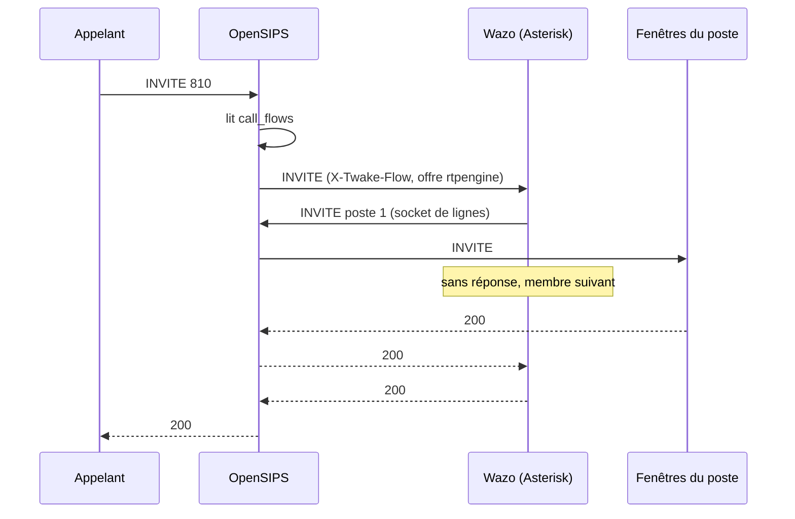

# ADR 0028 : SVI, files et groupes séquentiels : des parcours d'appel réglés dans la passerelle, exécutés par Wazo

Date : 2026-10-20. Révisé : 2026-11-14. État : proposée. Remplacé par : aucun. S'appuie sur 0027 et 0022 ; complète 0014 (les groupes simultanés restent à OpenSIPS).

## Contexte

L'ADR 0005 réserve à Wazo trois fonctions : groupe séquentiel (sonnerie en cascade), file d'attente, SVI. Sans lignes Wazo (`WAZO_LINES`), le comportement d'avant ne change pas.

## Décision

- `CallFlow` (`telephony-types`) : `number` (2 à 6 chiffres, jamais 0 en tête, jamais urgence, jamais poste, groupe ni accès Meet), `kind` (`sequential`, `queue`, `menu`), `members` (1 à 12 postes), `ringSec`, `waitSec`, `choices` et `greeting` pour un standard. Gardés dans le `Store` (`call_flow_configs`, migration 023), réglés par les administrateurs (`/api/v1/admin/flows`, capacité `callFlows`, écran « Parcours d'appel »).
- Wazo : un groupe wazo-confd par groupe séquentiel et par file (`provider-wazo`, `syncFlows`), stratégie `linear` ou `least_recent`, membres `Local/<poste>@twake-members` (`WAZO_MEMBERS_CONTEXT`). La stratégie n'est jamais modifiée en place : un changement de type refait le groupe. Le standard n'est pas une ressource Wazo (son IVR passe par wazo-agid) : ses touches sont dans la route.
- La route (`seq|…`, `queue|…`, `menu|…`) est écrite dans `call_flows` (base d'OpenSIPS) seulement quand Wazo a le groupe, et retirée avant lui (`beforeRemoval`).
- OpenSIPS : un numéro qui a une route passe avant le groupe d'appel (`route[rules_step]`), vers Asterisk par le socket des boîtes, avec `X-Twake-Flow` (retiré de tout INVITE entrant). Échec ou Wazo écarté : `480`, jamais 404 (`group_missed`). Plafonds `FLOW_CALLS_PER_CALLER` et `FLOW_CALLS_ALL` : 486 au-delà. CDR `via = flow`.
- Dialplan de la stack : `docker/wazo/asterisk/extensions-flows.conf` (`Queue`, `Background`, `WaitExten`, `Hangup(19)` en échec).

## Séquence

Source : `docker/opensips/opensips.cfg.tpl:3443`, `docker/wazo/asterisk/extensions-flows.conf`.

## Compromis

- Gagné : files, SVI et cascades sans second écrivain d'OpenSIPS.
- Coût : un groupe est un rechargement des files chez Asterisk.
- Limite connue : un poste en ne pas déranger ou en renvoi sonne quand même depuis un groupe ; pas de musique d'attente ni de position ; pas de SDA vers un parcours ; pas de standard dans un standard ; route limitée à 2000 caractères. Non vérifié : Wazo par paquets, charge, IVR de wazo-confd.

## Alternatives écartées

- Étendre `RingGroup` : deux exécutants pour une table.
- Parcours seulement chez OpenSIPS ou Wazo : la passerelle perdrait la donnée.
- `/queues` de wazo-confd : membres utilisateurs ou agents, or une ligne n'a pas d'utilisateur (0027).
- IVR de wazo-confd : dépend de wazo-agid.
- `serialize_branches` : cascade sans file ni standard.

## Code

`apps/gateway/src/call-flows.ts`, `apps/gateway/migrations/023_call_flow_configs.sql`, `packages/provider-wazo/src/`, `packages/provider-opensips/src/index.ts`, `docker/opensips/opensips.cfg.tpl`, `docker/wazo/asterisk/`.
