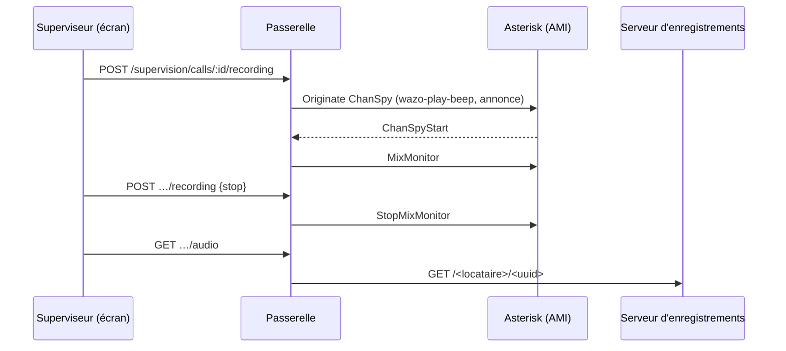

# ADR 0029 : enregistrement et supervision des appels qui passent par Wazo, par l'AMI d'Asterisk

Date : 2026-10-20. Révisé : 2026-11-14. État : proposée. Remplacé par : aucun. Précise 0005 ; s'appuie sur 0022 et 0027.

## Contexte

`MixMonitor` et `ChanSpy` n'agissent que sur un canal Asterisk. Un appel de personne à personne n'en a pas (0027) : il n'est ni enregistré ni supervisé ici. Sont couverts les appels que Wazo place vers une ligne. Les API de wazo-calld refusent une ligne sans utilisateur Wazo ; call-logd n'existe pas dans la stack.

## Décision

- `provider-wazo` parle à l'AMI (`WAZO_AMI`) par deux comptes : `WAZO_GATEWAY_AMI_USER` (`system` + `reporting` : `CoreShowChannels`, `MixMonitor`) et `WAZO_GATEWAY_ORIGINATE_USER` (`originate` seul). Un seul compte ferait de `Originate` un shell ; la passerelle refuse de démarrer avec le même compte.
- Un appel est un canal `PJSIP/<extension>-<suffixe>`. Superviser : `Originate` vers la ligne du superviseur qui exécute `ChanSpy` (écouter `uqE`, souffler `uqEw`, intervenir `uqEB`) ; non annoncé, journalisé.
- Annonce légale avant tout enregistrement : contexte Wazo `wazo-play-beep`, son `RECORDING_NOTICE_SOUND` ; pas d'annonce, pas d'enregistrement (503 `NOTICE_MISSING`, ou 502). `MixMonitor` part après le `ChanSpyStart` de l'annonce.
- Droits : administrateurs, ou `SUPERVISOR_ROLE` / `SUPERVISOR_USERS` ; seul un administrateur supprime. Pas de supervision de son propre appel (`OWN_CALL`). Effacement avec `DELETE /me/history`.
- Conservation `RECORDING_RETENTION_DAYS` (30 par défaut), tour toutes les 10 minutes ; journal `supervision_log` sans numéro ni parole ; pas d'action sans sa ligne (503 `JOURNAL_UNAVAILABLE`).
- Fichiers servis par un serveur d'enregistrements à nous (`WAZO_RECORDINGS_URL`, `docker/wazo/recordings.py`), pas call-logd.
- Routes : `/api/v1/supervision/{calls,recordings,log}`, `…/calls/:id/recording`, `…/spy` ; migration 024 ; capacité `supervision`. Sans `WAZO_AMI` : 501.

## Séquence

Source : `apps/gateway/src/supervision.ts:343`, `packages/provider-wazo/src/`.

## Compromis

- Gagné : annonce et journal avant toute écoute ; deux comptes AMI étroits.
- Coût : un appel au superviseur compte comme un appel de Wazo (CDR `wazo`).
- Limite connue : qu'Asterisk dise que l'annonce a démarré ne prouve pas que les deux parties l'entendent (non mesuré). Information préalable des salariés et base légale à l'organisation (CNIL). Supervision des files : pas faite. Non vérifié : Wazo par paquets, charge.

## Alternatives écartées

- `record-call` de rtpengine : média chiffré à décoder, un démon de plus.
- Tous les appels par Wazo : écarté en 0027.
- wazo-calld, snoop de calld, wazo-amid REST : ligne sans utilisateur, application Stasis, locataire maître.
- Annoncer l'écoute du superviseur : retire son but.
- Enregistrer sans annonce : l'annonce est le texte légal.

## Code

`apps/gateway/src/supervision.ts`, `apps/gateway/migrations/024_recordings_supervision.sql`, `packages/provider-wazo/src/`, `docker/wazo/recordings.py`.
