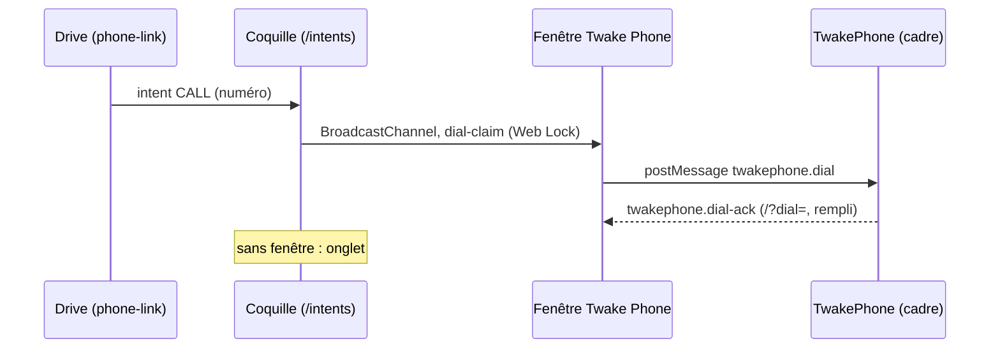

# ADR 0032 : TwakePhone dans Twake Workplace, par une coquille Cozy qui l'encadre

Date : 2026-10-30. Révisé : 2026-11-14. État : proposée. Remplacé par : aucun. Précise 0006 ; s'appuie sur 0031.

## Contexte

Le POC était une app Cozy ; 0006 l'a remplacée par une app web autonome (OIDC), donc TwakePhone n'est plus dans Workplace et `phone-link` ouvre une app absente. La fiche TWP-633 et le CCTP CANUT §7.4.6.2 demandent un écran « Softphonie » et le click-to-call sur tout numéro. Workplace a une forme pour cela : la coquille (`cozy-twakechat`, `cozy-twakemail`).

## Décision

- `apps/workplace` : une app Cozy (slug `phone`, drapeau `phone.embedded-app-url`), barre Twake, `apps/web` dans une iframe `allow="microphone; autoplay; clipboard-write"`. Aucune dépendance Cozy dans `apps/web`. `FRAME_ANCESTORS` nomme les instances.
- Encadrée, la connexion s'ouvre dans une fenêtre (`signinPopup`, `twakephone-signin`), au clic seulement : le fournisseur d'identité refuse d'être encadré (LemonLDAP::NG : non vérifié). Session renouvelée par `offline_access`.
- L'intent `CALL` (`io.twake.phone.number`) : le service `/intents` valide (`toDialTarget`) et confie le numéro par `BroadcastChannel` à une fenêtre visible qui prend un Web Lock (`dial-claim`, `twakephone.dial`, accusé `twakephone.dial-ack` 1 s). Sans fenêtre en 400 ms : `phone-link` ouvre `#/bridge/?dial=<numéro>`. Rien n'est composé.
- Les contacts `io.cozy.contacts` de la personne nomment, après l'annuaire, les numéros E.164 inconnus, jamais un poste interne ; un numéro partagé par deux noms ne nomme personne. Demandés par le pont (`requestParentOrigin`), 1 000 par page ; la passerelle ne les voit jamais.

## Séquence

Source : `apps/workplace/src/dialRelay.js`, `apps/web/src/embedded.ts:27`.

## Compromis

- Gagné : TwakePhone dans la grille d'apps sans seconde application ; un lien ne compose jamais (0031).
- Coût : un cadre tiers, une connexion par fenêtre.
- Limite connue : `BroadcastChannel` et Web Lock sont cloisonnés par site (un domaine de la liste des suffixes publics sépare Drive de Twake Phone : l'app s'ouvre dans un onglet). La première fenêtre visible prend le numéro même si son cadre est déconnecté. Le `frame-src` de cozy-stack doit admettre l'origine de TwakePhone. Non fait : le widget (0034), l'essai sur LemonLDAP::NG, la publication au registre Cozy, l'usage de `phone-link` par Drive, Contacts et Mail. L'e2e joue un faux cozy-stack, un seul site, Chromium.

## Alternatives écartées

- Remettre l'app Cozy du POC : deux applications (0006).
- Un intent qui compose : un lien ne compose jamais.
- Relayer à une fenêtre en arrière-plan : un clavier que personne ne voit.
- Connexion dans le cadre par redirection : refusée par le fournisseur d'identité.

## Code

`apps/workplace/` (`manifest.webapp`, `src/dialRelay.js`, `test/workplace.e2e.mjs`), `apps/web/src/embedded.ts`, `apps/web/src/auth/AuthProvider.tsx`, `packages/phone-link/src/index.tsx`.
