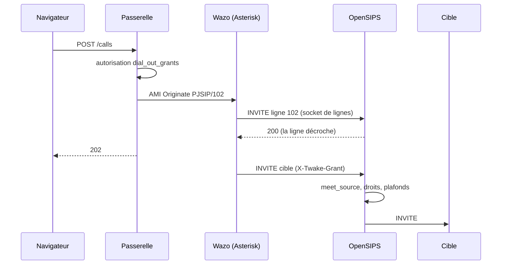

# ADR 0033 : click-to-call, Wazo fait sonner le téléphone de la personne puis appelle le numéro à son nom

Date : 2026-10-30. Révisé : 2026-11-14. État : proposée. Remplacé par : aucun. S'appuie sur 0027, 0029 et 0018. Décidée dans le fil de discussion du projet (« faire ce qu'il manque pour arriver au niveau du POC »).

## Contexte

Le POC lançait un appel depuis le serveur. Depuis le retrait d'Asterisk, `provider-opensips` répond 501 : OpenSIPS est un proxy et ne place pas d'appel. Qui a un téléphone de bureau ou Linphone (0002) doit pouvoir appeler depuis le clavier. Wazo place des appels vers les lignes (0027).

## Décision

- `POST /calls`, quand `calling.outbound` est faux et que la personne a une ligne Wazo : la passerelle écrit une autorisation `dial_out_grants` (`room = 'click-to-call'`, extension, numéro, 40 s, jeton), puis demande à l'AMI (compte `originate`, 0029) un `Originate` du canal `PJSIP/<extension>`, contexte `twake-click-to-call`, variables `TWAKE_LINE`, `TWAKE_TARGET`, `TWAKE_GRANT`.
- Ligne décrochée, le contexte compose la cible par l'endpoint de la ligne (`Dial`, 60 s) avec `X-Twake-Grant`. Asterisk ponte les deux appels.
- OpenSIPS : un INVITE du socket de lignes avec `X-Twake-Grant` (et une offre, sinon 488) prend l'autorisation par `route[meet_source]` (salle `click-to-call` seulement, jamais celle d'une salle de Meet), puis suit le chemin d'un appel de la personne : droits, plafonds, anti-fraude, trunk (0017). CDR `via = click-to-call`.
- `/capabilities` dit `clickToCall` ; « Appeler depuis mon téléphone » à côté de « Appeler ». Jamais depuis un lien seul (0031).
- Codes de refus : `CLICK_TO_CALL_RINGING`, `_NO_ANSWER`, `_UNREACHABLE`, `_TIMEOUT`. Réponse 202 une fois la ligne décrochée (30 s au plus).
- Écart : la ligne d'index (`README.md`) dit `Originate` puis `Transfer` vers la cible, avec un REFER laissé passer. Le code fait `Dial` dans le dialplan (`docker/wazo/asterisk/extensions.conf:56`) et OpenSIPS ne laisse passer aucun REFER pour cela.

## Séquence

Source : `apps/gateway/src/app.ts:1936`, `docker/opensips/opensips.cfg.tpl:763`.

## Compromis

- Gagné : l'appel passe par les droits et plafonds de la personne ; aucun B2BUA.
- Coût : le média passe par Asterisk (pont) ; le CDR montre deux appels (`wazo` vers la ligne, `click-to-call` vers la cible) ; la supervision ne voit qu'un des deux canaux.
- Limite connue : le jeton passe dans les variables du canal (une fois, 40 s) ; `wazo_lines` peut avoir du retard ; pas de limite de débit côté passerelle ; la clé d'idempotence n'est pas lue.

## Alternatives écartées

- `Transfer()` d'Asterisk : mesuré, le canal de Wazo ne se termine jamais (BYE, `TIMEOUT(absolute)` et `Hangup` AMI n'y font rien) ; il demandait aussi une exception aux REFER.
- Wazo sort vers l'opérateur sans OpenSIPS : hors droits et plafonds (0016, 0017).
- `b2b_logic` : un module de plus pour ce que Wazo fait.

## Code

`apps/gateway/src/app.ts`, `packages/provider-wazo/src/`, `docker/wazo/asterisk/extensions.conf`, `docker/opensips/opensips.cfg.tpl`, `apps/gateway/src/click-to-call.spec.ts`.
