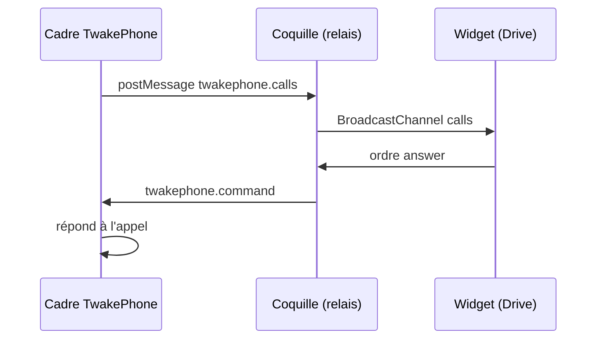

# ADR 0034 : le widget des autres apps est une télécommande de la fenêtre Twake Phone, pas un téléphone

Date : 2026-10-30. Révisé : 2026-11-14. État : proposée. Remplacé par : aucun. S'appuie sur 0032.

## Contexte

Le widget du POC portait un softphone dans un cadre caché, avec un jeton de cozy-stack. Aujourd'hui TwakePhone se connecte en OIDC, la session vit dans l'onglet (`sessionStorage`) et, encadré, ne se connecte qu'au clic : un cadre caché de taille zéro n'aurait jamais de session. `@twake/phone-widget` monte l'intent `io.twake.phone.widget` dans une app hôte, et personne ne le sert.

## Décision

- Un seul téléphone : la fenêtre Twake Phone. Son cadre (`ParentCalls`, `apps/web/src/embedded.ts`) dit ses appels à son parent (`twakephone.calls` : id, sens, état, numéro, nom ; rien du média) vers l'origine du pont (`requestParentOrigin`), et n'exécute que `answer`, `reject`, `hangup` (`twakephone.command`), de son parent seul.
- La coquille (`apps/workplace/src/callsRelay.js`) relaie sur le `BroadcastChannel` de son origine et porte au cadre les ordres qui nomment sa fenêtre.
- Le widget est la page `/intents` de la coquille (`widget.js`, sans React) : il demande les appels (`calls-request`), montre l'appel qui sonne d'abord, règle sa taille (`resizeClient`, 0 sans appel). Les numéros confiés par `phone-link` (`twake-phone:dial`) suivent le relais `CALL` de 0032.

## Séquence

Source : `apps/workplace/src/callsRelay.js`, `apps/workplace/src/widget.js`, `apps/web/src/embedded.ts:79`.

## Compromis

- Gagné : aucune session, aucun micro, aucun contact SIP de plus ; la fenêtre Twake Phone reste celle qui sonne et parle.
- Coût : sans fenêtre Twake Phone ouverte, le widget ne montre rien (le Web Push de l'étape 5 prévient).
- Limite connue : la confiance s'arrête à l'origine de la coquille ; `FRAME_ANCESTORS` ne doit nommer que des instances. Le cadre redit ses appels toutes les 10 s, le widget oublie une fenêtre muette depuis 25 s. Une seule carte à la fois. Toute app Cozy peut ouvrir l'intent et saisir, par la taille de son cadre, que la personne est en appel (accepté). Le cloisonnement par site de 0032 vaut ici. Non prouvé de bout en bout : un appel SIP piloté depuis le widget (l'e2e de la coquille n'a pas de serveur SIP).

## Alternatives écartées

- Un softphone dans le widget : pas de session possible, et une fenêtre de plus qui sonne par app.
- Le jeton de session dans `localStorage` : il survivrait à l'onglet et s'exposerait à toute page de l'origine.

## Code

`apps/web/src/embedded.ts`, `apps/workplace/src/callsRelay.js`, `apps/workplace/src/widget.js`, `packages/phone-widget/src/index.ts`, `apps/workplace/test/workplace.e2e.mjs`.
