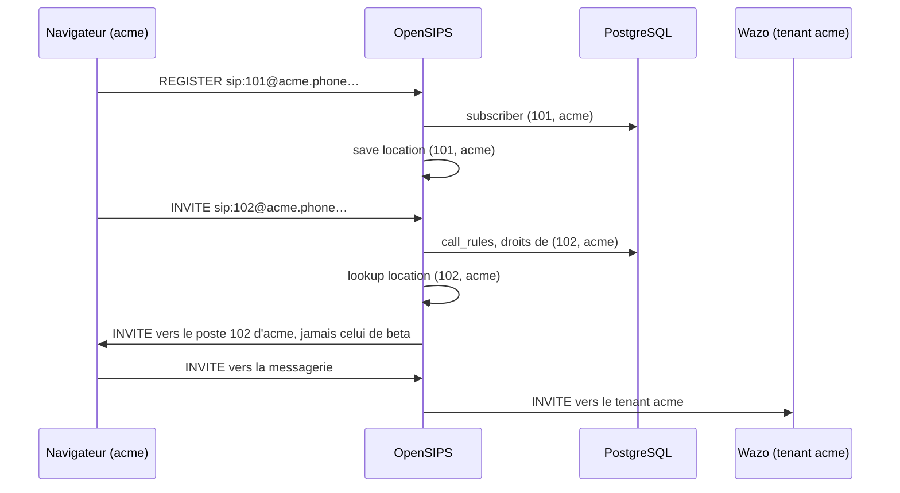

# ADR 0036 : SaaS multi-tenant sur une pile partagée, un domaine SIP par client

Date : 2026-11-15. État : acceptée, code pas encore aligné. Remplacé par : aucun. Précise : ADR 0004, 0005, 0016. Décidée dans le fil de discussion du projet le 2026-11-15, après une consultation par messages directs le 2026-11-14 : trois personnes consultées, une réponse (contre une pile par client, sans avis sur Wazo).

## Contexte

TwakePhone sera vendu en SaaS dans Twake Workplace, à plusieurs organisations. La passerelle sépare déjà les organisations (`tenant_id` en base). Le chemin des appels n'en sert qu'une : OpenSIPS indexe les postes par leur seul numéro (`use_domain 0`), et Wazo n'a qu'un tenant (`twakephone`). Deux options ont été pesées : une pile par client, ou une pile partagée.

## Décision

- Une seule pile (OpenSIPS, rtpengine, PostgreSQL, Wazo, passerelle) sert toutes les organisations. Pas de pile par client.
- Chaque organisation a son domaine SIP. OpenSIPS passe en multi-domaine (`use_domain 1`).
- Les postes, les contacts, les règles d'appel, les groupes et les numéros directs sont indexés par `(tenant, poste)`. Le poste 101 de deux clients désigne deux postes distincts.
- Chaque organisation a son tenant Wazo, au lieu du seul tenant `WAZO_TWAKEPHONE_TENANT`.

## À préciser

Propositions, pas encore décidées :

- Modules OpenSIPS touchés : `use_domain` sur `auth_db` et `usrloc`, et le module `domain` pour relier un domaine au `tenant_id` (non vérifié dans la doc d'OpenSIPS 3.6).
- Source du tenant d'une session : le jeton OIDC de LemonLDAP (attend les faits sur LemonLDAP). `DEFAULT_TENANT` resterait pour le mode dev et une installation à un seul client.
- Trunks par organisation : la table `trunks` a déjà un `tenant_id` (`packages/provider-opensips/src/trunks.ts:82`), mais une base OpenSIPS ne sert qu'un tenant de trunks.
- Partage de la capacité : les plafonds par organisation ne bornent que les appels sortants (`route[outbound_limit]`, `opensips.cfg.tpl:1883`). Rien n'empêche encore une organisation de prendre toute la capacité de la pile en appels internes.

## Séquence

Modèle cible. Aujourd'hui, `save` et `lookup` n'utilisent que le numéro (`docker/opensips/opensips.cfg.tpl:934` et `:3580`).

## Code actuel, à aligner

- OpenSIPS : `modparam("auth_db", "use_domain", 0)` (`opensips.cfg.tpl:133`) ; `usrloc` en `single-instance-no-db` (`:144`) ; les requêtes SQL du script filtrent par `username` sans tenant (par exemple `subscriber s WHERE s.username = $rU` à `:3385`).
- Wazo : un seul tenant, `TWAKE_TENANT = os.environ.get('WAZO_TWAKEPHONE_TENANT','twakephone')` (`docker/wazo/bootstrap.py:25`).
- Passerelle : `DEFAULT_TENANT` fixe le tenant de l'authentification (`apps/gateway/src/auth.ts:210`), de l'annuaire (`ldap-directory.ts:267`), du trunk OVH (`main.ts:186`) et des boîtes vocales (`main.ts:193`).

## Compromis

- Gagné : une seule pile à exploiter, à surveiller et à faire monter en charge ; un nouveau client se crée par des lignes en base, sans déploiement.
- Perdu / coût : gros chantier sur le script OpenSIPS (4 662 lignes) et sur la passerelle ; une panne de la pile touche tous les clients.
- Limite connue : une erreur de filtre (une requête sans tenant) mélange deux clients ; chaque requête du script devra être testée avec deux tenants. Capacité de la pile commune non mesurée (banc de charge à venir). Découper Wazo autrement (une instance par client, par exemple) n'a pas été étudié.

## Alternatives écartées

- Une pile par client, créée par le chart : isolation forte et peu de code à changer, mais le coût et l'exploitation montent avec chaque client .

## Code

`docker/opensips/opensips.cfg.tpl`, `docker/wazo/bootstrap.py`, `apps/gateway/src/auth.ts`, `apps/gateway/src/main.ts`, `apps/gateway/src/ldap-directory.ts`.
