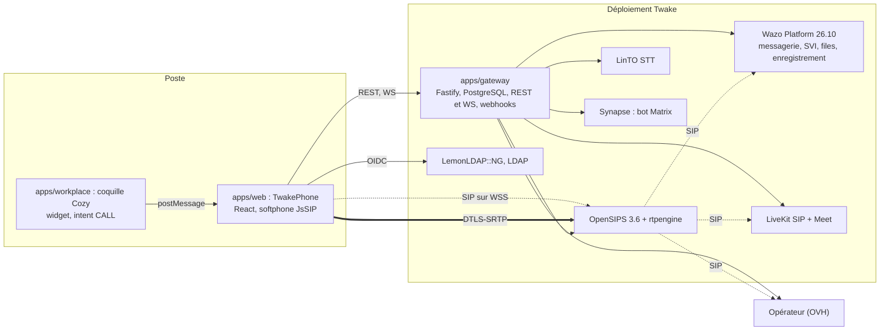

# Architecture : TwakePhone (vue BMAD)

**Date :** 2026-11-02
**Méthode :** BMAD v6, phase 3 (solution), sur un projet existant
**Entrées :** [PRD](prd-twake-phone-2026-11-02.md), `docs/ARCHITECTURE.md` (référence détaillée de ce qui est implémenté), ADR 0001 à 0034

Ce document ne recopie pas `docs/ARCHITECTURE.md`. Il relie les exigences du PRD aux choix d'architecture, et il dit ce qui manque.

## 1. Moteurs d'architecture

1. **Souveraineté et licences** (NFR-011) : uniquement des briques open source, hébergées chez le bénéficiaire.
2. **Rien sur le poste** (FR-004) : le navigateur est le téléphone.
3. **Neutralité vis-à-vis du fournisseur** : l'app et la passerelle ne connaissent que le contrat `provider-sdk`. OpenSIPS, Wazo, OVH et LiveKit restent chacun dans leur provider.
4. **Plan de contrôle séparé du plan média** : la passerelle ne voit jamais l'audio.
5. **Fraude et droits décidés par le serveur SIP** (NFR-005) : rien ne contourne OpenSIPS, pas même Wazo (ADR 0033).
6. **L'e2e comme preuve** (NFR-010).

## 2. Style

Une application web (SPA React) et une passerelle modulaire (monolithe Fastify à providers). Le serveur SIP et le serveur de central sont des services externes, pilotés par base de données, MI, AMI et REST.

## 3. Pile

| Couche | Choix | ADR |
|---|---|---|
| Front | React, cozy-ui et Twake MUI, OIDC avec PKCE, i18n en français et en anglais | 0006 |
| Softphone | JsSIP, WebRTC, service worker et Web Push | 0003, 0015 |
| Passerelle | Node 24, Fastify, OpenAPI, PostgreSQL | 0007 |
| Serveur SIP | OpenSIPS 3.6 (`usrloc` puis `mid_registrar`, `dispatcher`, `dialplan`, `fraud_detection`, `acc`) | 0004, 0016, 0017, 0027 |
| Média | rtpengine, deux interfaces (interne et externe) | 0030 |
| Central | Wazo Platform 26.10 (Asterisk 22) | 0005, 0022, 0028, 0029 |
| Conférence et visio | LiveKit, LiveKit SIP, Meet | 0018, 0019, 0026 |
| Transcription | LinTO STT, bot Matrix | 0023 |
| Opérateur | OVH (`provider-ovh`) | 0021 |
| Intégration Workplace | Coquille Cozy, intent `CALL`, `PhoneLink`, widget télécommande | 0031, 0032, 0034 |

## 4. Composants

| Composant | Rôle | Exigences |
|---|---|---|
| `apps/web` | Clavier, appel en cours, récents, annuaire, réglages, administration, supervision | FR-004 à FR-030 |
| `packages/softphone` | Enregistrement, appels, attente, transferts, DTMF, plusieurs fenêtres | FR-004 à FR-009 |
| `apps/gateway` | Comptes, présence, renvois, groupes, droits, CDR, webhooks, click-to-call, synchronisation de l'annuaire et de Wazo | FR-001 à FR-003, FR-010, FR-013 à FR-033 |
| `provider-opensips` | Écritures en base d'OpenSIPS, MI, événements | FR-003, FR-013, FR-014, FR-017, FR-020, FR-028 |
| `provider-wazo` | Boîtes vocales, lignes, parcours, AMI (`Originate`, supervision) | FR-001, FR-015, FR-017 à FR-022 |
| `provider-ovh` | Repli des lignes, CDR de l'opérateur | FR-016, FR-010 |
| `conference-livekit` | Salles, accès téléphonique, conférences | FR-008, FR-034 |
| `phone-link`, `apps/workplace` | Click-to-call et télécommande dans les autres apps | FR-001, FR-002, FR-035 |

## 5. Données

PostgreSQL de la passerelle : comptes, annuaire, renvois, groupes, parcours, alertes, file de webhooks. PostgreSQL d'OpenSIPS : `subscriber`, `call_rules`, `call_groups`, `display_names`, `push_targets`, `acc`. Wazo garde ses propres bases (confd, messages).

Une seule source par donnée :
- l'annuaire LDAP pour les personnes (ADR 0009) ;
- `acc` pour l'historique des appels (ADR 0011) ;
- la passerelle pour les parcours d'appel (ADR 0028).

## 6. Couverture des NFR

| NFR | Solution | Écart |
|---|---|---|
| NFR-001 Performance | Le navigateur parle directement à OpenSIPS. La passerelle reste hors du chemin de l'appel. | Pas de mesure sur le pilote. |
| NFR-002 Configuration à chaud | Les écritures vers wazo-confd sont fusionnées par la file de wazo-sysconfd. | Un rechargement PJSIP bloque les appels ~30 s. Il faut le regrouper ou le planifier, ou faire porter les lignes par un « realtime » Asterisk plutôt que par un rechargement de fichier. |
| NFR-003 Authentification | OIDC avec PKCE, secrets `env:NOM`, secret SIP par personne | Le mode `jwt` n'est pas éprouvé en réel ; les secrets ne sont pas par session. |
| NFR-004 Chiffrement | WSS, TLS, DTLS-SRTP (rtpengine) | Trunk en clair (selon l'opérateur). |
| NFR-005 Fraude | `fraud_detection`, profils de dialogue, plafonds par défaut, autorisations `dial_out_grants` | Aucun. |
| NFR-006 Fiabilité | Webhooks au moins une fois, bail en base | Une seule réplique ; l'appartenance des appels est en mémoire (Redis à faire). |
| NFR-007 Accessibilité | Socle RGAA, focus et rôles ARIA testés en e2e | Pas d'audit complet. |
| NFR-008 Compatibilité | Trois navigateurs en CI ; SIP standard | Safari non joué. |
| NFR-010 Preuve | e2e SIP, web et Workplace en CI | Étape 11a instable (cause : rechargement PJSIP, PR #49). |

## 7. Sécurité

- Les administrateurs ont un rôle du SSO.
- Les droits d'appel sont décidés par OpenSIPS, jamais par le navigateur.
- Wazo n'appelle l'extérieur qu'avec une autorisation de la passerelle, à usage unique et limitée dans le temps (ADR 0033).
- Le compte AMI de Wazo est réduit à `Originate` (ADR 0029). Celui de wazo-sysconfd n'a ni `Command` ni `Originate`.
- Les webhooks sont signés en HMAC-SHA256.

## 8. Choix et compromis

| Choix | Gain | Coût |
|---|---|---|
| Softphone navigateur à la place de Linphone | Rien à installer, une seule pile | Écart avec le mémoire ; réception liée à un navigateur lancé |
| OpenSIPS à la place de Flexisip | Un seul serveur pour le trunk, la fraude et le routage | Compétence OpenSIPS à tenir ; pas de push mobile natif (à ajouter pour EPIC-008) |
| Wazo derrière OpenSIPS (pas devant) | OpenSIPS seul décide du chemin d'un appel | Les transferts ne passent pas par Wazo ; la supervision ne voit pas les appels de personne à personne |
| Passerelle en une seule réplique | Simplicité du MVP | Redis avant le multi-bénéficiaires |

## 9. Ce que l'architecture doit encore trancher

1. **Mobile (EPIC-008) :** le client (Flutter avec `sip_ua`, ou Linphone provisionné), et le push (APNS et FCM). Un ADR est à écrire.
2. **Rechargement de Wazo sans coupure (NFR-002) :** comment Asterisk charge les lignes (realtime, ou rechargement planifié).
3. **Supervision des appels de personne à personne (FR-021, FR-022) :** les faire passer par Wazo, ou enregistrer dans rtpengine.
4. **Statistiques (EPIC-007) :** des tableaux de bord dans l'app, ou l'export des CDR vers `twake-user-activity` et PostHog ou Matomo.
5. **Provisioning (FR-031) :** Directory Manager et `ldap-rest` comme source des créations et des suppressions.
